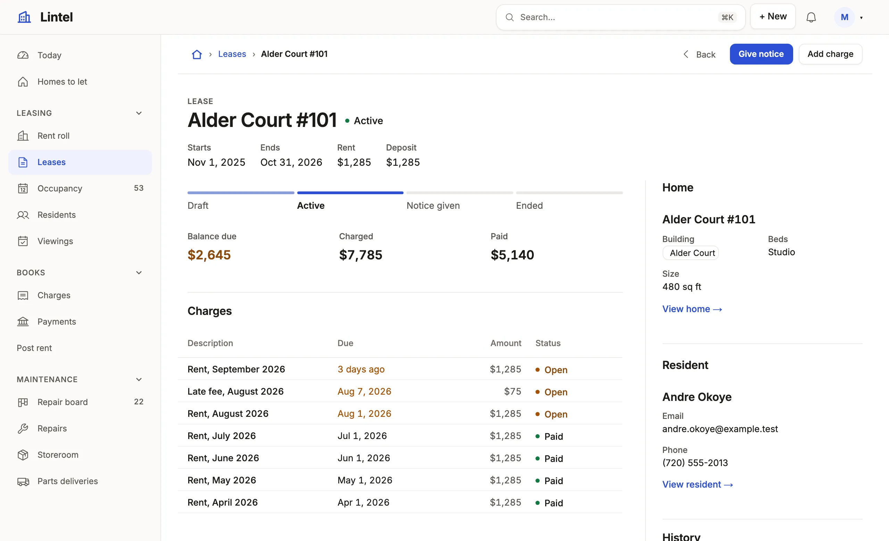

# mistri

**A few lines of TypeScript. A complete App.** — [mistriwork.dev](https://mistriwork.dev)

mistri is an App framework. You declare navigation, record pages, forms,
dashboards, commands, policies, jobs and workflows in a typed TypeScript DSL
over a database you already have (PostgreSQL or SQLite), and mistri serves the
App from it: the pages, the sign-in, the access rules and the API. It is at the
1.0 release candidate stage; the [changelog](CHANGELOG.md) has each release.

```bash
npm create mistri my-app                     # a starter App with its own SQLite database
cd my-app && npm install
npx @mistriwork/mistri dev                   # serve it; a save reloads it
npx @mistriwork/mistri check --app .         # schema types, typecheck and validation, as CI runs them
```

Node 24.22.1 or newer.

<picture>
  <source media="(prefers-color-scheme: dark)" srcset="site/src/assets/home/hero-dark.webp" />
  
</picture>

## What is in it

Everything below is stable unless it says **Preview**. The
[status page](https://mistriwork.dev/docs/status/) has the full list.

**Pages and UI** — [lists](https://mistriwork.dev/docs/lists/) ·
[record pages](https://mistriwork.dev/docs/pages/) · [forms](https://mistriwork.dev/docs/forms/) ·
[dashboards](https://mistriwork.dev/docs/dashboards/) · [looks](https://mistriwork.dev/docs/looks/)

- Lists as a grid, checklist, queue, board, split, calendar, cards or tree, with counted tabs, filters, edits in place and CSV import. The Gantt presentation is **Preview**.
- Record pages built from sections: a header with the record's actions, facts, related lists, cards, a gallery, history.
- Forms from the schema, with groups, defaults, conditions and multiple steps; public forms for signed-out visitors.
- Dashboards of metrics, charts, breakdowns and waiting work, over a time window the reader picks.
- One address per thing (`/invoices/12`, `/invoices?tab=overdue`), ⌘K search, j and k through a list's records, phone layouts, light and dark.
- Five looks (Workshop, Lumen, Mono, Sage, Ledger) and twelve palettes, or a theme of your own from `defineTheme`.
- [Custom components](https://mistriwork.dev/docs/custom-components/) and free-form pages in React, fed by declared, authorized reads.

**Data and rules** — [resources](https://mistriwork.dev/docs/access-model/) ·
[query language](https://mistriwork.dev/docs/query/) · [actions](https://mistriwork.dev/docs/actions/) ·
[schema changes](https://mistriwork.dev/docs/change-your-schema/)

- Types generated from your database, so a misspelled table or column is an editor error.
- Segments: a condition named once in the query language, reused by tabs, metrics and roles.
- Computed columns, rollups, validation and state machines whose verbs become buttons.
- Files and attachments, tags, record history, notifications and an inbox, documents to print.
- Versioned SQL migrations, written for you from a `schema.sql`; HTTP APIs as sources; read replicas.
- A resource's full-text `search` is **Preview**.

**Commands and automation** — [commands](https://mistriwork.dev/docs/commands/) ·
[events and jobs](https://mistriwork.dev/docs/events-and-jobs/) ·
[integrations](https://mistriwork.dev/docs/integrations/)

- Commands: server code with declared inputs, a typed `db`, `refuse(…)` and one transaction, safe to retry.
- Events, jobs on a schedule, signed inbound callbacks, webhooks and durable workflows.
- Email, and integrations with outside services (`@mistriwork/mistri/integration`).

**Sign-in and access** — [roles](https://mistriwork.dev/docs/roles/) ·
[row access](https://mistriwork.dev/docs/row-access/) · [sign-in](https://mistriwork.dev/docs/sign-in/) ·
[tenant Apps](https://mistriwork.dev/docs/tenant-apps/)

- Roles granting tables, columns, commands and actions; row policies; all enforced on the server.
- Passwords, GitHub, Google, OpenID Connect and SAML 2.0. SCIM provisioning is **Preview**.
- Tenant Apps: many organizations in one App, each seeing only its own rows, with invitations and public intake.

**Agents** — [build with an agent](https://mistriwork.dev/docs/build-with-an-agent/) ·
[observe](https://mistriwork.dev/docs/observe/) · [App API](https://mistriwork.dev/docs/app-api/) ·
[assistant](https://mistriwork.dev/docs/assistant/)

- An agent skill for Claude Code, Codex, Cursor and GitHub Copilot, and an App drafted from an approved brief.
- `mistri check` answers with a stable code, the file and line, and the fix; `mistri shot` and `mistri grade` draw and measure the pages.
- The dev server records each request's SQL, refusals and slow statements; `mistri observe --mcp` hands them to the agent.
- An App's reads and commands as MCP tools and HTTP endpoints, under scoped tokens and the same grants as its pages.
- An in-App assistant that answers and proposes changes as the signed-in person (Claude, with your API key).

**Build, test and deploy** — [build and deploy](https://mistriwork.dev/docs/build-and-deploy/) ·
[testing](https://mistriwork.dev/docs/testing-apps/) · [the general path](https://mistriwork.dev/docs/general-path/)

- No build step to serve; `mistri build` is the optional production step: typecheck, validation and a pinned bundle.
- A testing kit: sign in as each role, run commands, assert a permissions matrix; `mistri test init` writes a first suite.
- Traces to your collector over OpenTelemetry, readiness checks and a support bundle.
- Mount an App in your own Node server, or embed it in your React app.
- `mistri deploy` to Cloudflare Containers is **Preview**, as are feature flags, experiments, behavior analytics and the Suite Console.

## Build an App with a coding agent

Point your agent (Claude Code, Codex, Cursor, GitHub Copilot, or any agent that
reads `AGENTS.md`) at this section. Everything runs from the npm package in the
App's own project; no mistri checkout is needed. The full guide, with the
prompt to hand over and the acceptance rubric, is
[Build an App with a coding agent](https://mistriwork.dev/docs/build-with-an-agent/).

**1. Install** the package, the skill and the browser, in the project folder:

```bash
npm init -y && npm install @mistriwork/mistri typescript
npx @mistriwork/mistri agent init        # writes .claude/skills/mistri/, .agents/skills/mistri/ and a block in AGENTS.md
npm install --save-dev playwright && npx playwright install --only-shell chromium
```

`agent init --tool claude` (or `codex`, `cursor`, `copilot`) picks one
agent's folder. Commit the skill with the project, and run `agent init` again
after upgrading mistri. The headless Chromium is for `mistri shot` and
`mistri grade`.

**2. Brief first.** Load the skill (`SKILL.md`) and follow its step 0 before
writing any App file:

- Interview the person in rounds of at most four questions, each with a default,
  skipping what the request or `npx @mistriwork/mistri schema --brief` already says
  (`references/interview.md` in the skill).
- Fill `BRIEF.md` from the skill's `references/brief-template.md`, show it, and
  wait for approval.
- For a new database, draft the App from the approved brief:

  ```bash
  npx @mistriwork/mistri new --brief BRIEF.md ./my-app
  cd my-app && npm install
  ```

  It writes the schema and first migration, a seeded SQLite database, the
  lists, record pages and dashboard, the roles, a stub for each command and the
  look. For a database that already exists, draft with
  `npx @mistriwork/mistri --config mistri.json --scaffold-app ./my-app` and seed a disposable
  copy with `npx @mistriwork/mistri seed --app ./my-app --config mistri.json`.

**3. Build page by page** (shell, home dashboard, lists, record pages, forms), in the App's folder:

```bash
npx @mistriwork/mistri docs compose-record-page         # the page type's guide; also compose-shell, compose-list, compose-dashboard, compose-form
npx @mistriwork/mistri check --app . --brief            # after every edit, until it exits 0
npx @mistriwork/mistri check --app . --design --brief   # where a page will come out basic
npx @mistriwork/mistri shot --app . <route> --text      # what the page shows, as text
npx @mistriwork/mistri shot --app . <route> --both      # PNGs at a desk and on a phone, graded with the skill's rubric
```

`npx @mistriwork/mistri explain <code>` explains a check code, and
`npx @mistriwork/mistri docs <topic>` prints the reference offline. When
`mistri.json` sits outside the App's folder, as on the `--scaffold-app` path,
add `--config ../mistri.json` to `check`, `shot`, `dev` and `grade`.

**4. Accept it.** Walk the journey in `npx @mistriwork/mistri dev .` (create,
change, reload, an invalid value, an empty list, a denied action, a phone), then:

```bash
npx @mistriwork/mistri test init .      # a journey per role and a permissions matrix
node --test 'tests/*.test.ts'
npx @mistriwork/mistri grade .          # every page at a desk, on a phone and in the dark; fix until no error
```

Finish with the skill's `references/handback.md` checklist, and report the
commands run with their exit codes, the screenshots and what is left.

**Rules.** Import only `@mistriwork/mistri/app` in the App, and
`@mistriwork/mistri/commands` and `@mistriwork/mistri/policy` in server-only
modules. Never import or patch mistri's own source. When the platform cannot do
what the App needs, say so in the report, and file it at
[github.com/rbaljinder/mistri/issues](https://github.com/rbaljinder/mistri/issues).

## Build a small App

An invoicing App: two tables, a dashboard, a list with tabs, a customer page,
three roles, and a command that refuses a bad payment date. Each step below
was run as written, on SQLite.

In an empty folder:

```bash
npm init -y && npm pkg set type=module
npm install @mistriwork/mistri typescript @types/node
```

and a `tsconfig.json` (the one `npm create mistri` writes):

```json title="tsconfig.json"
{
  "compilerOptions": {
    "target": "ES2023",
    "module": "NodeNext",
    "moduleResolution": "NodeNext",
    "strict": true,
    "noEmit": true,
    "allowImportingTsExtensions": true,
    "verbatimModuleSyntax": true,
    "skipLibCheck": true,
    "types": ["node"]
  },
  "include": ["**/*.ts"]
}
```

**1. The schema.** `schema.sql` is the schema you want; mistri writes the
migration that gets a database there.

```sql title="schema.sql"
create table customer (
  id serial primary key,
  name text not null,
  email text
);

create table invoice (
  id serial primary key,
  customer_id integer not null references customer (id),
  total numeric(10, 2) not null,
  due_on date not null,
  paid boolean not null default false,
  paid_on date
);

create index invoice_customer on invoice (customer_id);
```

**2. The connection.** The App names a connection; the server's config says
where it is. Writing is opt-in for each connection.

```json title="mistri.json"
{
  "connections": [{ "name": "billing", "url": "billing.db", "writable": true }]
}
```

For PostgreSQL, the `url` is `postgres://localhost/billing`; the same
`schema.sql` serves both.

**3. The App.** Resources, a dashboard, two lists, a record page, the menu and
the roles, typed against the database's own columns.

```ts title="app.ts"
import { dashboard, defineApp, header, listView, metric, page, related } from '@mistriwork/mistri/app';
import type { App } from './mistri-schema.d.ts';

export default defineApp({
  id: 'billing',
  name: 'Billing',
  connection: 'billing',
  resources: {
    customer: { access: 'write', recordLabel: '{name}' },
    invoice: {
      access: 'write',
      // A condition named once, in the query language; tabs and metrics use it by name.
      segments: {
        unpaid: 'paid = false',
        overdue: 'paid = false and due_on < today',
        settled: 'paid = true',
      },
    },
  },
  views: {
    overview: dashboard('Overview', [
      metric('Owed', 'invoice', { segment: 'unpaid', measure: 'sum total as owed', to: 'invoices' }),
      metric('Overdue', 'invoice', { segment: 'overdue', measure: 'sum total as overdue', to: 'invoices' }),
    ]),
    invoices: listView('Invoices', 'invoice', {
      show: ['customer_id', 'total', 'due_on', 'paid'],
      tabs: ['unpaid', { segment: 'overdue', sort: 'due_on' }, 'settled'],
    }),
    customers: listView('Customers', 'customer', { show: ['name', 'email'] }),
  },
  pages: {
    customer: page('customer', [
      header({ facts: ['email'] }),
      related('Invoices', 'invoice', 'customer_id', { show: ['total', 'due_on', 'paid'], sort: 'due_on desc' }),
    ]),
  },
  nav: ['overview', 'invoices', 'customers'],
  home: 'overview',
  auth: {
    providers: ['email'],
    roles: {
      // A clerk edits customers and invoices, but not `paid`: step 5's command sets that.
      clerk: {
        label: 'Clerk',
        read: true,
        write: ['customer', 'invoice'],
        create: ['customer', 'invoice'],
        fields: { invoice: { write: ['customer_id', 'total', 'due_on'] } },
      },
      admin: { label: 'Admin', extends: 'clerk' },
      auditor: { label: 'Auditor', read: true },
    },
  },
} satisfies App);
```

`mistri-schema.d.ts` does not exist yet: `mistri check` writes it from the
database, and from then on a column the table lacks fails the typecheck.

**4. Run it.**

```bash
npx @mistriwork/mistri migrate diff init --app .   # writes migrations/V1__init.sql from schema.sql
npx @mistriwork/mistri migrate up --app .          # makes billing.db, then checks the App against it
npx @mistriwork/mistri seed --app .                # a few dozen believable rows to work with
npx @mistriwork/mistri dev                         # serves it, and prints a sign-in for each role
```

Sign in as the clerk: the Overview's two figures open the invoices behind
them, the tabs are counted, **New invoice** asks for a customer, a total and a
due date, and a customer's page lists their invoices. The auditor reads the
same pages and can change nothing. Leave the server running; a save to
`app.ts` reloads it.

**5. A command.** A change that depends on the record's state, or on several
writes agreeing, is server code. It goes in `commands.ts` beside `app.ts`; the
App names it and never imports it.

```ts title="commands.ts"
import { defineCommand, defineCommands, defineSource, field, refuse } from '@mistriwork/mistri/commands';
import type { Rows } from './mistri-schema.d.ts';

const billing = defineSource<Rows>('billing');

export const recordPayment = defineCommand({
  source: billing,
  target: 'invoice',
  // Checked again inside the transaction; it also decides where the button shows.
  when: 'paid = false',
  input: { paid_on: field.date() },
  async handle({ db, record, now }, input) {
    if (input.paid_on > now().toISOString().slice(0, 10)) refuse('A payment cannot be dated in the future.', { field: 'paid_on' });
    await db.invoice.update(record, { paid: true, paid_on: input.paid_on });
  },
});

export default defineCommands({ recordPayment });
```

Give it a button on the invoice, and grant it to the clerk (add `action` to
the import):

```ts title="app.ts, in part"
    invoice: {
      // … segments …
      actions: { pay: action('Record payment', { command: 'recordPayment' }) },
    },
  // …
      clerk: {
        // … read, write, create, fields …
        commands: ['recordPayment'],
      },
```

A command keeps a journal, so the database gets that table once, with the
server stopped:

```bash
npx @mistriwork/mistri migrate stores up --app .
npx @mistriwork/mistri check --app .               # 3 of 3 steps passed
npx @mistriwork/mistri dev
```

An unpaid invoice now has **Record payment**. Given a date after today, it is
refused next to the field and nothing is written. The auditor has no such
button, and the server refuses the command for that role even when it is
called directly. `npx @mistriwork/mistri test init .` writes a test suite: a
journey per role and a permissions matrix.

More: [the DSL in one App](https://mistriwork.dev/docs/dsl-tour/) reads the
flagship sample top to bottom, and [Tick in fifteen minutes](https://mistriwork.dev/docs/tick-tutorial/)
edits a running App.

## More

- [Documentation](https://mistriwork.dev/docs/getting-started/), and offline: `npx @mistriwork/mistri docs`
- [Sample Apps](examples/apps/README.md): Tick (a to-do list in one file), Lintel (the flagship, a property company's staff desk and resident portal) and Ladle (an App inside a React site of its own)
- [The package's README](packages/mistri/README.md), the npm page
- [Changelog](CHANGELOG.md) · [Security](SECURITY.md) · [Contributing](CONTRIBUTING.md) · [Deploying](docs/deploy.md)

## Development

```bash
npm install
npm test          # typecheck, lint, client checks, the unit suite, the component tests
npm run build     # emit dist/, runnable by plain node
```

The repository's `.node-version` names the minimum Node (24.22.1) for version managers.

The packages live under `packages/` (`mistri`, `create-mistri`,
`@mistriwork/engine`, `@mistriwork/ui`, `@mistriwork/kit`,
`@mistriwork/cloudflare` and `tablewalk`); how they depend on one another is
in [docs/boundary.md](docs/boundary.md), and what runs where in
[docs/architecture.md](docs/architecture.md). [CONTRIBUTING.md](CONTRIBUTING.md)
says which constraints are load-bearing.

## License

MIT.

---

This repository also builds **tablewalk**, a standalone database browser that
is read-only by default: `npx tablewalk <db>` opens a SQLite or PostgreSQL
database with its foreign keys as links. See [tablewalk.dev](https://tablewalk.dev)
and [its README](packages/tablewalk/README.md).
