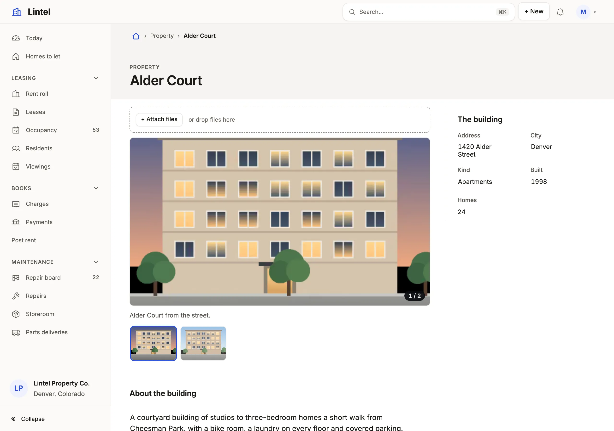

Declare the tables an App serves, which of them it writes or deletes, and which columns no reader ever receives.

```ts title="examples/apps/lintel/resources.ts"
export const resources = {
  // …
  property: {
    access: 'write',
    // …
  property_photo: {
    access: 'write',
    delete: true,
    // …
  staff: {
    recordLabel: 'name',
  },
```

See it in the sample (`examples/apps/lintel/resources.ts:19`) (other keys left out); [Sample Apps](/docs/examples/) says how to run Lintel.



## What you'll see

- **New** and Edit on buildings, and New, Edit and Delete on their photos; staff are read, with no New and no Delete.
- A table the App does not declare is not there: no address and no metadata, and every endpoint answers as if it did not exist.
- `authority.lock` beside the App records each resource and what it may do, and `mistri check` fails when that changes unreviewed.

## When to use it, and when not

- Declare every table a view, page, label path or rollup reads; `{}` is enough, because a declared resource reads by default.
- Use `hidden` for a column no one may ever receive (a password hash, a cost); use a role's `fields` instead when some signed-in readers may see it ([roles and field access](/docs/roles/)).
- Use the standalone [database browser](/docs/database-browser/) instead for tables nobody curates: raw SQL, the schema browser and the connection manager are its tools, never an App's.

## Options

| Key | What it does | Default | Status |
| --- | --- | --- | --- |
| `{}` | Declares the resource; it reads | not served | Stable |
| `access: 'write'` | New, Save and edits; the ceiling roles grant within | reads only | Stable |
| `delete: true` | Offers Delete; needs `access: 'write'` | no Delete | Stable |
| `hidden: [...]` | Columns cut from metadata, results, exports and the API; a query naming one is refused; no role grants it back | none | Stable |
| `fields: { read, write }` | A column ceiling for signed-in roles; needs `auth.roles` | every column | Stable |
| `recordLabel`, `noun`, `labels` | What names a record, what one is called, column captions | the name column | Stable |

Another, with what a dealer paid kept from every reader (illustrative: no shipped example hides a column this way):

```ts
vehicle: { ...resources.vehicle, hidden: ['cost'] },
```

Writes need the connection too: nothing writes unless mistri.json says `"writable": true`, and the server checks it in every route and tool that writes, not the UI. Every read runs in a read-only transaction. Every key: [resources reference](/docs/dsl-resources/).

## Common mistakes

- `[unknown-resource]` or `[outside-ceiling]`: a view or a role names a table the App does not declare, or writes one without `access: 'write'` → declare it, with `access: 'write'` where it is written.
- `has "fields" and no "access"` or `[needs-auth]` → `fields` is for signed-in roles; without sign-in, use `hidden`.
- Every column reaches any browser that reaches the port when there is no `auth` → keep the server on loopback (the default), add [sign-in](/docs/sign-in/), and `hidden` the [secrets](/docs/secrets/).

## Related

- [Roles and field access](/docs/roles/): who reads and writes what, within these ceilings.
- [Row access](/docs/row-access/): which rows each reader sees.
- [Display rules](/docs/vocabularies/): how a resource's values are drawn.
- [Relationships](/docs/relationships/): how resources point at each other.
