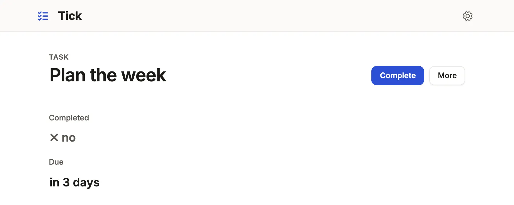

Put a one-click change on a record, such as a status, a stamp or a move along
the record's states, as a button.

```ts title="examples/apps/tick/app.ts"
actions: {
  complete: action('Complete', { set: { completed: true }, when: 'completed = false' }),
  reopen: action('Reopen', { set: { completed: false }, when: 'completed = true' }),
},
```

See it in the sample (`examples/apps/tick/app.ts:42`).



## What you'll see

- A button for each action whose `when` holds: an open task offers **Complete**, a finished one **Reopen**.
- One click writes the `set` columns through the ordinary update, so the history and notifications see an ordinary edit.
- With `confirm: true` the button asks first; with `reason: '<column>'` it asks why and writes the note with the change.

## When to use it, and when not

- Use a fixed action when the change is fixed values (a status, a flag, a stamp) and whoever writes the record may make it.
- Use a [machine](#a-records-states-machine) instead when a status may move only along the paths you allow, through every door.
- Use a [command](/docs/commands/) when the change depends on other rows, on who acts, or on several writes that must agree when it runs.
  A fixed action's `when` reads stored columns; one that reads a computed
  column or a rollup is refused when the App loads, since a command's `when` reads those.

## Options

| Key | What it does | Default | Status |
| --- | --- | --- | --- |
| `set` | The columns written, with constants or stamps | required | Stable |
| `when` | A query-language condition on the record; the button shows where it holds | always | Stable |
| `confirm` | Ask before writing | `false` | Stable |
| `reason` | A column for a required note, written with the change; not with `bulk` | none | Stable |
| `bulk` | Offer it on a queue's selection, written record by record | `false` | Stable |
| `header` | `false` keeps it out of the record's action bar and menu; still granted, and run from a queue, a board or `useCommand` | `true` | Stable |
| `command` | Run a [command](/docs/commands/) instead; it takes no `set`, `when` or `reason`. One that asks nothing runs on one click, or asks first with `confirm: true`; one with inputs asks them in its form | none | Stable |

All keys: [the generated reference](/docs/dsl-resources/).

### Stamps: the moment, the day and the person

`now`, `today` and `me` from `@mistriwork/mistri/app` are stamps the server works out
inside the write, so a request cannot choose them. `computed.date('today + 14 days')`
(also `.number`, `.boolean`) is a constant expression over `today`, `now`,
`me`, numbers and date spans.

```ts
const approveSheet = action('Approve timesheet', {
  set: { status: 'approved', approved_by: me, approved_at: now },
  when: 'status = submitted',
  bulk: true,
```

`now` on a `DATE` column is the day in `ui.timezone` (UTC without one), and
on a timestamp with no zone (`timestamp`, `DATETIME`) the wall clock there too;
a timestamp with a zone (`timestamptz`) gets the UTC instant. A machine's
`since`, a `Date` a command writes and a New form's `now` follow the same rule.
`me` is the signed-in account's email, so it needs `auth`. Where anyone may
sign up, an action that stamps `me` is refused until the address is confirmed.
A reference stamped with `me` needs the account's row of the `auth.me` table.
A stamp a column cannot hold, or an expression that does not parse, stops the
App at startup and `mistri check` names it. Stamps are not written in tenant
Apps yet; use a command's `now()` and `actor` there. Keep stamped columns out
of every role's `fields` write list.

### Who may click it

A fixed action is a generic update: it needs the role to write the resource,
and its `when` decides only whether the button is drawn. To let a role make
exactly these changes and no others, grant the actions by id instead of
`write`, as a payroll App would for approvals:

```ts
auth: { roles: { admin: { actions: { timesheet: ['approve'] } }, payroll_manager: { actions: { timesheet: ['approve'] } } } },
```

The server then admits that role's update only as exactly one granted action:
its `set`, its stamps and its reason, with its `when` judged on the stored row.
Any other update is refused `403` with the code `forbidden`. The resource needs
`access: 'write'`. Under a row policy it acts only on the principal's rows;
tenant Apps refuse the grant.

### A record's states: machine

```ts title="examples/apps/lintel/resources.ts"
machine: machine('status', {
  draft: { on: { signLease: 'active' } },
  active: { on: { giveNotice: 'notice' } },
  notice: { on: { endLease: 'ended' } },
  ended: { final: true },
}),
```

See it in the sample (`examples/apps/lintel/resources.ts:140`) (each verb is a command here; a fixed verb says `{ to, label, set }`).

A new record starts in the first state. Each verb is a button where the state
lists it, the page's summary draws the road as a stepper, and a board has a
lane per state. The server takes a change of the column only along an edge,
from every door: Save, a list's cell, an import, the [App API](/docs/app-api/),
MCP, a fixed verb and a command. A verb is a fixed move (`to`, with `label`, `set`,
`reason`, `when`, `confirm`, `bulk`) or a command by name, which takes `to`,
`label`, `when`, `bulk` and `confirm`: a command that asks nothing runs on one
click, or asks first with `confirm: true`
(`readyForPickup: { on: { handOver: { to: 'collected', confirm: true } } }`). `since` names a
timestamp the server stamps on every move, and a state's
`after: { '3 days': 'expireApplication' }` runs that command through the
[jobs](/docs/events-and-jobs/) once a record has stayed that long.
A timer at an instant is the resource's, not a state's:
`at: { due_at: { command: 'warnBreach', when: "status = 'open'" } }` beside
`machine` runs it once the time in that column has passed while the record
matches `when`; a new time arms it again. `by: { automation:
'escalated' }` is a move no verb makes and no button offers: only a command
running as that service role (`service: true`) takes it.

Name the sets of states people talk about with `groups`, and ask them as
`is open` is asked, in a query, a segment, a tab, a nav count or a board, whose
lanes shrink to the group:

```ts
machine: machine('status', { … }, { groups: { onBench: ['checked_in', 'in_repair', 'waiting_parts'] } }),
segments: { bench: 'status is onBench' },
```

An edge tells people through the resource's `notify`, as any write does. A rule
on the column the machine moves hears every edge that lands where `when` says,
whichever door took it; `on: { action: 'finish' }` hears one verb by name:

```ts title="examples/apps/lintel/resources.ts"
{
  on: { changes: 'status' },
  when: 'status = completed',
  send: { channel: 'email', to: 'resident_id.email', consent: 'resident_id.email_ok' },
  title: 'Your repair is done: {title}',
},
```

See it in the sample (`examples/apps/lintel/resources.ts:281`).

A verb that names another record's command moves this record with it: cancel
an order, and its pending payment is voided and its pending parcel cancelled in
the same transaction, with no handler code:

```ts
payment: { machine: machine('status', { pending: { on: { markPaid: 'paid', cancelOrder: 'voided' } }, … }) },
```

Each row that points at the order moves along the edge; a row already final
stays; a row in a state that does not list the command refuses the whole
command. The command writes the table, its rows reach the record by one
reference, and the verb goes to one state, with no `when`. Such a verb is not a
button on the payment: it runs where its command is offered. A record that does
not point at the command's (a purchase order, named by its line's
`receiveLine`) is the handler's to move; its verb says where it may go.

## Common mistakes

- `[machine-dead-end]` or `[machine-unreachable]` → give the state a verb that leaves it or leads to it, or mark it `final: true`.
- `[machine-verb-unrunnable]` → grant the verb's command to a role, or let a role write the table.
- `[machine-command-outside]`: a command writes the machine's column and is not a verb → name it under the states it leaves.
- `[unknown-action]` in a header, a queue or a role's `actions` → use one of the ids the resource declares.

## Related

- [Commands](/docs/commands/): a change that checks other rows, or must agree when it runs.
- [Command forms and bulk](/docs/command-forms/): one request over a queue's whole selection.
- [Roles and field access](/docs/roles/): who writes a resource, and who runs which action.
- [Design a record page](/docs/compose-record-page/): where the header's buttons go.
