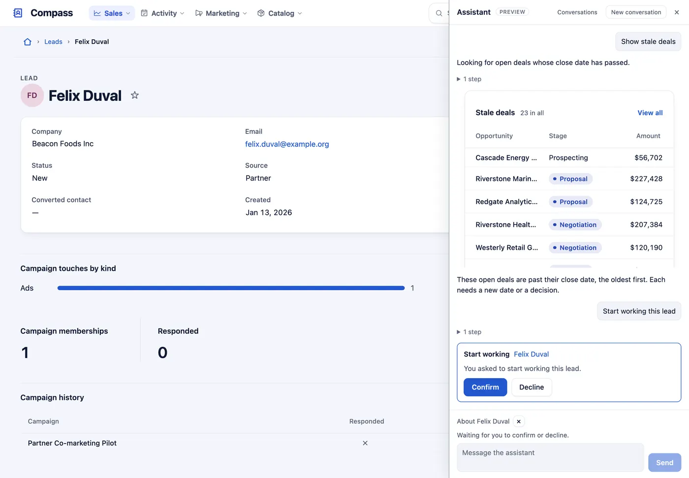

Let people ask the App about their records, see answers as the App's own tables and charts, and confirm the changes it proposes.

```sh
export ANTHROPIC_API_KEY=sk-ant-…
```

The App says what it is and what people ask it. No shipped example turns the assistant on, so this is illustrative:

```ts
assistant: assistant({
  instructions:
    'A property operations App. Staff ask about their leases, charges and repairs: find leases ending soon, ' +
    'sum up a resident before a call, and log what was done on a repair.',
  // Questions an empty conversation offers, one press each.
  starters: ['Which leases end soon?', 'Repairs by state', 'Which rent is overdue?'],
  // Beside every room, about the open record, and a room of its own at /assistant.
  placement: ['panel', 'record', 'page'],
  // Ending a lease is the desk's call, made on the lease itself.
  exclude: ['lease.endLease'],
  limits: { tokensPerTurn: 80_000, tokensPerPersonPerDay: 1_000_000 },
}),
```



## What you'll see

- A button in the App bar opens a panel beside the page; its corner button makes it full screen, and Escape puts it back. With `'page'` placed, it is also a page of its own (`/assistant`). Your conversations are listed beside it, the ones waiting for you first, and you can search them by what was said.
- Answers stream in as text, with tables, figures, charts and records drawn by the App's own components. A change is a card: Confirm runs it through the record's own button or form; nothing is written before.
- A record card carries the record's own buttons and Edit, and a table's rows their ⋯ menu where a list of that table has `rowActions`: shown only to people who may press them, and what they did is noted in the conversation.

## When to use it, and when not

- Use it when people ask questions the menus answer in several steps: "which deals are stale", "sum up this lead".
- Use a [dashboard](/docs/dashboards/) instead when the same question is asked every day.

## Options

| Key | Does | Default | Status |
| --- | --- | --- | --- |
| `instructions` | What the App is and what people ask it | none | Stable |
| `roles` | Who is offered it (needs `auth`) | everyone signed in | Stable |
| `exclude` | Verbs it never proposes: `'resource.action'`, `'resource.new'` | none | Stable |
| `tools`, `blocks` | Narrow its tools (`find`, `describe`, `query`, `show`, `run`) and what it may draw | all | Stable |
| `placement` | `'panel'`; `'record'` to read the open record as context; `'page'` for a page of its own | `'panel'`, `'record'` | Stable |
| `starters` | One-line questions offered on an empty conversation; `{ text, views, records }` offers one only in those views or on a record of those tables, at most six in one place | none | Stable |
| `limits` | Tokens per answer, per person per day, per App per day | 200,000 per person per day | Stable |
| `model`, `effort` | The Claude model and its effort | `claude-sonnet-5-5` | Stable |

A starter about the open record belongs on that record only:

```ts
starters: ['Which tickets are mine?', { text: 'Summarize this ticket', records: ['incident'] }, { text: 'Find stale deals', views: ['pipeline'] }],
```

It reads and proposes only what the signed-in person may: their roles, fields and verbs. The server needs
`ANTHROPIC_API_KEY` in its environment, never in the App, and the database needs its store
(`provisionStores(<the database>, { app: { definition } })` from `@mistriwork/mistri/maintenance`, which makes every store the App declares; `only: ['assistant']` names it alone and is refused for an App with no `assistant`).
What it reads to answer (rows, fields, the open record) is sent to the model provider (Anthropic) with each turn;
offer it (`roles`) only to people whose reads may leave your server. A conversation answers one question at a time,
and a person has at most two answers under way at once.

In a tenant App it answers inside the current customer only, and only where the platform owner has turned it on
for that customer in **Account → Manage tenants**.

## Common mistakes

- No button in the bar → set `ANTHROPIC_API_KEY` for the server. In a tenant App, the platform owner also turns it
  on for that customer in Manage tenants.
- The server refuses to start, naming the assistant store → provision it once, then start again.
- A verb it should never propose → name it in `exclude`; a role that may not run it is never offered it anyway.
- `nav: ['assistant']` refused → add `'page'` to `placement`; the menu names the page only when there is one.

## Related

- [Actions](/docs/actions/): the verbs it proposes.
- [Roles and field access](/docs/roles/): what it may read and propose for each person.
- [Dashboards](/docs/dashboards/): the sections its tables and charts are drawn with.
