Every dashboard block, list presentation and value display in Lumen, each with the declaration that asks for it.

```ts title="examples/apps/lintel/dashboards.ts"
    metric('Rent collected', 'charge', {
      query: 'kind = rent and status = paid',
      over: 'due_on',
      measure: 'sum amount as collected',
      better: 'up',
      area: 'money',
      icon: 'bank',
    }),
```

See it in the sample (`examples/apps/lintel/dashboards.ts:15`). Dashboard blocks go in a [dashboard](/docs/dashboards/)'s sections, presentations in a [list](/docs/lists/), and display rules under a resource's `display`.

The pictures were taken by `scripts/docs-shots.mjs`, some from Apps that are no longer samples (a CRM, a warehouse and a project tracker); a caption names the kind of App it shows. A snippet is a shortened declaration; where it is Lintel's rather than the picture's App, its caption says so.

## Dashboard blocks

### Metric cards

A figure with its change against the previous period and a spark of its trend.

<!-- no sample: the snippets below are illustrative declarations for the picture beside each -->

```ts
metric('Won', 'opportunity', {
  query: 'stage = closed_won and close_date = last 90 days',
  measure: 'sum amount as won',
  compare: 'previous period',
  better: 'up',
  over: 'close_date',
  spark: true,
})
```

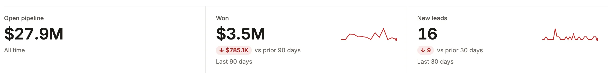

### Line chart

A trend by month; `curve: 'smooth'` never overshoots a month's count, and two keys draw a line per source.

```ts
chart('New leads by source', 'lead', 'month created_on, source', {
  query: 'created_on = last 12 months',
  curve: 'smooth',
})
```

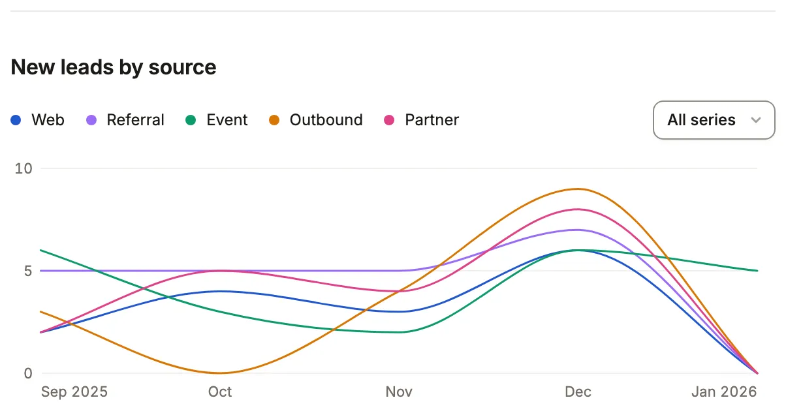

A breakdown, a chart and a matrix take a metric's `format` and `unit`: `measure: 'avg won * 100', format: 'percent'`
says each bar as "86.4%", and `measure: 'avg first_response_seconds', format: 'duration'` says a figure of seconds as
"10h 2m".

### Line chart, plain

The default shape is a line over a month, with the area washed under it.

```ts
chart('Bookings by month', 'opportunity', 'month close_date', {
  query: 'stage = closed_won and close_date = last 12 months',
  measure: 'sum amount as won',
})
```

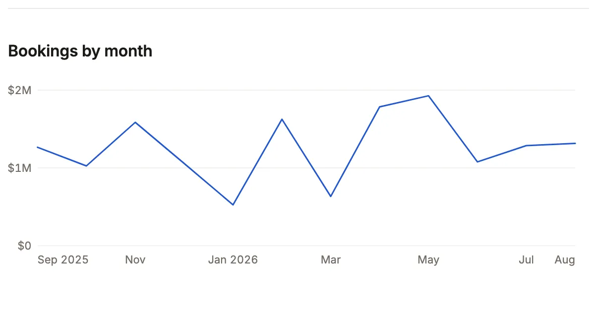

### Bar chart

`shape: 'bar'` draws each period as a bar.

```ts
chart('Lines moved by day', 'stock_movement', 'day moved_at', {
  query: 'moved_at = last 7 days and kind != "count"',
  shape: 'bar',
  over: 'moved_at',
})
```

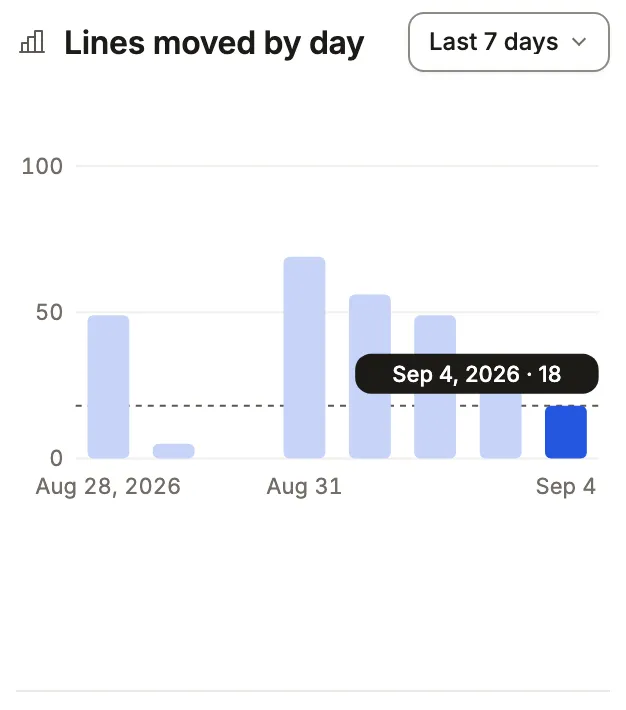

### Donut with a total

A donut says each slice's share and takes `total` for its middle.

```ts
chart('Leads by source', 'lead', 'source', {
  shape: 'donut',
  total: 'Leads',
  width: 'half',
})
```

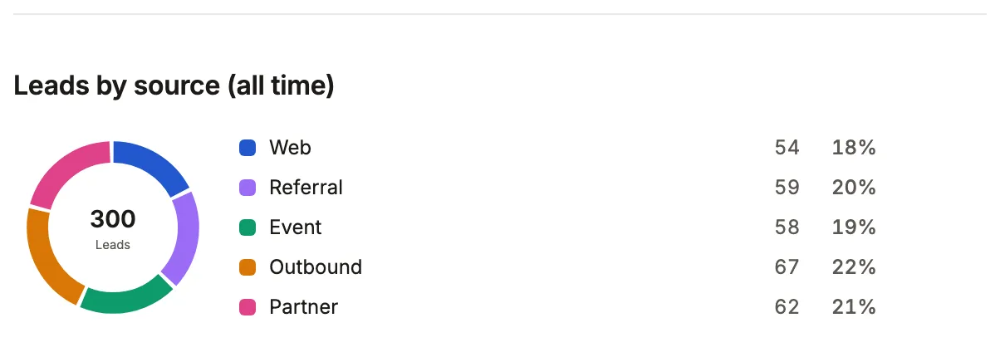

### Funnel

Stages a row passes in order, each counting the rows that reached it as a bar against the first, a share of the stage before it and the rows it lost. A row reaches a stage when it holds the section's `query`, every required stage before it and the stage's own conditions. An `optional` stage is a side road: counted against the stage before it and not required by the ones after.

```ts
funnel('Pipeline funnel', 'opportunity', [
  { label: 'Prospecting' },
  { label: 'Qualification', query: 'stage in (qualification, proposal, negotiation, closed_won)' },
  { label: 'Proposal', query: 'stage in (proposal, negotiation, closed_won)' },
  { label: 'Won', query: 'stage = closed_won' },
], { query: 'stage != closed_lost' })
```

A stage opens the list narrowed to the rows that reached it, and the figure it lost opens the rows that stopped there (`to` names the list, as a chart's does; `to: false` keeps them text). Where a stage's conditions cannot be turned over exactly, the lost figure is text. A funnel has 2 to 8 stages.

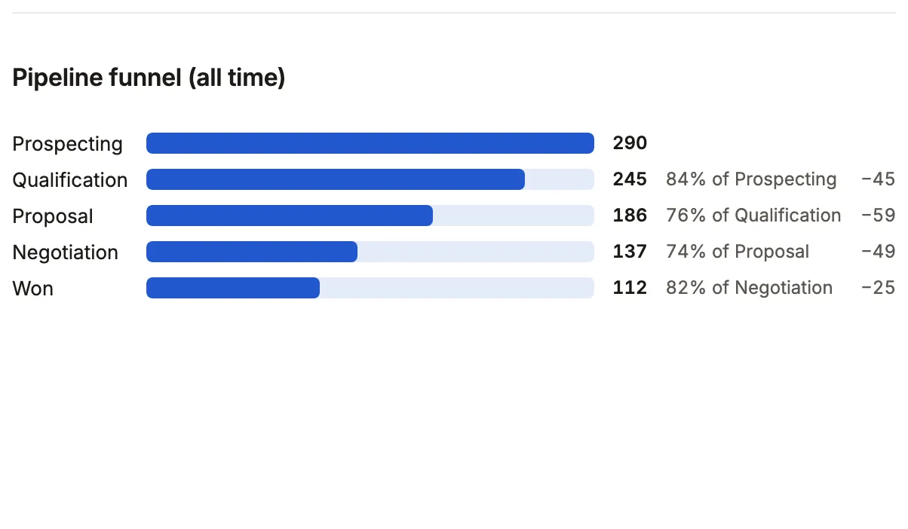

### Scatter

A dot per group, placed by two figures: `x` across, `measure` up.

```ts
chart('Reps: deals and value', 'opportunity', 'owner_id.name', {
  shape: 'scatter',
  x: 'count',
  measure: 'sum amount as value',
})
```

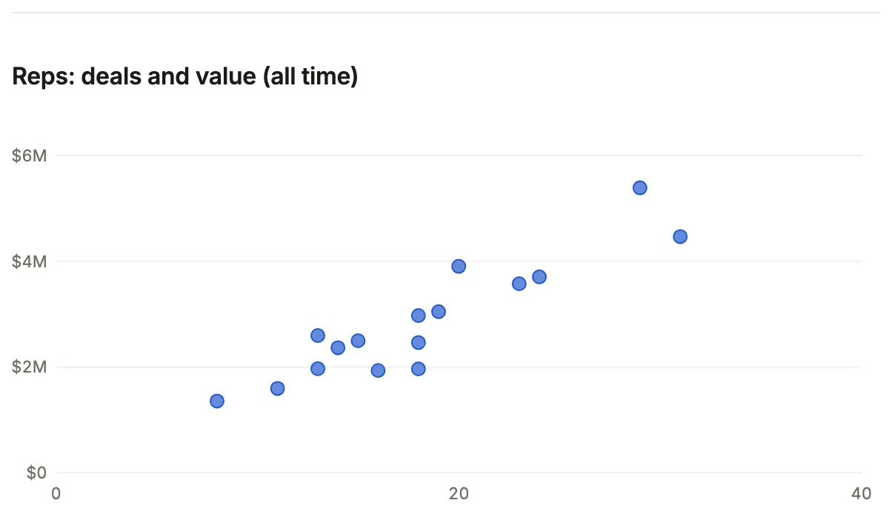

### Heat map

Two keys as a grid of shaded cells; an hour with nothing keeps its column.

```ts
chart('Moves by weekday and hour', 'stock_movement', 'weekday moved_at, hour moved_at', {
  query: 'moved_at = last 90 days and kind != "count"',
  shape: 'heatmap',
})
```

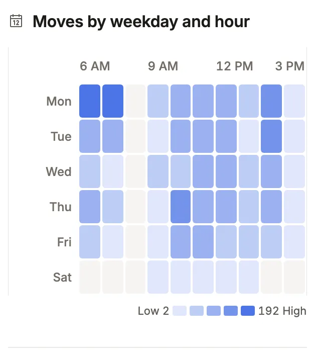

### Waterfall

Each period's rise or fall from where the last ended, then the total.

```ts
chart('Net units by month', 'stock_movement', 'month moved_at', {
  query: 'moved_at = last 6 months',
  measure: 'sum qty',
  shape: 'waterfall',
})
```

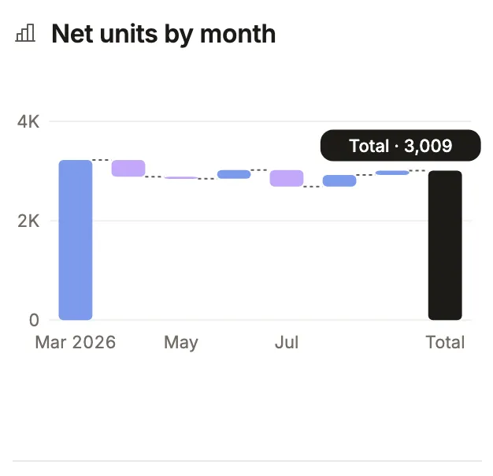

### Treemap

Tiles in proportion to a measure; past eight, one "Others" tile.

```ts
chart('Stock value by category', 'stock_level', 'product_id.category_id.name', {
  measure: 'sum value',
  shape: 'treemap',
})
```

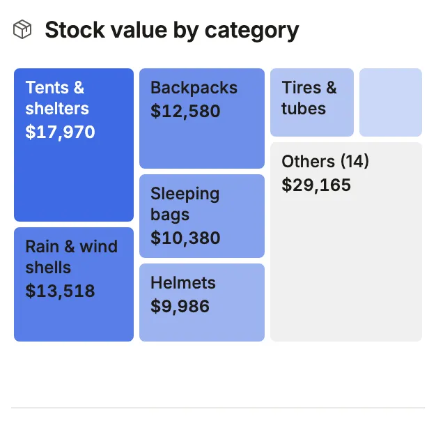

### Breakdown

Ranked bars by one key; a key of a column whose `display` has a `tone` (a severity, a state) is drawn in that tone, as its chip is.

```ts
breakdown('Pipeline by stage', 'opportunity', 'stage', {
  query: 'stage != closed_won and stage != closed_lost',
  measure: 'sum amount as value',
  width: 'half',
})
```

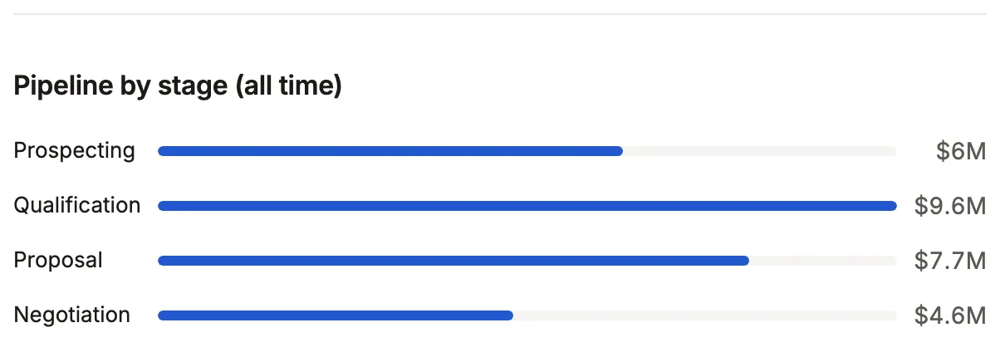

### Breakdown as steps

`shape: 'steps'` draws a pipeline as a row of steps in the vocabulary's order, each with its count and a short `notes` line.

```ts title="examples/apps/lintel/dashboards.ts"
    breakdown('Repairs by state', 'maintenance_request', 'status', {
      query: 'outstanding',
      shape: 'steps',
      to: 'repairs',
      notes: {
        new: 'Reported, not yet looked at',
        triaged: 'Waiting for a visit',
        // …
      },
    }),
```

See it in the sample (`examples/apps/lintel/dashboards.ts:25`); the picture is a warehouse App's pick lists.

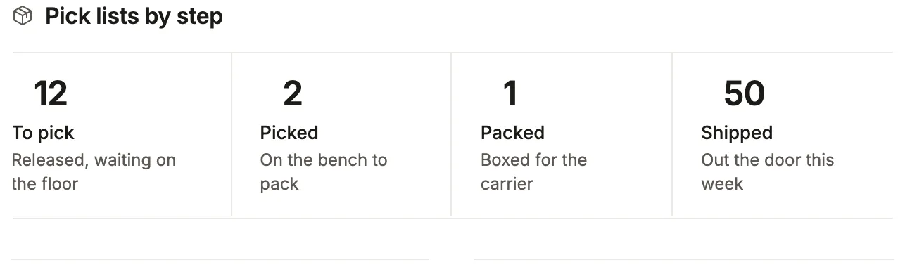

### Note banner

A wide banner with an eyebrow, a title and one action.

```ts
note('Work the leads that came in this week before they cool.', {
  title: 'Pipeline review',
  variant: 'banner',
  eyebrow: 'This week',
  action: { label: 'Open leads', to: 'leads' },
})
```

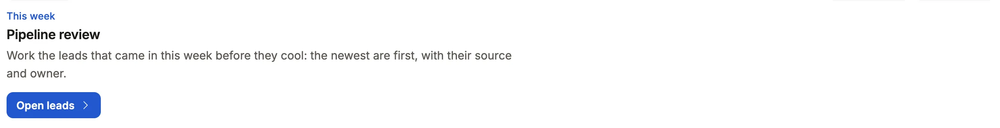

### Window button

`windowControl: 'button'` shows the window picker as one date-range button beside the filters.

```ts
dashboard('Sales dashboard', sections, {
  windowControl: 'button',
  windows: ['last 30 days', 'last 90 days', 'this year'],
})
```

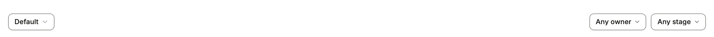

## List presentations

### List presentations: table

A list with no `presentation` is a grid: counted tabs, filters and a sort.

```ts
leads: listView('Leads', 'lead', {
  show: ['name', 'company', 'status', 'source', 'owner_id.name', 'created_on'],
  filters: ['status', 'source', 'created_on'],
  // `new` is a segment of the lead resource: segments: { new: 'status = new' }.
  tabs: ['new', { label: 'All' }],
})
```

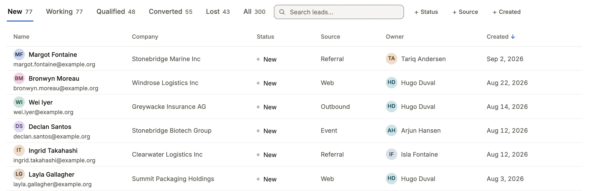

### Cards

`cards` draws each record as a card, with a picture from a file resource.

```ts
presentation: cards('name', {
  value: 'list_price',
  facts: ['sku', 'category_id.name', 'on_hand'],
  image: { from: 'product_photo', whose: 'product_id', sort: 'position' },
})
```

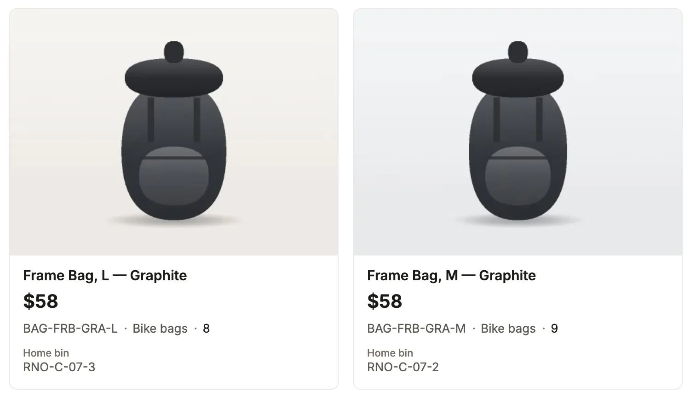

Without a picture, `media: 'icon'` leads each card with its `icon` column's mark on a tinted tile, and `footer` says up
to four values along the card's last line.

```ts
presentation: cards('name', { icon: 'kind', media: 'icon', description: 'summary', footer: ['price', 'turnaround'] })
```

### Board

Lanes of cards by one column; a card takes up to four `footer` facts, each with an optional icon, and a `category` tag.
A line may be a rollup or a computed column. Where the column is a `machine`'s, a card moves through its verbs: to the
lane a verb leads to from the card's state, or to any end of a verb whose command asks for the column.

```ts title="examples/apps/lintel/views.ts"
    board: {
      by: 'status',
      primary: 'title',
      category: 'category',
      lines: ['unit_id'],
      footer: ['assigned_to', { column: 'reported_on', icon: 'clock' }],
    },
```

See it in the sample (`examples/apps/lintel/views.ts:134`); the picture is a CRM's pipeline.

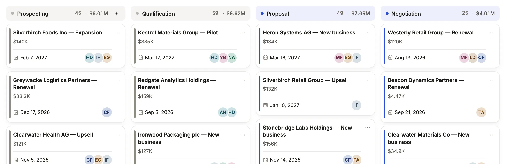

`category` adds a colored tag over the title in the color the column's `colors` rule gives. The picture predates it, so it shows no tag.

### Calendar

Records on their dates; the list's tabs narrow what the month shows.

```ts title="examples/apps/lintel/views.ts"
    presentation: calendar('preferred_on', 'name', { lines: ['unit_id'], badge: 'status' }),
```

See it in the sample (`examples/apps/lintel/views.ts:93`); the picture is a CRM's tasks.

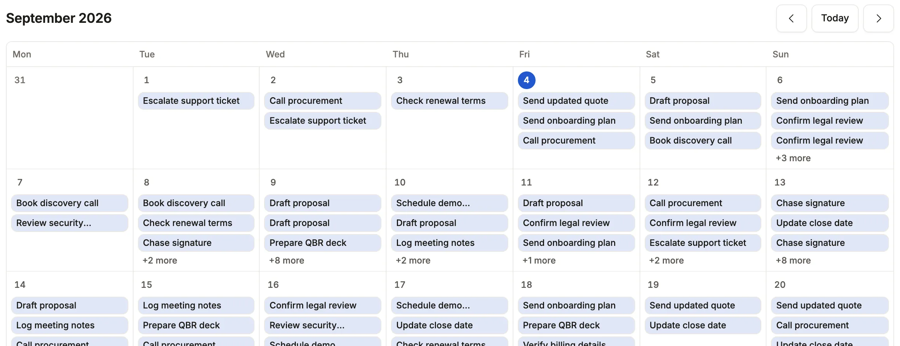

### Tree

Each record folded under the one its self-reference names.

```ts
presentation: tree('parent_account_id', 'name', { lines: ['city'] })
```

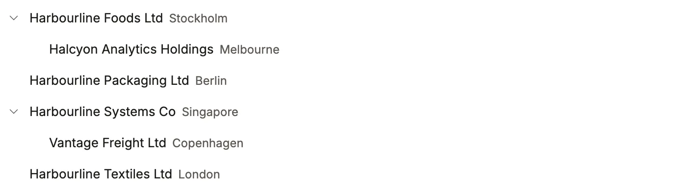

### Gantt

Records as spans between two dates, a row per value of `by`, a line at today.

```ts
presentation: gantt('starts_on', 'ends_on', 'name', { by: 'kind' })
```

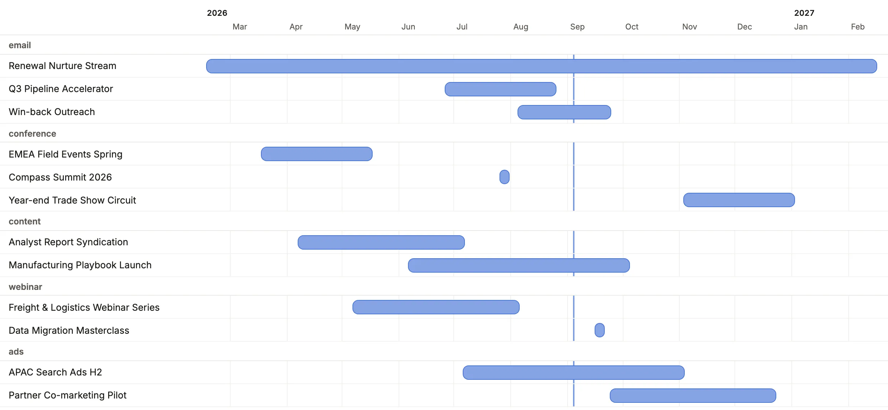

### Checklist

Tick things off from the list.

```ts
presentation: checklist('name', 'completed', { lines: ['due_on'] })
```

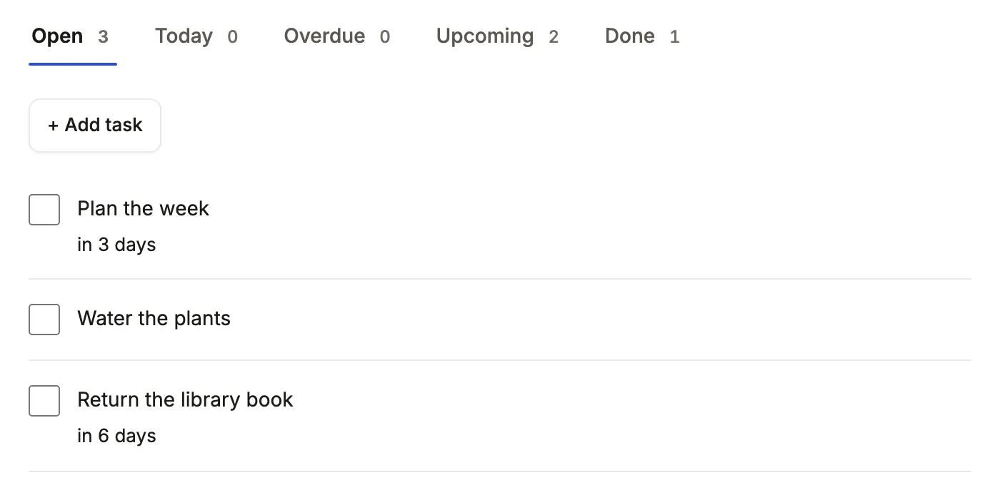

## Value displays

### Avatars

Overlapping initials for a list of names.

```ts
team: { format: 'avatars' }
```

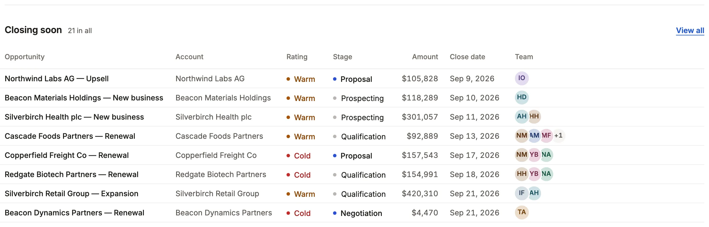

### Icon mark

A mark in a small toned square before the value.

```ts
name: { icon: { mark: 'tag', toneOf: 'status' } }
```

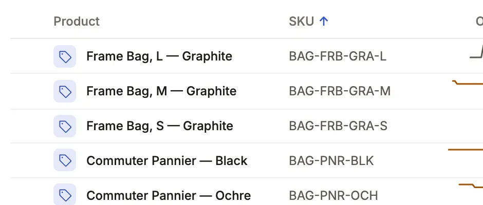

### Rating

Stars, edited as stars; `outOf` sets 3 to 10 (5 when unsaid).

```ts
health: { format: 'rating', tone: { '<= 2': 'bad' } }
```

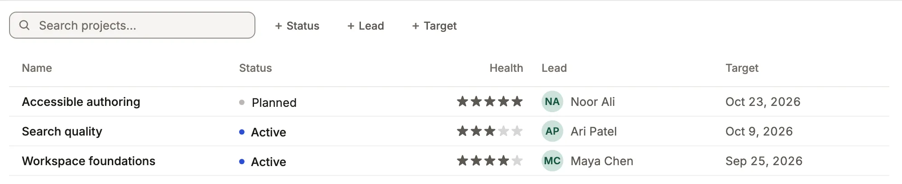

### Slider

A number edited along its range.

```ts
probability: { format: 'percent', bar: true, slider: { min: 0, max: 100, step: 5 } }
```

A CRM App sets a deal's probability this way. The slider appears only while the field is in edit, which a static address cannot show, so there is no picture.

### Ring

`ring: true` on a percent draws a progress circle beside the figure.

```ts
progress: { format: 'percent', ring: true }
```

No sample App that runs on SQLite draws this one, so there is no picture; Ignition (PostgreSQL) uses it.

### Color

A swatch, edited in the color picker.

```ts
brand_color: { format: 'color' }
```

No sample App that runs on SQLite draws this one, so there is no picture; Ignition (PostgreSQL) uses it.

### Time, month and year

Each value drawn its own way and edited in the browser's own picker.

```ts
opens_at: { format: 'time' },
renews_in: { format: 'month' },
founded: { format: 'year' }
```

No sample App that runs on SQLite draws this one, so there is no picture; Ignition (PostgreSQL) uses it.

### JSON

A tree on the record, an excerpt in a list, and a monospaced editor that says where the text stops being JSON.

```ts
specs: { format: 'json' }
```

No sample App that runs on SQLite draws this one, so there is no picture; Ignition (PostgreSQL) uses it.

### QR

A code to scan, with its text under it.

```ts
pass_code: { format: 'qr' }
```

No sample App that runs on SQLite draws this one, so there is no picture; Ignition (PostgreSQL) uses it.

### Scan

A Scan button reads a barcode or QR code from the camera where the browser can; the box stays for a scanner gun or the keyboard.

```ts
upc: { scan: true }
```

A warehouse App reads a product's UPC this way. The Scan button sits in the edit form, which a static address cannot show, so there is no picture.

### Signature

A pad to draw or type a signature, kept as a PNG in a file resource and drawn as the picture wherever the value is shown.

```ts
signature_id: { signature: true }
```

A warehouse App takes proof of delivery on a pick list this way. The pad is in the edit form, so there is no picture.

## Related

- [Dashboards](/docs/dashboards/): the sections and the window.
- [Lists](/docs/lists/): presentations, tabs and filters.
- [Display rules](/docs/vocabularies/): what a column says and how it is edited.
- [Component library](/components/): every block in every look.
