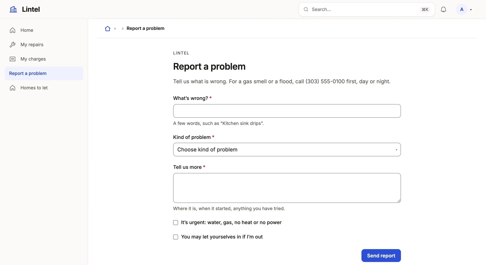

Give a command a page of its own that creates records, open it to the public,
or run it over a queue's selection at once.

```ts title="examples/apps/lintel/views.ts"
report: commandForm(
  'Report a problem',
  'reportIssue',
  [
    step('The problem', ['title', 'category'], { title: 'What’s wrong?', lead: 'Pick the closest kind; the office reads the rest.' }),
    step('Details', ['description', 'urgent'], { title: 'Tell us more' }),
    step('A visit', ['entry_ok', ['visit_on', 'visit_window']], { title: 'How should we visit?', next: 'Review' }),
  ],
  {
    style: 'intake',
    note: { icon: 'warning', text: 'For a gas smell or a flood, call (303) 555-0100 first, day or night.' },
    submitLabel: 'Send report',
    done: { title: 'Report sent', description: 'The office will be in touch about a visit.' },
  },
),
```

See it in the sample (`examples/apps/lintel/views.ts:220`).
Its command, `reportIssue`, says `targets: 'none'`: it names no record and inserts one.



## What you'll see

- A room at `/report` that `nav` and `home` may name, shown only to roles granted its command.
- One `step` per page of a stepper (without steps, one page), each asking the command's inputs it names, checked before sending, in fields that stay quiet until touched: a clean outline at rest, one focus ring on the field you are in, a danger edge on the one that is wrong, and "(optional)" beside a field that may be left empty. A form with steps shows "Step 2 of 4" beside a thin progress bar, in either style. At a desk, a form with steps drawn as a page lists its steps beside it: the ones done are links back, each with what it said in a line.
- One filled action, in the theme's primary-action color (`colors.primary`: the ink in Lumen, the accent in Mono and Sage, or your own), Back as a quiet word (on a phone, a stepped form's actions rest at the foot of the screen); after submitting, the `done` screen with **Fill in another**.

## When to use it, and when not

- Use a command form when creating a record takes a command: several tables, a number, a check on other rows, or a public visitor.
- Use the resource's own New form (`form` on the resource) instead when a new row is its columns and the role writes the table ([forms](/docs/compose-form/)).
- Use `targets: 'many'` with `bulk: true` on the action when the same command should apply to a queue's whole selection at once.

## Options

| Key | What it does | Default | Status |
| --- | --- | --- | --- |
| `steps` (third argument) | `step(title, inputs)`: each input in exactly one step | one page | Stable |
| `style` | `'intake'` (with steps): one question at a time under a progress bar, a sticky action bar, an editable review, and `note` under the title | `'stepper'` | Stable |
| `done` | The screen after submitting: `{ title, message }` | a generic one | Stable |
| `submitLabel`, `description`, `icon` | The button's words, the words under the heading, the menu's mark (signed in only) | none | Stable |
| `public` | Serve it signed out at `/form/<key>`, running a `public: true` command; a signed-out visitor who opens `/<key>` is sent there | `false` | Stable |
| `prefillable` | Inputs a page's link may fill in | none | Stable |
| `resume`, `draft` | Save every step into your tables as the visitor goes | none | Stable |

All keys: [the generated reference](/docs/dsl-views/).

### Signed-in forms

A form is signed in unless it says `public: true`. Its command runs as the
person who submits it, under their roles. In a tenant App the row lands in
the member's tenant, and under a row policy inside the member's rows.

### Public forms

`public: true` serves the form to anyone, running a command registered with
`public: true` (which implies `targets: 'none'`). Lintel lets a signed-out
visitor ask for a viewing this way:

```ts title="examples/apps/lintel/commands/viewing.ts"
export const requestViewing = defineCommand({
  source: lintel,
  target: 'viewing',
  public: true,
  read: ['unit'],
```

See it in the sample (`examples/apps/lintel/commands/viewing.ts:9`).

The server holds a public form to these rules:

- It always runs as a public principal (`actor.kind === 'public'`), even for a signed-in visitor, and a public command cannot be granted to a role.
- A `reference` input picks from a resource `auth.public` opens, by columns the public reads; anything else is refused as `[public-form-picker]`. The handler still reads the chosen row itself.
- Its handler reads the tables in its `read`, whether or not `auth.public` opens them. Under a [row policy](/docs/row-access/), it sees only the rows the policy's `publicForms` entry gives each; a table that entry leaves out reads as empty.
- It is write-only. Its command answers `shape({ reference, message })` and nothing else, and the done screen shows the reference and your fixed words. Make the reference random: `publicReference('IGN')` gives `IGN-7K2M-QX4T-9BRD`.
- Its audit keeps which columns were written, not the values.
- Submissions are rate limited per client (five a minute, thirty an hour) and across all clients. Behind a proxy, name it with `--trust-proxy`, on a tenant App's host as on the ordinary one; with a [cache](/docs/services/#the-cache-kind-cache) every instance shares the budget.
- A body over 64 KB is refused (413), and one that has not finished arriving after ten seconds is dropped (408). The form's submission key makes a retry the same receipt, never a second row.
- The form carries a hidden decoy field a person never sees, that autofill and a screen reader skip. A submission that fills it gets an ordinary-looking answer, nothing is written, and the command's metrics count it as the outcome `decoy`.
- `auth: { challenge: 'verifyHuman' }` asks a human check before the submission is read, with `challenges` exported from the commands module: on every submission, every saved step of a form saved on each step, and a form under a row policy alike. The form draws the provider's widget and sends its token; a missing or refused token is answered 403 `challenge_failed`. A token counts once, so a refused submission is sent again with a fresh one under the same submission key. The [Turnstile package](/docs/integrations/#a-human-check) is one provider. A tenant App's public forms ask it too, on every tenant's link and mapped host: one check for the App, not one per tenant.
- A request first spends the client's own budget, then passes the human check (and a page's ticket), and only then spends the App-wide one, so a flood without tokens cannot use up the budget a person's submission needs.
- It never appears in `nav`; a [landing page](/docs/landing-pages/) or a signed-out `home` rule links to it. In a tenant App, the link's `?via=` address places it with one tenant ([tenant Apps](/docs/tenant-apps/#public-intake)).

Hold nothing scarce on an unverified submission: write a request that staff act on.

### The intake style

`style: 'intake'` draws a form with steps as an application: a progress bar, the step's `title` and `lead` as the heading, and Back and Continue in a bar that stays at the foot of the screen. `step(label, inputs, { title, lead, next, skip })` says the step's words: `next` replaces Continue, and `skip` replaces it while every field on the step is empty. Put fields side by side by naming a row, an array of up to three inputs: `step('Name', [['first_name', 'last_name'], 'date_of_birth'])`. The last step is a review that sums each step up under its name, with a Change that opens that step's fields in place, and sends what it shows (a date in words, a sensitive value as its last four characters, with Change); an optional question left empty is not listed; `review: false` leaves it out. A group's answers are listed there as "Label: value" lines. `note: { icon, text }` is one quiet line of reassurance under the title. The form's `description` is said once, under the first step's title. A text, number or amount box that a person leaves holding an answer its own rules take gets a quiet check at its end. A box that is still being typed in, or holds a wrong answer, gets none.

An intake form is a signed-in form too: Lintel's Report a problem is three steps in the App shell, and a headline link with `open: 'modal'` (`{ label: 'Report a problem', to: 'report', open: 'modal' }`) opens it over a unit's record. `npx @mistriwork/mistri new --template intake` starts a public one on the stock block alone, passing `mistri check` with its own browser test.

### Fields for an application

An application asks for amounts, months, a few choices and an identity number. The command's input says so, and the form draws each one to match:

```ts
input: {
  income: field.money({ min: 1, live: { monthly: 'income / 12' } }),
  moved_in: field.month({ label: 'Moved in' }),
  account: field.choice(ACCOUNTS, { as: 'cards' }),
  extras: field.choices(EXTRAS, { as: 'cards', exclusive: ['none'] }),
  monthly: field.money({ min: 150, max: 1000, step: 10, as: 'slider' }),
  texts: field.bool({ optional: true, label: 'Text messages', statement: SMS_CONSENT }),
  make: field.choice({ from: 'vehicle_make', label: 'name' }),
  ssn: field.text({ mask: '000-00-0000', sensitive: { keep: 'last4' } }),
  zip: field.text({ mask: '00000', message: 'Enter the 5 digits of your ZIP.' }),
  joint: field.bool({ label: 'Applying with someone?', as: 'buttons' }),
  co_name: field.text({ optional: true, when: 'joint = true' }),
},
rules: [{ must: 'confirm_email = email', message: 'The email addresses do not match.' }],
```

- `live` lines are worked out under a number as it is typed. They are never sent. An amount reads grouped (`2,500`) once it is typed. On a slider (`as: 'slider'`) it reads in the currency, with the two ends under the track.
- A yes-or-no question reads as two buttons with `as: 'buttons'` on a `field.bool`; `field.choice(OPTIONS, { as: 'cards' })` is one answer as icon cards, `field.choices` several.
- A `mask` is the field's pattern (`0` a digit, `a` a letter); its `message` is said when an answer does not fill it.
- Several choices `as: 'cards'` are one group to the keyboard: Tab reaches it once, the arrows move between cards, and Space turns one on or off. A card draws its option's `icon`.
- A `statement` is a consent's whole paragraph, up to 2,000 characters, drawn beside its box. The label stays the box's name and the review's. It works on a box that must be checked (`accept: true`) and on one that may be left.
- `when` shows a field only while its condition over the other answers holds. An unanswered field is null, as in SQL: `joint = false` and `joint != true` do not hold until someone answers, so a question that waits on a "No" stays hidden until "No" is pressed. `is empty` reads the null itself. A bare word is read as the kind its field holds: `battery != no` against a choice compares the word `no`, and only a yes-or-no field reads yes and no as true and false. `rules` are said at their field. The server checks each step before Continue, and checks the whole input again on submit.
- A `sensitive` value is drawn masked, with Show. It is never prefilled or put in an address. Only what `keep` says is stored: `last4`, `hash`, or `none`. With `handler`, the handler sees the whole value and nothing stores it.
- A choice `from` a table offers the table's rows. They are read once and kept until one of them changes, never for a set time, for the source and the resource they come from. Every reader shares the copy, except in an App with a row policy, which reads per request; a tenant App keeps one copy per tenant, the rows of the tenant the form's link places ([tenant Apps](/docs/tenant-apps/#public-intake)). The public form's options arrive with the form, under an ETag. The copy only offers: on submit, the chosen key is read by its primary key inside the command's transaction, so a row deleted a moment ago is refused.
- `inputs: { color: swatch }` draws a field with one of the App's own [input components](/docs/custom-components/#options), on a public form as on a signed-in one, and on a form a storefront places. The visitor's page loads only the components that form draws. The server still reads the value as the field's kind.
- A public page's commands carry their choices from a table too: `page.useCommand('enrol').choices('make')` gives a page's own `<select>` the rows, served under `auth.public` with the App's payload and kept as a form's are.

### Forms saved on every step

A public form whose steps each name a command of their own
(`step('Address', 'saveAddress')`) saves a long application into your tables
as the applicant goes; the form's command is the final submit. No shipped
example shows one.

- `resume: { token, expires, progress, after: '14 days' }` names the root row's columns. The applicant's place is an HttpOnly, `SameSite=Strict` cookie; only its SHA-256 is stored, and it is cleared on submit.
- Later steps write tables that point at the root; the server fills the link in, and a step reads and writes only its own application's rows.
- Nothing saved is answered back, even with the cookie. After a reload the review reads "Saved — not shown for your privacy".
- `draft: { status: 'in_progress' }` keeps drafts out of staff lists; a tab whose query names that value shows them. Expired drafts are purged when a new application starts, unless `abandoned: 'keep'`.

A `statusCheck` lets an applicant ask for a submitted application's state at
`/form/<key>/status`, confirmed by one to three details only they know. Every
wrong answer gets the same reply, and five failures lock the receipt for an hour. `stepUp: { email, show }` emails a six-digit code that
opens more for 15 minutes, through the [email service](/docs/email/). `link`
adds a submitted application to an account on proven control only (the same
device, a passed status check, or an email verified by code), never on a
matching name.

### Several records at once

Declare `targets: 'many'` on the command and its action may say `bulk: true`:
one request names a queue's selection (up to 200 records) and commits for all
of them or none.

```ts
export const approvePost = defineCommand({
  source: forum,
  target: 'post',
  targets: 'many',
  write: ['thread', 'report'],
  when: 'status = held',
```

The handler loops over `records`. Any refusal refuses the whole request and
names the record it is about. Before submitting, the form lists the records
that no longer match `when`, with **Deselect ineligible**. Public and
event-recording commands cannot target many. For a result per record, use a
fixed [action](/docs/actions/) with `bulk: true`, which writes each on its own.

## Common mistakes

- `[public-form-reference]`: a public form's command answers no `reference` → `output: shape({ reference: text({ pattern: publicReferencePattern('…') }), message: literal('…') })`.
- "A public command runs from a public form and names no record: drop its targets." → delete `targets`; `public: true` implies `'none'`.
- `[restated]` on `targets: 'none'` beside `public: true` → delete it.
- The form is missing for a role → grant that role the form's command; a signed-in form opens only to roles granted it.

## Related

- [Commands](/docs/commands/): the operation the form runs, its inputs and its receipt.
- [Design a form](/docs/compose-form/): when a step earns its place.
- [Public pages](/docs/landing-pages/): the landing that links to a public form.
- [Email](/docs/email/): the codes and links a status check sends.
