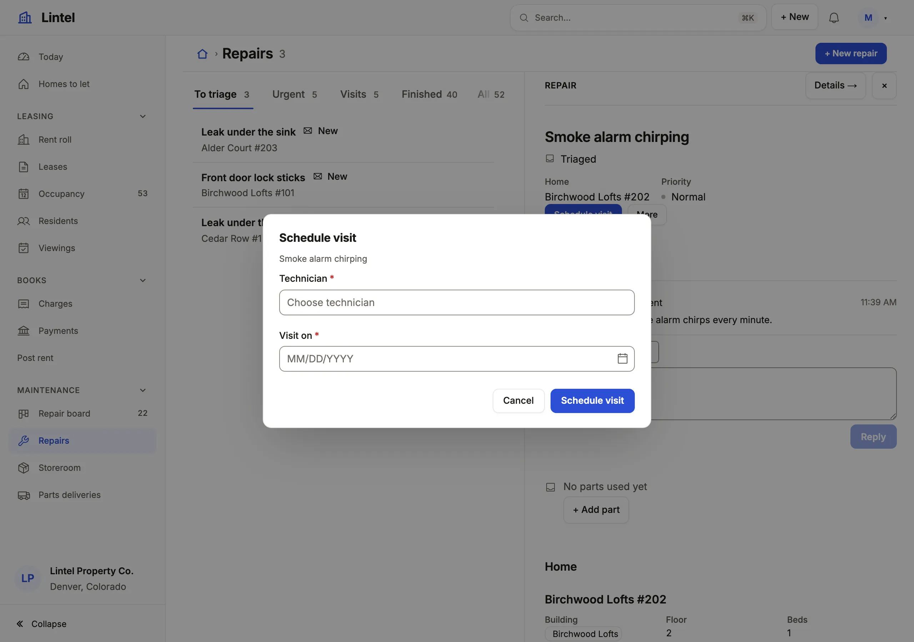

Make a named server operation that checks the record, writes several tables in
one transaction and answers a retry from its receipt.

```ts title="examples/apps/lintel/commands/maintenance.ts"
export const scheduleVisit = defineCommand({
  // …
  input: {
    technician: field.reference('staff', { by: 'id', labelColumn: 'name', query: 'role = technician and active = true' }),
    visit_on: field.date(),
  },
  output: said,
  // …
  async handle({ db, record, now }, input) {
    // …
    if (input.visit_on < day(now)) refuse('A visit is booked for today or a day still to come.', { field: 'visit_on' });
    // …
    return { message: `Booked ${technician.name} for ${input.visit_on}.` };
  },
});
```

See it in the sample (`examples/apps/lintel/commands/maintenance.ts:105`).
The App names it as a machine verb (`scheduleVisit: 'scheduled'`) or in an action, `reply: action('Message the resident', { command: 'replyToResident' })`,
and never imports the module. The module is `commands.ts` beside `app.ts` (or
`--commands <file>`); its default export lists every command by id:
`export default defineCommands({ scheduleVisit, … })`.



## What you'll see

- A **Schedule visit** button where the repair's machine lists the verb, opening a form built from its `input`: a technician picker and a date.
- A refusal in the reader's words beside the form (`refuse('A visit is booked for today…')`), with nothing written.
- On success the message the handler returned; the repair and the note on its conversation changed together, or neither did.

## When to use it, and when not

- Use a command when the change depends on current state, on who is acting, or on several writes that must agree, or when callers will retry it.
- Use a fixed [action](/docs/actions/) instead when the change is fixed values that any writer of the record may set.
- Use a [command form](/docs/command-forms/) for a command that creates records from a page of its own, and `targets: 'many'` for a queue's selection.

## Options

| Key                           | What it does                                                                                                                                                                                                                                                                                           | Default   | Status |
| ----------------------------- | ------------------------------------------------------------------------------------------------------------------------------------------------------------------------------------------------------------------------------------------------------------------------------------------------------ | --------- | ------ |
| `source`, `target`            | The source it runs on, in one transaction, and the table of the record it acts on                                                                                                                                                                                                                      | required  | Stable |
| `targets`                     | `'one'`, `'many'` (a selection) or `'none'` (a form's command, which inserts into `target`)                                                                                                                                                                                                            | `'one'`   | Stable |
| `read`, `write`               | The tables it touches beyond the target; any other is a type error and refused at runtime                                                                                                                                                                                                              | none      | Stable |
| `when`                        | A query-language condition on the target, checked in the transaction; it also places the button. It may read the target's rollups and computed columns (`'fulfillment_status = pending'`), and a balance built from a sum of its rows' computed column (`'balance > 0'`), read in the same transaction; it compares two values as a list does (`'qty < reorder_at'`, `'paid < owed'`) | none      | Stable |
| `input`                       | The fields its form asks, parsed by the same reader on the server                                                                                                                                                                                                                                      | none      | Stable |
| `output`                      | The [shape](#output-shapes) of what `handle` returns; leave it out when it returns nothing                                                                                                                                                                                                             | none      | Stable |
| `track`                       | What it keeps for a retry: `'none'`, `'receipts'` or `'audit'` ([below](#what-a-command-keeps))                                                                                                                                                                                                        | by caller | Stable |
| `lookup`, `effects`, `events` | Read another source first, post a webhook after commit, record [events](/docs/events-and-jobs/)                                                                                                                                                                                                        | none      | Stable |

Commands run only on the server. `mistri check` writes
`mistri-commands.d.ts`, so a command name that does not exist, or one placed
on the wrong table, fails the typecheck, and `when` is checked against the
target's columns. The other keys (`validate`, `initial`, `audit`, `realm`,
`enabledBy`) are typed and documented in `@mistriwork/mistri/commands`.

## Inputs

Each input is required unless it says `optional: true`, and is labeled from
its key (`due_on` is "Due on") unless it says otherwise.

| Helper                                                  | Takes                                                                                                                                                                                                                                                                                                                                                                                                                                                                                                                                                                                                                                                                                                                                                                                                                                                                                                                                                                                                                                                                |
| ------------------------------------------------------- | -------------------------------------------------------------------------------------------------------------------------------------------------------------------------------------------------------------------------------------------------------------------------------------------------------------------------------------------------------------------------------------------------------------------------------------------------------------------------------------------------------------------------------------------------------------------------------------------------------------------------------------------------------------------------------------------------------------------------------------------------------------------------------------------------------------------------------------------------------------------------------------------------------------------------------------------------------------------------------------------------------------------------------------------------------------------- |
| `field.text()`, `field.textarea()`                      | `min`/`max` characters, `pattern` and its `message`, `case: 'upper' \| 'lower'`                                                                                                                                                                                                                                                                                                                                                                                                                                                                                                                                                                                                                                                                                                                                                                                                                                                                                                                                                                                      |
| `field.email()`, `field.phone()`, `field.url()`         | text with that format                                                                                                                                                                                                                                                                                                                                                                                                                                                                                                                                                                                                                                                                                                                                                                                                                                                                                                                                                                                                                                                |
| `field.richText()` | formatted text, stored as cleaned HTML; `min` characters of text and `max` of HTML (65,536 unsaid); `mentions: { from, by, label?, groups? }` (`groups` lets an @ name a team, and `groups.through` names the membership table); `images` (a file resource that keeps a picture as an attachment). The API and agents may send Markdown. |
| `field.number()`, `field.money()`, `field.date()`       | `min`, `max`, `below`/`above` a sibling; numbers also `integer`, `step`                                                                                                                                                                                                                                                                                                                                                                                                                                                                                                                                                                                                                                                                                                                                                                                                                                                                                                                                                                                              |
| `field.datetime()`                                      | a date and a time of day, typed in the App's `ui.timezone`; the handler receives the UTC instant (`2026-10-12T13:30:00.000Z`), and the API or an agent sends ISO 8601 with its `Z` or offset (a time with none is refused). `min`, `max` (instants), `below`/`above` a sibling                                                                                                                                                                                                                                                                                                                                                                                                                                                                                                                                                                                                                                                                                                                                                                                       |
| `field.bool()`                                          | `accept: true` for a box that must be checked (consent, terms)                                                                                                                                                                                                                                                                                                                                                                                                                                                                                                                                                                                                                                                                                                                                                                                                                                                                                                                                                                                                       |
| `field.choice(values)`                                  | values (said as words: `wont_fix` is "Wont fix") or `{ value, label }`; radios up to four, a listbox past that                                                                                                                                                                                                                                                                                                                                                                                                                                                                                                                                                                                                                                                                                                                                                                                                                                                                                                                                                       |
| `field.reference(table, { by, labelColumn, query })` | a picker; on a public form, over a resource `auth.public` opens, by columns the public reads (`[public-form-picker]`). `record.<column>` in `query` is the target's own value: `query: 'sales_order_id = record.id'` offers only this order's lines |
| `field.group(fields, { repeat: { min, max } })`         | a section, or rows people add and remove                                                                                                                                                                                                                                                                                                                                                                                                                                                                                                                                                                                                                                                                                                                                                                                                                                                                                                                                                                                                                             |
| `field.lines(from, { show, copy, query, min, max })` | a record's lines as a lines grid: each line a row of `from` asking the columns in `show` (all required), money worked out beside it and summed as the subtotal. `copy: { unit_price: 'variant_id.price' }` shows a column filled from the referenced record, never sent; `query` narrows a reference's picker as in `field.reference`. The handler receives typed rows (`{ variant_id: number; quantity: number }[]`) and writes them, so `from` is in `write`; a refused line names its cell (`refuse(msg, { field: 'lines[1].quantity' })`). Never on a public form or in a group; it says `description`, not `help`. |
| `field.defined(from, { whose })` | questions kept as rows of `from` (columns `key`, `label`, `type`, and optionally `options`, `required`, `help`, `position`), asked as one section and answered as an object by key. `whose` is the column naming the target, so each record asks its own questions and those naming none. The server judges the answers against the rows it reads in the command's transaction; `from` is in `read`. Never on a public form or in a group. |

Every field takes `help` and a `default` it opens at: a literal, `today`
(a date), `now` (a datetime), `me` (a text field, the reader's email) or
`{ record: 'on_hand' }`, the target's own column, so a stock count opens at
what the shelf holds: `field.number({ default: { record: 'on_hand' } })`.
`me` and `{ record }` fill a field of the input itself; `{ record }` needs a
command that targets one record, and a value worked out from several is
`initial()`'s.

A field with `when` is asked only while its condition holds over the draft:
a bare name is another answer (`nickname: field.text({ when: 'joint = true' })`),
and on a command that targets one record `record.<column>` is that record's
value (`reason: field.text({ when: 'record.open_parts > 0' })`). The form
draws it while the condition holds and then requires it; the server refuses
it sent while the condition does not hold, and requires it while it does.
Only a top-level field takes `when`. A command's `rules`
(`[{ must: 'confirm_email = email', message: 'The addresses differ.' }]`) are
checked at each step and again by the run.

A refusal names its field by path
(`vehicles[1].stock`) and never echoes the value. Limits: 32 fields in one
declaration, 128 in all, groups two deep, 50 rows a repeat or a lines field.

## The handler

`handle(context, input)` runs in one transaction on its source. Before it
runs, a missing target is `not_found`, one at another revision
`stale_record`, and one failing `when` `ineligible_state`, said as the part
that failed in the App's words for its column (`Balance is $108.99; needs ≤
$0.00`), with the value only to a person who may read that column. A role
without the grant is told so: `Your role has no grant for "Refund".` A handler may
remove its own target (Unrelate, Remove): the row is judged against the
reader's rows as it is removed, and is not looked for after.

A command that only adds child rows to its target (a note, a comment, an
attachment) can say so: `appendOnly: true`, with the tables in `write`. It is
then not refused as `stale_record` for a change it never touched; the check
waits for its first write to the target, and is decided from the revision the
command read, so a trigger or digest column its own insert moved cannot refuse
it. A record other people keep editing still takes a note, and the same command
renaming the record is refused if it moved. Every command that does not declare
it is refused before the handler, as above. A form that prefilled values from
the record (`initial`) and a verb of a machine keep the check before the handler
either way. Because the refusal can come after the handler has started, a
`fetch` or `decide()` in a declared command's `lookup` or handler has already
run when the stale refusal is raised; keep those free of effects or leave the
declaration off.

| Context                                                       | What                                                                                                                                                                                                                                      |
| ------------------------------------------------------------- | ----------------------------------------------------------------------------------------------------------------------------------------------------------------------------------------------------------------------------------------- |
| `record`, `records`                                           | The target as this transaction reads it; every target, in request order, for `targets: 'many'`                                                                                                                                            |
| `db.<table>`                                                  | The footprint, typed from `Rows`: `get`, `find`, `where(…).orderBy().limit()`, `count`, `insert`, `update(row, changes)`, `remove(row)`; on a file resource, `insertFile({ name, type, data }, values)`                                   |
| `files`                                                       | The parts a mail intake received, `[{ name, type, size, data }]` (tenant mail)                                                                                                                                                            |
| `actor`                                                       | The verified principal: `id`, `roles`, and for an account `email` and `name`; `kind` is `'public'` or `'service'` for a public form or a job                                                                                              |
| `door`                                                        | Where the request came in: `'ui'` (a screen or a form), `'api'` (the App API), `'mcp'` (App MCP), `'job'` or `'workflow'`. The host says it, never the request                                                                            |
| `now()`, `today()`, `nextNumber(name, { per, start, after })` | The server clock; the day it falls on in `ui.timezone` (`YYYY-MM-DD`, UTC without one); the next number of a sequence, taken in this transaction. `after` is the highest number rows already hold (a seed's): the number taken is past it |

A `where` is an object (`{ status: 'available' }`), the query language, or a
tagged template whose values are always quoted:
``db.vehicle.where`make = ${input.make}` ``. More than 1,000 rows without
`.limit` is refused. Ids past 2^53 arrive as strings; never pass one through
`Number()`.

Bytes go into a row only through `insertFile`, under the file resource's
rules: its name, type and size columns are filled, and a file over its
`maxBytes` (at most 10 MB in a tenant App) is refused. The audit keeps the
file's name, type and size, never its bytes. A new row may start in its
machine's first state or one the machine lists in `entry`; a reference it
sets must point at a table the command reads.

`refuse(code, detail?)` says no and keeps nothing the handler wrote:
`refuse('forbidden')`, `refuse('invalid_input', 'borrower')`. A sentence
instead of a code is `ineligible_state` in the reader's words (one line, at
most 300 characters). A sentence about one answer names its input, and the
form says it beside that field and stays open to change it:
`refuse('Only $12.00 is left to refund.', { field: 'amount' })` (a row of a
list is `lines[0].quantity`).

The handler reads its footprint whole, as the App's own server code: a
column a role's `fields` or the resource's `hidden` withholds is still in
`record` and `db`. What reaches the person stays narrowed, so keep a withheld
value out of `output` yourself.

### Output shapes

`output: shape({ applicationId: text({ max: 200 }), reviewDueOn: date(), message: literal('Lead converted.') })`.
The helpers from `@mistriwork/mistri/commands` are `text`, `int`, `number`, `id`,
`bool`, `date`, `literal`, `list`, `shape`, `optional`, `nullable` and
`oneOf`; `ShapeOf<typeof s>` is the type. The shape is checked before commit
and is what the receipt stores.

### One open loan: let the database guard it

A read-before-insert check cannot hold "one open loan per item" alone:
a racing request or another writer skips it. Add the final guard in the
database (Lintel's ledger does the same for a month's rent,
`UNIQUE (lease_id, kind, period)`):

```sql
CREATE UNIQUE INDEX one_open_loan_per_item
  ON equipment_loan(equipment_id) WHERE returned_on IS NULL;
```

The losing request is refused (the handler's words where it saw the open
loan, `duplicate_record` where the index caught the race) and changes nothing.
Where the conflicting row may be hidden (a tenant or row-policy App) the
answer is `temporarily_unavailable`.

### Starting values, other sources, webhooks

- `initial({ record, db })` returns the form's starting values, read at the revision the form submits. A command with `targets: 'none'` gets no `record`: its form opens at what `initial({ db })` reads.
- A granted command with `targets: 'none'` that no form runs (Mark all read) is a button: `useCommand('markAllRead').run({}, {})` sends it with an empty key.
- `run` resolves with `{ status: 'applied', output }`, `output` being what the handler returned, so a component acts on what it made (opens the ticket by `output.id`) instead of looking it up; otherwise `{ status: 'refused', message }`, or `{ status: 'closed' }` when its form closed with nothing sent.
- A command on a record that only a component runs (a playbook's tick) is still the resource's action, in no menu: `checkStep: action('Mark a step done', { command: 'checkStep', header: false })`. `useCommand('checkStep')` runs it under the same grant, revision check and audit.
- `lookup({ sources, record })` reads another source (a database or an HTTP connection) before the transaction opens; a failure is `temporarily_unavailable`.
- `effects: { notify: post('dealer-hooks', output => ({ id: output.applicationId })) }` posts to a `"kind": "webhook"` connection after commit, with retries; nothing is sent on rollback. `{ envelope: false, headers }` sends your own body shape; a delivery whose headers name one the request owns, the connection's `auth.header` among them, is rejected for an operator, not sent. On a tenant App each delivery carries its tenant.
- `effects: { text: send('sms', output => ({ to: output.phone, text: 'Shipped.', consent: true })) }` sends on an [integration's](/docs/integrations/) channel after commit.

## Who may run it

The server runs a command only for a role granted it:
`staff: { read: true, write: false, commands: ['checkoutEquipment', 'returnEquipment'] }`.
The `target` and every table in `write` need `access: 'write'` on the
resource, and the connection `"writable": true`, checked by every route and tool that writes. The
role still gets no Save, New or Delete on them: the command is the only way
they change. A table a role also edits in place needs a `fields` rule saying
which columns, or a [machine](/docs/actions/#a-records-states-machine).
`check` reports every such conflict in one run, with the grant rules it shares
with [roles](/docs/roles/#columns-fields): a role's `create` needs `write`,
`fields` only narrows an existing read or write, any role writing a table a
command writes must narrow it (`[command-and-edit]`), and a target's `version`
is never in a `fields` write list.

`check` saying `unresolved reference resource or label column` on a
`field.reference` input usually means the table is missing from `read`.

A role granted a command must read every table in its `read`, unless the
command reads one under its own authority:
`read: ['rate_card'], elevate: { read: ['rate_card'] }`. The handler reads it
whole; the caller sees only the declared `output`, never the rows. An
elevation never makes a command an [App API](/docs/app-api/) operation for a
role that cannot read the table, and `mistri check --design` lists every one.

## Load and run

Commands run on SQLite and PostgreSQL and keep a journal in the business
database: one row per command, its receipt and audit together. Startup checks it and never creates it;
with the server stopped, one command creates the journal, the event store when
a command records events, and every other store the App uses (`--jobs <file>`
adds its jobs'):

```sh
npx @mistriwork/mistri migrate stores up --app .
```

From a script, `migrateSqliteCommandJournal(path)` or
`migratePostgresCommandJournal(url)` from `@mistriwork/mistri/maintenance` does the same
for the journal. On PostgreSQL, `provisionStores({ postgres: url }, { only: ['schema-epoch'] })`
(run once, as a role that may create event triggers) makes each command check
one row instead of a digest of the catalog. Handler changes need a restart.

A caller hears only the refusal's code. The reason is printed where the server
runs (`because: The "payment" row id 12 is outside the principal's rows`), and
shown on the page only to the App's `admin` when served from its directory on
loopback.

## What a command keeps

| `track`    | Kept                                           | A request sent again after its answer was lost                          |
| ---------- | ---------------------------------------------- | ----------------------------------------------------------------------- |
| `none`     | nothing                                        | runs against the record as it is now, usually refused as `stale_record` |
| `receipts` | a receipt per request                          | replays the first answer; the handler does not run again                |
| `audit`    | the receipt and every change, before and after | as `receipts`, and the audit keeps the changes (`audit.redact` applies) |

Without `track`, an action clicked in the browser keeps nothing, a signed-in
form or a request with an `Idempotency-Key` keeps a receipt, and the App API,
MCP and jobs always keep one. Public forms, imports, tenant Apps and commands
that record events keep a receipt and a full audit. A declared `track` never
goes below what the caller needs. `defineApp({ track: 'audit' })` sets it for
every command.

The same idempotency key with the same input replays the receipt; with
anything else it is `idempotency_conflict`. An `unknown` outcome means
completion is uncertain: keep the request and its key, and ask its status;
never retry under a new key. There is no Undo and there are no Save hooks: a
Save followed by a command is two operations.

`authority.lock` records each command's contract (target, targets, input,
output). Once the App API or MCP publishes the command, a job runs it, or its
receipts are kept, `mistri check` names a contract change as breaking, and
`mistri check --bump <command>` moves it to the next version.

## Common mistakes

- `[outside-ceiling]`: the command's target or a `write` table has no `access: 'write'` → add it to the resource; a target is always written. `[command-unreadable]`: the footprint reads a table the role does not read, so its button never shows → grant the role that table.
- `[command-and-edit]`: a role edits in place a table a command writes → say which columns it edits in a `fields` rule, or give the table a machine.
- Under a row policy or in a tenant App, a command answers `invalid_result` and the terminal says `Command "…" set job.bench_id, which points at a "bench" row, and "bench" is not in the command's footprint` → add that table to the command's `read`. Only a reference the write sets is judged; one a row already holds is not.
- A form says the record changed (`stale_record`) → it moved since the form opened; reopen it. A record's `version` column, where there is one, is the revision.

## Related

- [Actions](/docs/actions/): the button that runs a command, and fixed changes that need none.
- [Command forms and bulk](/docs/command-forms/): a command that creates records, public forms, a queue's selection.
- [Events, jobs and workflows](/docs/events-and-jobs/): what runs after a command commits.
- [The DSL in one App](/docs/dsl-tour/): a full working command, step by step.
- [App API](/docs/app-api/): commands for programs, with receipts and `Idempotency-Key`.
