Each built-in building block an App is drawn with, by category, with the declaration that asks for it and a link to it in the library.

```ts title="examples/apps/lintel/views.ts"
  repairs: listView('Repairs', 'maintenance_request', {
    icon: 'wrench',
    roles: [...OFFICE, 'technician'],
    // …
    split: { row: { primary: 'title', lines: ['unit_id'], badge: 'status' } },
```

See it in the sample (`examples/apps/lintel/views.ts:143`). Each block below is shown once, with a link to it in the [component library](/components/), where you can switch between the looks, light and dark.

The library is Storybook, built with this site: each story draws the real component over fixture data, with no server behind it. The pictures here are in Mono; the toolbar's Look and Mode buttons dress any story in the others.

## Lists

A list view is a grid unless its `presentation` says otherwise; rows, filters and permissions don't change with it. See [Lists](/docs/lists/) and [Choose a building block](/docs/choose/#show-rows).

<div class="tw-looks tw-parts">
<figure>

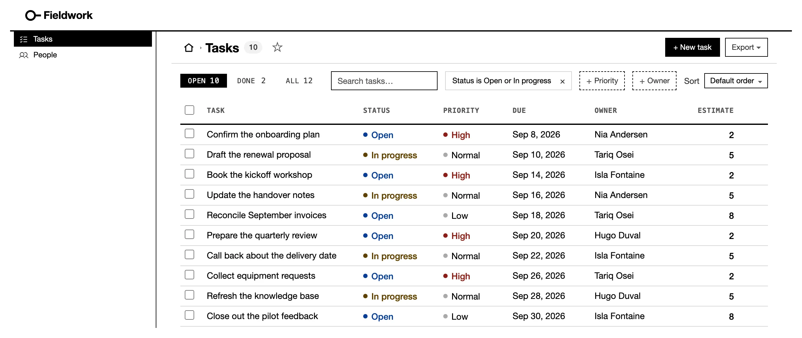

<figcaption><strong>Grid</strong>: the default, with tabs, filters, Sort and a selection. <code>listView('Tasks', 'task', { show, tabs, filters })</code> · <a href="/components/?path=/story/rooms-list--room">Open in the library</a></figcaption>
</figure>
<figure>

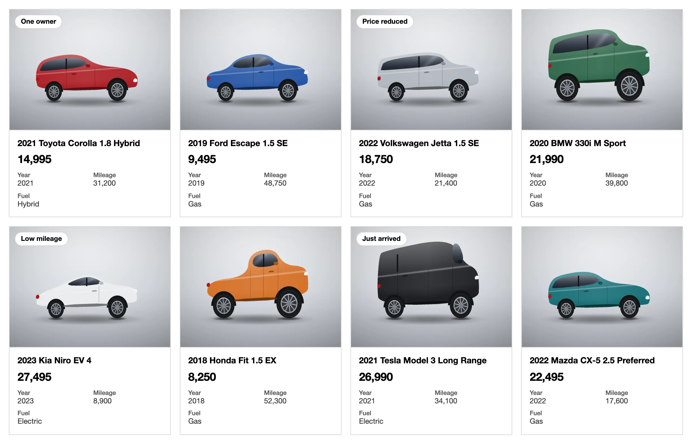

<figcaption><strong>Cards</strong>: a picture, a figure and a line of facts. <code>cards('title', { value, facts, image })</code> · <a href="/components/?path=/story/lists-cards--grid">Open in the library</a></figcaption>
</figure>
<figure>

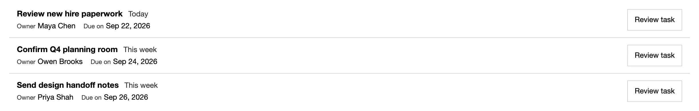

<figcaption><strong>Queue</strong>: compact rows made to work through. <code>queue('title', { badge, lines, facts })</code> · <a href="/components/?path=/story/lists-queue--readonly-task-queue">Open in the library</a></figcaption>
</figure>
<figure>

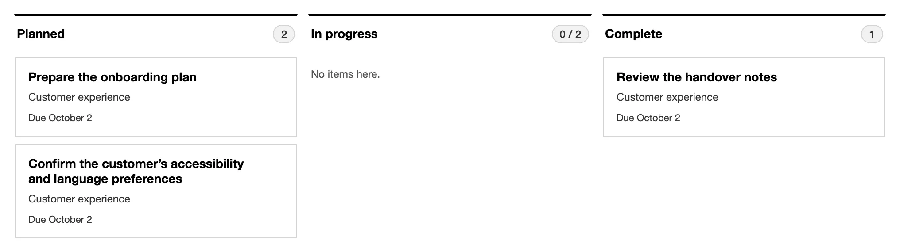

<figcaption><strong>Board</strong>: lanes by one column; a drag is an ordinary update. <code>board: { by: 'status', primary }</code> · <a href="/components/?path=/story/lists-work-collections--board-lanes">Open in the library</a></figcaption>
</figure>
<figure>

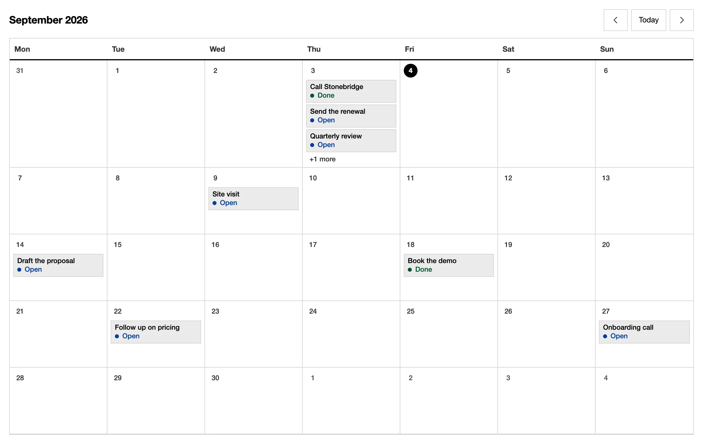

<figcaption><strong>Calendar</strong>: a month by one date column, or ranges with <code>end</code>. <code>calendar('due_on', 'title')</code> · <a href="/components/?path=/story/lists-calendar--month">Open in the library</a></figcaption>
</figure>
<figure>

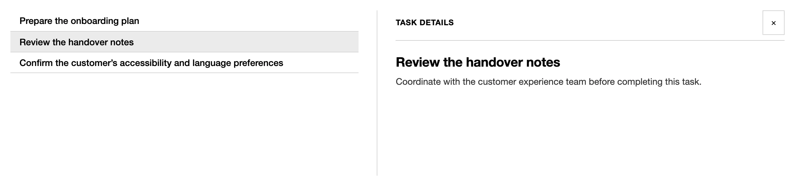

<figcaption><strong>Split</strong>: the list beside the picked record. <code>split: { detail }</code> · <a href="/components/?path=/story/lists-work-collections--split-inbox-selected">Open in the library</a></figcaption>
</figure>
</div>

## Records

A record page is a list of sections. See [record pages](/docs/pages/).

<div class="tw-looks tw-parts">
<figure>

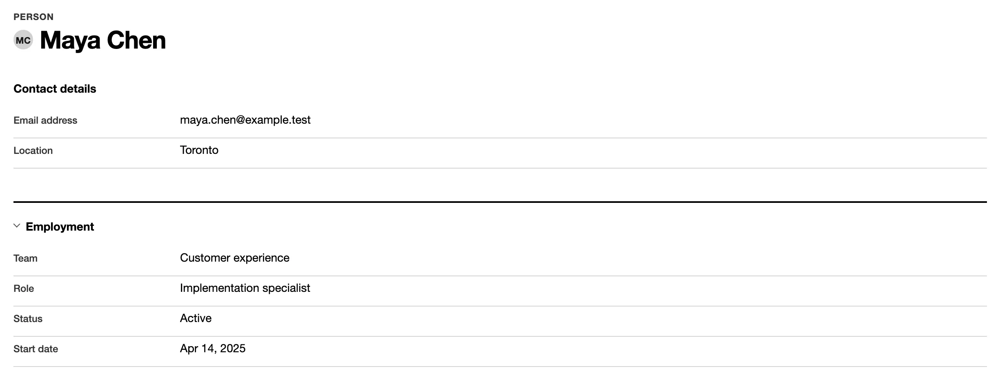

<figcaption><strong>Fields</strong>: grouped values, edited in place where the reader may write. <code>fields(['name', 'status'], { title: 'Details' })</code> · <a href="/components/?path=/story/records-complete-page--profile">Open in the library</a></figcaption>
</figure>
<figure>

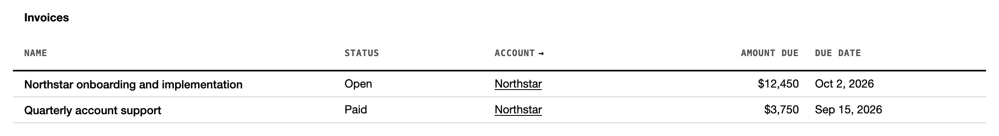

<figcaption><strong>Related list</strong>: the rows that point at this record. <code>related('Invoices', 'invoice', 'account_id', { show })</code> · <a href="/components/?path=/story/records-related-collections--table-and-phone-records">Open in the library</a></figcaption>
</figure>
<figure>

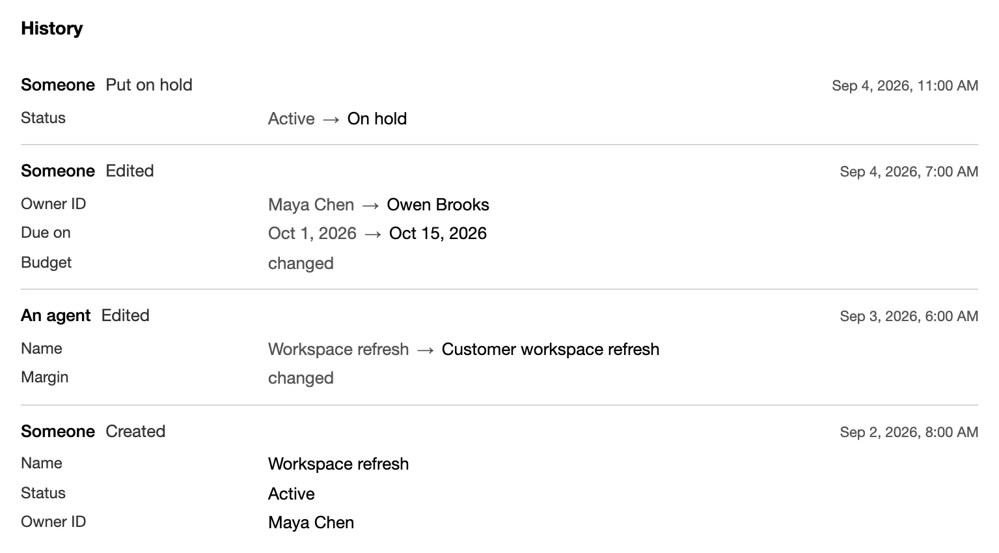

<figcaption><strong>History</strong>: the record's own changes, newest first. <code>history()</code> · <a href="/components/?path=/story/records-sections--history">Open in the library</a></figcaption>
</figure>
<figure>

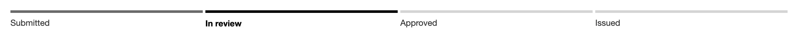

<figcaption><strong>Workflow</strong>: where the record stands. a resource's <code>machine('status', { … })</code>, drawn over its summary · <a href="/components/?path=/story/records-workflow-status--in-review">Open in the library</a></figcaption>
</figure>
</div>

## Dashboards

A dashboard is a list of sections about whole tables; on a record page the same helpers take `whose` and count only that record's rows. See [dashboards](/docs/dashboards/).

<div class="tw-looks tw-parts">
<figure>

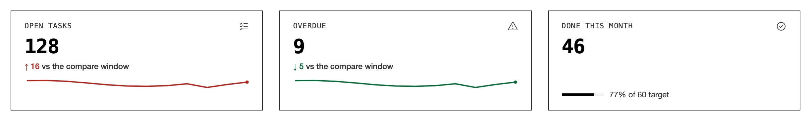

<figcaption><strong>Metrics</strong>: a figure, its change and a target. <code>metric('Open tasks', 'task', { query, better: 'down' })</code> · <a href="/components/?path=/story/dashboards-stat-cards--trends-and-marks">Open in the library</a></figcaption>
</figure>
<figure>

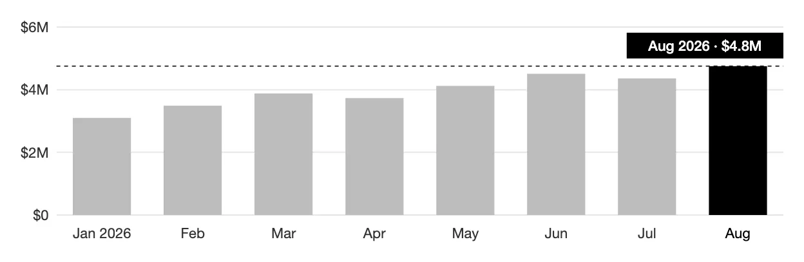

<figcaption><strong>Charts</strong>: lines, bars, stacked bars and donuts. <code>chart('Created', 'task', 'month created_on', { shape: 'bar' })</code> · <a href="/components/?path=/story/dashboards-charts--bars">Open in the library</a></figcaption>
</figure>
<figure>

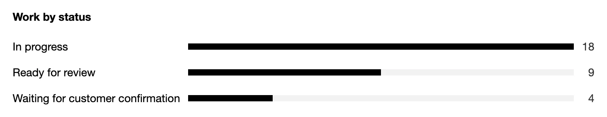

<figcaption><strong>Breakdowns</strong>: a count per value, in its vocabulary's order, else biggest first. <code>breakdown('Work by status', 'task', 'status')</code> · <a href="/components/?path=/story/records-sections--grouped-counts">Open in the library</a></figcaption>
</figure>
<figure>

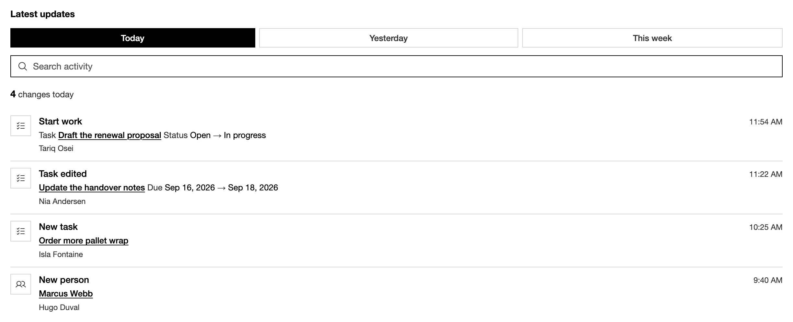

<figcaption><strong>Activity</strong>: recent changes across resources, as the reader may read them. <code>activity('Latest updates', { task: { icon: 'list-checks' } })</code> · <a href="/components/?path=/story/dashboards-activity--feed">Open in the library</a></figcaption>
</figure>
<figure>

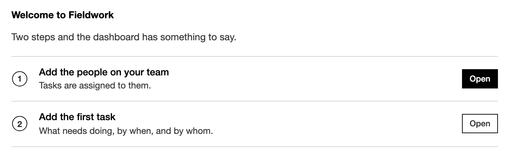

<figcaption><strong>First run</strong>: next steps in place of a dashboard of zeros. <code>firstRun('Welcome', [{ label, to }])</code> · <a href="/components/?path=/story/dashboards-first-run--fresh">Open in the library</a></figcaption>
</figure>
</div>

## Forms and commands

The New form comes from the resource; a command's form from its declared inputs. See [forms](/docs/forms/) and [command forms](/docs/command-forms/).

<div class="tw-looks tw-parts">
<figure>

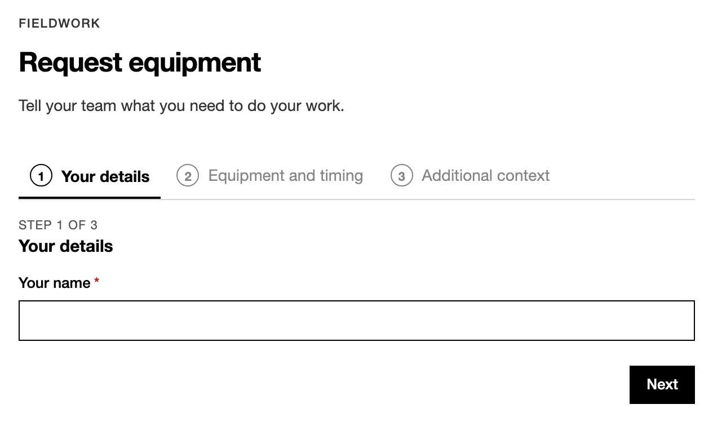

<figcaption><strong>Guided form</strong>: a command form in steps. <code>commandForm('Request', ref, [step('About you', [...])])</code> · <a href="/components/?path=/story/forms-complete-form--guided-request">Open in the library</a></figcaption>
</figure>
<figure>

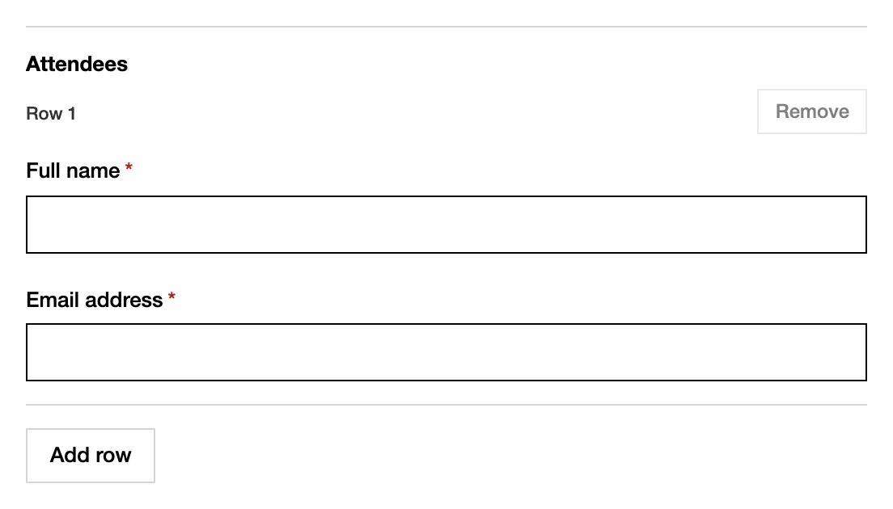

<figcaption><strong>Declared inputs</strong>, including a repeating group. <code>field.group({ … }, { repeat: { min: 1, max: 30 } })</code> · <a href="/components/?path=/story/forms-command-fields--repeated-group">Open in the library</a></figcaption>
</figure>
</div>

## States

A room with nothing to show, that may not be read or could not be fetched, says so in one line where its rows would be. A list's `empty` gives its own words.

<div class="tw-looks tw-parts">
<figure>

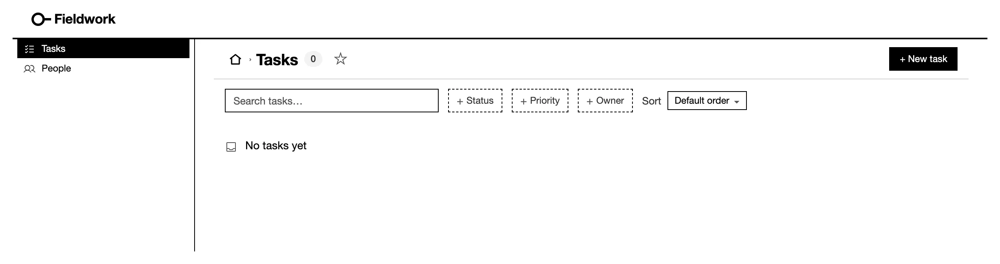

<figcaption><strong>Empty</strong>: the list's own words. <code>empty: { title, message }</code> · <a href="/components/?path=/story/rooms-list--empty">Open in the library</a></figcaption>
</figure>
<figure>

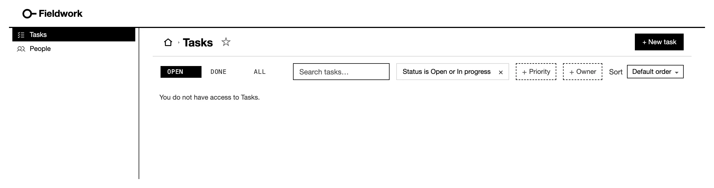

<figcaption><strong>Refused</strong>: a room the reader may not open; signed out, its action is the sign-in. · <a href="/components/?path=/story/rooms-list--forbidden">Open in the library</a></figcaption>
</figure>
<figure>


<figcaption><strong>Problem</strong>: a fetch that failed, said in plain words. · <a href="/components/?path=/story/rooms-list--offline">Open in the library</a></figcaption>
</figure>
</div>

## Chrome

The sign-in screen, the account menu and the bell come with `auth`. See [sign-in](/docs/sign-in/).

<div class="tw-looks tw-parts">
<figure>

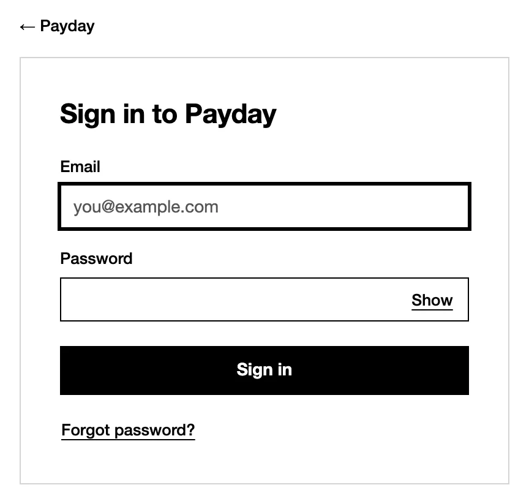

<figcaption><strong>Sign-in</strong>: the App's front door. <code>auth: { providers: ['email'] }</code> · <a href="/components/?path=/story/accounts-sign-in--at-rest">Open in the library</a></figcaption>
</figure>
<figure>

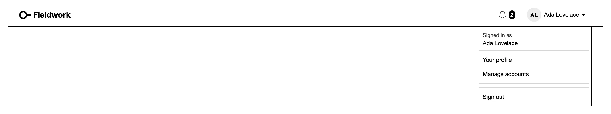

<figcaption><strong>Account menu</strong>: profile and settings; Manage accounts for an <code>admin</code>. · <a href="/components/?path=/story/navigation-account-and-notifications--account-menu">Open in the library</a></figcaption>
</figure>
<figure>

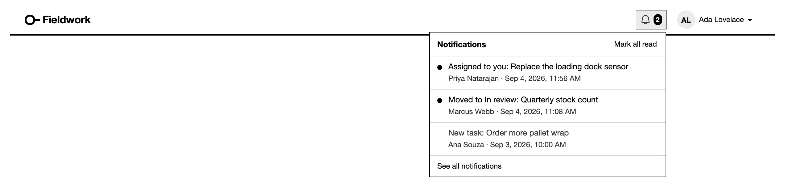

<figcaption><strong>Bell</strong>: the reader's notifications, from a resource's <code>notify</code> rules. · <a href="/components/?path=/story/navigation-account-and-notifications--bell">Open in the library</a></figcaption>
</figure>
</div>

## Custom components

Where no built-in fits, an App draws its own with a React module and `@mistriwork/mistri/ui`. The library shows two from the test Apps under **Fixture Apps**. See [custom components](/docs/custom-components/).

<div class="tw-looks tw-parts">
<figure>

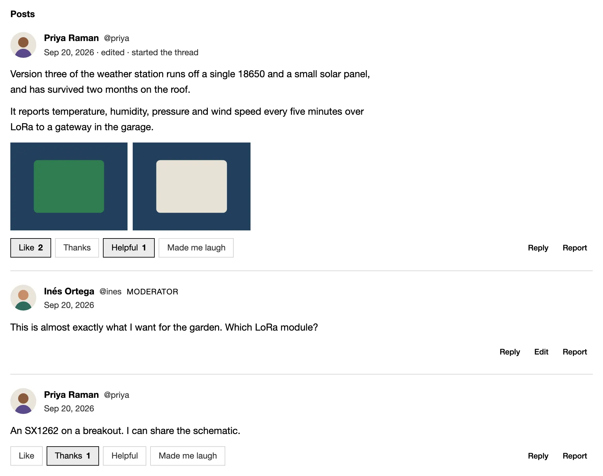

<figcaption><strong>Post stream</strong>, a list view's rows drawn by the App. <code>customList(postStream, { show })</code></figcaption>
</figure>
<figure>

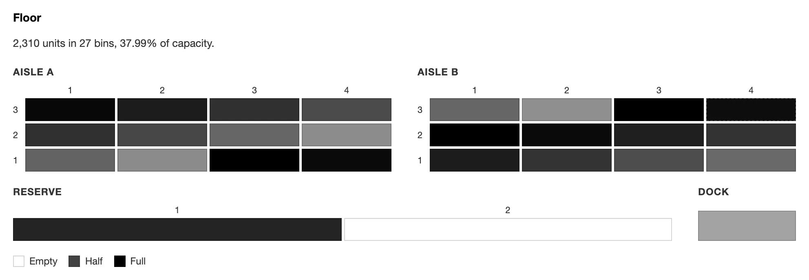

<figcaption><strong>Bin map</strong>, a page section fed by declared reads. <code>custom('Floor', binMap, { rows })</code></figcaption>
</figure>
</div>

## Run the library locally

```sh
npm install && (cd storybook && npm install)
cd storybook && npm run dev   # http://localhost:6006
```

`npm run build:site` builds it into `site/dist/components/`.

## Related

- [Blocks gallery](/docs/blocks/): every dashboard block and presentation, with its declaration.
- [Choose a building block](/docs/choose/): which block fits which job.
- [Custom components](/docs/custom-components/): draw a block of your own.
- [Looks](/docs/looks/): the looks the library switches between.
