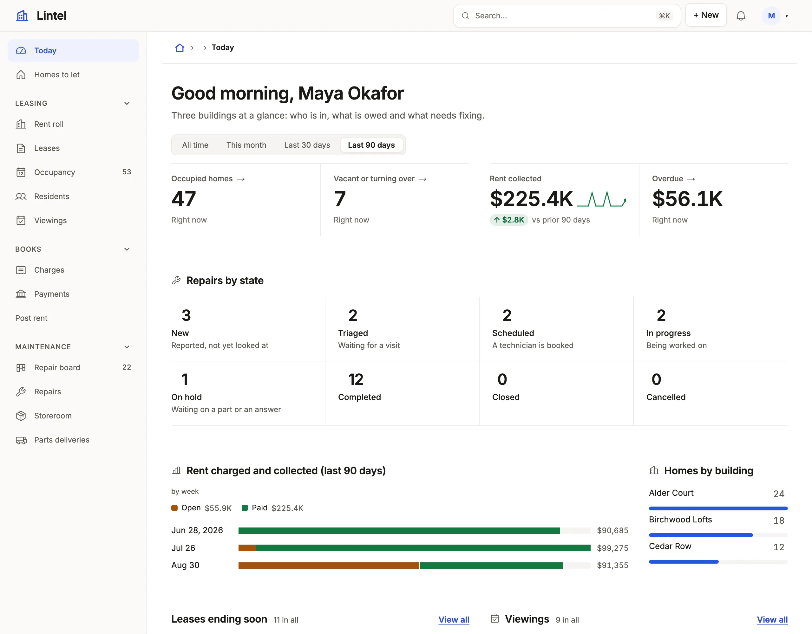

Rules of the form "when X, use Y" for which figures, charts and lists a dashboard leads with and how they share a row.

A dashboard answers "how are we doing, and what needs me" in that order:
figures first, then how they move and divide, then what to act on. Lintel's
Today dashboard is the worked example.

- **Always**, lead with a strip of three or four `metric`s of equal
  `width`; a strip that does not divide leaves one card alone on a row —
  `examples/apps/lintel/dashboards.ts:11`.
- **When a figure has a before**, `over` (its date column) with `better`:
  the change from the period before and the trend across the window come
  unasked —
  `examples/apps/lintel/dashboards.ts:17`.
- **When the board is read by period**, `windows` on the dashboard and
  `over` on each section they narrow —
  `examples/apps/lintel/dashboards.ts:73`.
- **When a figure moves over time**, a `chart` over `auto`, which picks
  the day, week, month or quarter the window calls for — `examples/apps/lintel/dashboards.ts:40`.
- **When a total divides by a vocabulary**, a `breakdown` at a third or
  half width, beside a donut of another division —
  `examples/apps/lintel/dashboards.ts:49`.
- **When two divisions cross**, a `matrix`.
- **When there is work waiting**, `rows` of it with a `limit`, two to a row —
  `examples/apps/lintel/dashboards.ts:50`.
- **When a number needs a sentence**, a `note` last.

The sections are in [Dashboards](/docs/dashboards/).

## Related

- [Dashboards](/docs/dashboards/): every section and window.
- [Segments](/docs/segments/): a condition named once and used as a metric.
- [Composing a list](/docs/compose-list/): the lists a dashboard links to.
