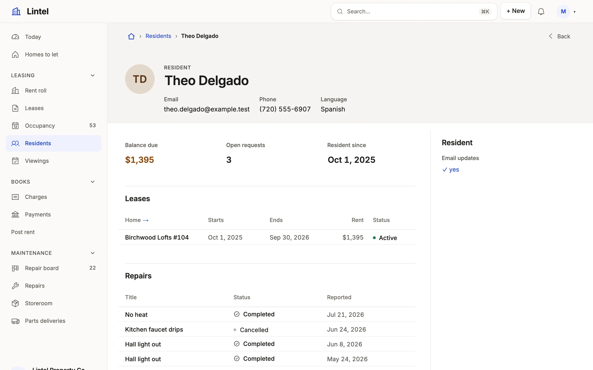

Rules of the form "when X, use Y" for a page about one person, place or account: its head, figures, activity and related records.

An overview page is a record page read as a profile: who or what it is, what
it adds up to, how it has been active, and what it made. No shipped example
is a full overview page; Lintel's resident page is the nearest, a profile
that keeps the operational anatomy.

- **When the record is a person or a company**, dress its name with an
  `avatar` (a photo resource where there is one) and a `subtitle`.
- **Always**, use `header()` for the head, never a custom section that
  draws the name a second time — `examples/apps/lintel/pages/resident.ts:8`.
- **When its figures are counted from other tables**, declare `rollups` and
  show them in a `summary`, a `fields()` of them; a sum two references away takes
  `whose: 'lease_id.resident_id'` — `examples/apps/lintel/resources.ts:89`,
  `examples/apps/lintel/pages/resident.ts:9`.
- **When it has prose of its own** (a bio, a description), a one-column
  `fields` section after the figures —
  `examples/apps/lintel/pages/unit.ts:28`.
- **When it has a history over time**, a `chart` of its activity with
  `whose` and a reduced `height`.
- **When a dashboard section applies to one record**, reuse it narrowed with
  `whose` ("this account's bookings").
- **When what it made is the point** (threads, posts), related lists with a
  `limit` and `empty: 'hide'`, and no aside beside them —
  `examples/apps/lintel/pages/resident.ts:14`, `examples/apps/lintel/pages/unit.ts:33`.

With no aside, the page runs the full width: a metric strip of three
(`width: 'third'`) fits it; beside an aside, use the summary. The skeleton for
an operational record is [Composing a record page](/docs/compose-record-page/). The sections themselves are in [Record pages](/docs/pages/).

## Related

- [Composing a record page](/docs/compose-record-page/): the skeleton of an operational record.
- [Record pages](/docs/pages/): every section an overview page uses.
- [Dashboards](/docs/dashboards/): the sections a page narrows with `whose`.
