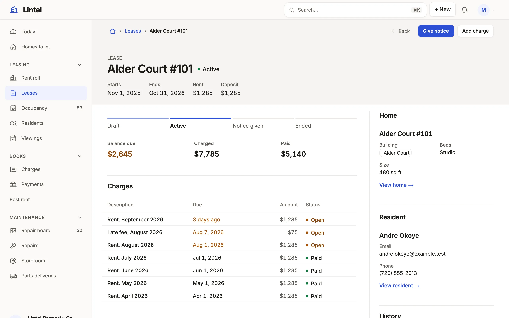

Rules of the form "when X, use Y" for which section a record page needs and where it goes, each with a worked example.

A record page follows one skeleton: a head, its figures, its children as tabs, and an aside. A record worked by talking, chosen from photos or read has its own (`layout`, the last four rules). Lintel's lease and repair pages are the examples.

- **Always**, start with `header({ status, facts })`: the state beside the name and 3–4 facts under it (the parent, a figure, a date) —
  `examples/apps/lintel/pages/lease.ts:10`.
- **When the record has figures**, use a `summary` of 3–4 rollups (the first
  `fields()` under the head), not metric cards — `examples/apps/lintel/pages/lease.ts:16`.
- **When its state is an ordered pipeline of 3–6 steps**, define a
  `machine` on the resource; its states and transitions supply the stepper —
  `examples/apps/lintel/resources.ts:140`.
- **When it has two or more child lists**, draw them as tabs with
  `listTabs: true`, each of at most 4 columns, the status last (Lintel's
  lease page says `listTabs: false` and stacks its two) —
  `examples/apps/lintel/pages/lease.ts:31`.
- **When people add children from the record**, give the list a `create`
  whose `prefill` carries the record's own references —
  `examples/apps/lintel/pages/maintenance_request.ts:30`.
  A role that may read but not create still sees the list, without its New.
- **When a price came down**, give the headline `was: 'was_price'`; the
  older figure is struck through beside it while it is higher.
- **When the siblings matter**, a `related` list matched on the parent's
  column, `{ same: ['property_id'] }` ("more homes in this building") —
  `examples/apps/lintel/pages/unit.ts:41`.
- **When it has a parent**, put a `card('Home', 'unit_id', ['property_id', 'bedrooms', 'sqft'])` beside the lists, in the aside first where there is one —
  `examples/apps/lintel/pages/lease.ts:27`.
- **When one child row is "the current one"** (the next task, the active
  lease), use `current()` in the aside.
  It selects one row to display; it does **not** prove there is only one.
  If people need every active child, add a related list; if there must be at
  most one, enforce that in the database.
- **When the children have children of their own**, read the list as groups: `group: { by: 'lease_id', show: ['unit_id', 'status'], sort: 'start_on desc' }`
  puts a header over each lease (its name, linked to it, its facts) and that lease's charges under it, a page of groups at
  a time. `limit` counts the rows to a group, and "Show all" opens one in place (up to 50). One level only: what a second
  level would name is a fact on the header. Tables only, not with a presentation; it composes with `empty`, `totals` (a subtotal under each group) and
  `rowActions` (a ⋯ on each group's rows). The rows with no value are one group, "No lease" by default or what
  `empty` names, and always last; `sum: 'amount'` says a summed column in each header after the count —
  `examples/apps/lintel/pages/resident.ts:17`.
- **Always, beside the lists**, a `properties` rail of the remaining fields
  (`fields()` with `region: 'aside'`),
  then `history()` where the record keeps one (both stand in the aside unasked) —
  `examples/apps/lintel/pages/lease.ts:29`.
- **When a list is usually empty**, set `empty: 'hide'`: left out rather than drawn empty (where the reader may
  add a row it collapses to a line instead, so the Add stays). `empty: 'collapse'` says it in one line, and several
  side by side become one, "No charges, payments or notes yet", each with its Add; `page(…, [...], { empty: 'collapse' })`
  says it for every list that says nothing of its own. Inside `listTabs` an empty list is a tab, neither —
  `examples/apps/lintel/pages/unit.ts:33`.
- **When the record is worked by talking** (a repair, a ticket), say
  `layout: 'conversation'`: its one `timeline` last in the main column, so the
  composer ends the thread, and its lists in `region: 'aside'` —
  `examples/apps/lintel/pages/maintenance_request.ts:37`.
- **When the record is chosen from photos** (a home, a vehicle), say
  `layout: 'showcase'`: a `gallery` first, its price `headline` beside it in the
  aside, the rest under both at full width; on a phone the price follows the
  photos —
  `examples/apps/lintel/pages/unit.ts:43`.
- **When the record is read** (a task, a policy), say `layout: 'article'`: one
  column at a reading measure, with no aside —
  `examples/apps/tick/app.ts:69`.
- **A page that names no layout is drawn in the one its sections make**, chosen when the App is read, never from a row: a `gallery` first is a showcase, a `timeline` ending the main column with no list there a conversation, and the record's long text with at most 12 facts and nothing else an article; `mistri check --defaults` says which and why. A written layout refuses a section it cannot place where a chosen one falls back to the record, and `layout: 'record'` keeps the record's own.

The aside is a third of the record, 256px to 320px: nothing in it wider than two columns. Beside it, four figures and tabs of four short columns fit in the top menu's shell (`shell: { placement: 'top' }`, the scaffold's); beside the side menu, at a desk, three figures do, so keep the summary to three or draw the menu on top (`mistri check --design` says which). Title the rail by what it holds, the record's noun, never "Details".

## Related

- [Record pages](/docs/pages/): every section named above.
- [Composing an overview page](/docs/compose-overview/): a person's or company's page.
- [Actions](/docs/actions/): the machine behind the stepper.
