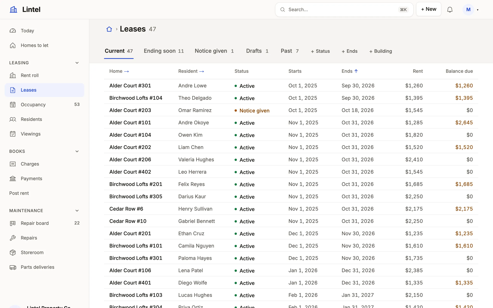

Rules of the form "when X, use Y" for how an App chooses its look, mark, menu and home, each with a worked example.

The shell is the first thing a reader sees and carries more of an App's
look than any section: a chosen look, a mark, and a menu arranged the way
the day runs. Lintel is the worked example.

- **Always**, choose a look with `ui.theme.preset` on purpose; without one an
  App wears Lumen, which Lintel's own look extends — `examples/apps/lintel/app.ts:171`.
- **Always**, give the App a `logo` mark and every view an `icon` of what
  it lists, never `table` — `examples/apps/lintel/app.ts:170`,
  `examples/apps/lintel/views.ts:25`.
- **When the menu has more than six entries**, group it with `navGroup` in
  the order the work runs, each group with an icon —
  `examples/apps/lintel/navigation.ts:15`.
- **When people pick a list by how much is in it**, `shell.counts: true` —
  `examples/apps/lintel/app.ts:176`.
  Only a list of work is counted: its machine's unfinished states, a date at
  or before today (said in red), or the reader (`me`). A list's `count: true`
  or `false` says otherwise.
- **When the menu is long**, the side placement with `rail: true`, so a
  folded menu keeps its icons — `examples/apps/lintel/app.ts:175`; **when it is a few groups**, `placement: 'top'`.
- **When one role works in a few places and others in many**, the top bar
  for that role alone: `shell: { placement: { top: ['employee'] } }`. A
  person whose every role is listed gets the bar; anyone holding another
  keeps the sidebar.
- **When people make many kinds of thing**, gather them in one header
  menu, `shell: { new: [{ view: 'tickets' }, { command: 'raiseChange', label: 'Change' }] }`,
  so the menu lists places and the button lists what to make —
  `examples/apps/lintel/app.ts:178`.
- **When the first entry is a dashboard**, give it the menu word people say
  (`{ to, label: 'Today' }`) — `examples/apps/lintel/navigation.ts:9`.
- **When roles start in different places**, `home` by role —
  `examples/apps/lintel/app.ts:161`.

The looks are in [Looks](/docs/looks/); the keys in
[Navigation and the shell](/docs/nav-and-shell/).

## Related

- [Navigation and the shell](/docs/nav-and-shell/): every shell and menu key.
- [Looks](/docs/looks/): the built-in looks.
- [Themes](/docs/themes/): make a look of your own.
