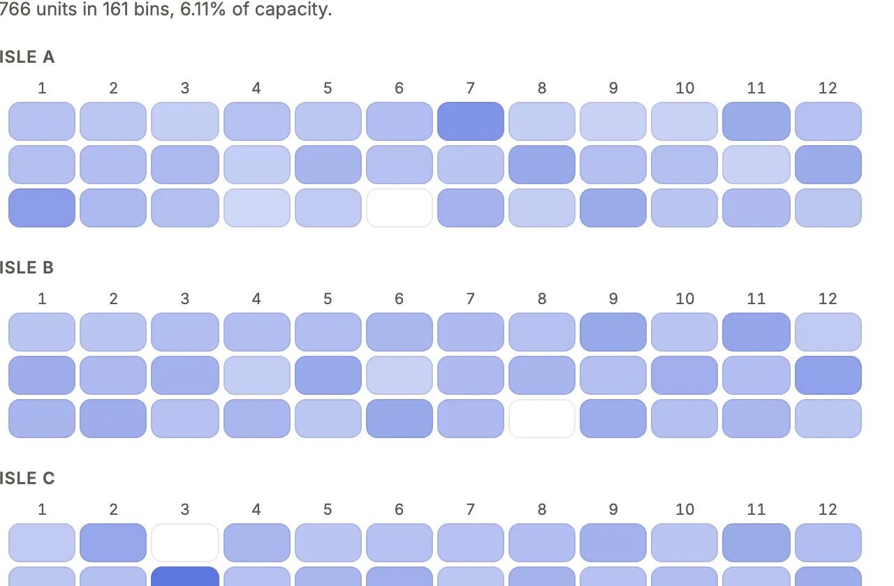

Draw what no built-in block draws with a React component of your own, fed by checked reads and changing data only through commands.

```sh
npm i -D rolldown @types/react
```

An App declares a component by an id and a module path inside its directory, and a section places it:

```ts
export const binMap = component('bin-map', { module: './widgets/BinMap.tsx' });

export const warehouseBins = custom('Floor', binMap, {
  rows: {
    bins: { from: 'bin', whose: 'warehouse_id', show: ['id', 'code', 'zone', 'capacity', 'units', 'active'], sort: 'code', limit: 500 },
  },
  figures: {
    bins: { from: 'bin', whose: 'warehouse_id', measure: 'count' },
    units: { from: 'bin', whose: 'warehouse_id', measure: 'sum units' },
  },
});
```

<!-- no sample: no sample App needs a component of its own; Ladle's free-form page is below. -->

The module, `widgets/BinMap.tsx`, draws with `@mistriwork/mistri/ui`.



## What you'll see

- The section stands among the page's built-in ones, with its title, in every look and in dark mode, because it draws with the looks' tokens.
- Its one read (`bins`) arrives as typed `rows`, and its two figures (`bins`, `units`) as exact `figures`, all compiled at load and run under the reader's grants, field projection and row policy; loading and errors are the platform's to draw.
- Edited from source, the module recompiles on save; `mistri build` bundles it, pinned to its version.

## When to use it, and when not

- Use a component only when no section, presentation, chart or display rule draws it, and the need is one App's: a bin map, a payroll timeline, a forum's post stream.
- Use [Choose a building block](/docs/choose/) first: a bug is fixed in the platform, and a need two Apps share is a platform gap to report, not a component.
- Use a [command](/docs/commands/) for anything the component changes: it never writes on its own.

## Options

| Kind              | Declared                                                           | Placed                                                                                          | Props type     |
| ----------------- | ------------------------------------------------------------------ | ----------------------------------------------------------------------------------------------- | -------------- |
| Section (default) | `component(id, { module, props })`                                 | `custom(title, comp, { record, rows, props })` on a page or dashboard                           | `SectionProps` |
| Value             | `kind: 'value'`                                                    | `resources.<r>.display.<column>`                                                                | `ValueProps`   |
| Input             | `kind: 'input'`                                                    | `resources.<r>.inputs`, an action's or a command form's `inputs` (`'trade.vin'` inside a group) | `InputProps`   |
| List              | `kind: 'list'`                                                     | `presentation: customList(comp, { show })`                                                      | `ListProps`    |
| Page              | `definePage({ path, label, reads, … })` in `pages/<path>.page.tsx` | Its own address and nav place; see [free-form pages](#free-form-pages)                          | `PageProps`    |

`props` are JSON-safe: `prop.number({ default, min, max })`, `prop.text`, `prop.bool`, `prop.choice([...])`. `rows` holds up to eight named reads, `{ from, show, query?, sort?, limit? }`, tied to the record by `whose` on a page or to the window by `over` on a dashboard. Every key: [pages reference](/docs/dsl-pages/#pagessectionskindcustom).

## Write the module

```tsx
import { Empty, useFormat, useNavigate, type SectionProps } from '@mistriwork/mistri/ui';
import type { Rows } from '../mistri-schema.d.ts';
import type { warehouseBins } from '../pages/warehouse.ts';

export default function BinMap({ rows }: SectionProps<typeof warehouseBins, Rows, 'warehouse'>) {
  // rows.bins[0].code is a string, rows.bins[0].units a number
}
```

`@mistriwork/mistri/ui` is the only mistri module a component imports. It holds:

- **The kit**: `Card`, `Stack`, `Row`, `Cluster`, `Beside`, `Heading`, `Button`, `Value`, `Tone`, `Meter`, `Stat`, `Columns`, `Table`, `Items`, `Item`, `Dropdown`, `Segmented`, `SplitListDetail`, `Empty`, `Loaded`, `Skeleton`, `Icon`, `Text` (`<Text tone="muted" size="sm">`: a line of secondary ink, `tone` `default`, `muted` or `danger`), `VisuallyHidden` (words only a screen reader hears, clipped rather than hidden: `<VisuallyHidden>, opens in a new tab</VisuallyHidden>`). A `Card`'s title is an h3; a card that is a section of a page under the platform's h1 says `level={2}` so the outline does not skip a level. `Table` draws each cell as a `Value`, dressed as the App dresses that column; sorting stays yours (`sort`, `onSort`), and `onRowClick` makes the first cell a link. `Button` with an `href` is a link in the button's dress: it opens a new tab, copies as an address, and an address of this App is followed in place. The platform's fields (`TextField`, `Select`, `Checkbox`, `Switch`, `Slider`, `YesNo`, `ChoiceCards`, `FileField`) are exported from the same entry. A free-form page's row of verbs at the screen's foot is `<Row foot>`: on a phone a notice stands above it instead of covering it. `<Cluster min="14rem">` lays its children in equal columns at least that wide, as many across as fit and one on a phone, and never scrolls sideways: `<Cluster>{teams.map((team) => <Card key={team.id} title={team.name}>…</Card>)}</Cluster>`.
- **Reads**: `useRows`, `useRecord`, `useBreakdown`, `useFile`, all under the reader's grants, row policy and tenant.
  `useFile(resource)` gives a function from a row's key to the picture's address: ``. In a tenant App the file is read on the reader's session first, so the address is `undefined` until it arrives and the component draws again then; draw a placeholder meanwhile.
  Each read answers `isPending` until its first answer and `isFetching` while any answer is on its way. A refresh that fails keeps the last good rows and says so: `isStale` is true and `refreshError` holds the failure. `useRows` reads `limit` rows (20 unless said), and its `page` says `{ limit, hasMore }`; `more()` reads the next page onto the end. `page.total` is there only when the server counted one, never guessed from the rows. Each read is consistent on its own: two reads on one page are two answers, possibly a moment apart, never one snapshot.
- **Commands**: `useCommand(cmd)` with `available`, `reason`, `run` and `open`; an applied run resolves with the command's `output`. `useAction(id)` is the same handle for a fixed action (a machine's verb, `action(label, { set })`).
- **Inputs**: `run(record, input)` takes only the command's declared inputs, by name. A refusal names the inputs it is about in `fields` (`{ amount: 'Enter an amount of zero or more.' }`): say each beside its control. `useField(cmd, name)` binds one input to a control of your own: its label, `text` as typed, `value` as it is sent, `error` once judged, and `inputProps` for the shell's fields; a `money` input reads what is typed with `parseMoney(text, { currency, locale })`, which answers `{ minor, major }` exactly (a figure past 2^53 stays text) or `{ problem }`. `useOptions(cmd, name)` is a reference input's choices for a picker you draw (`Typeahead` from `@mistriwork/ui` keeps the keyboard): searched and paged as the platform's own picker reads them, the latest text winning, and `resolved` names a pick by its key, `available: false` where the reader has lost access to it.
- **Optional reads**: a read the reader may not be granted, such as a part of a page that another source serves, says `optional: true` (`useRecord(resource, key, show, { optional: true })`) and answers `refused: boolean`, typed only then. A 401 or 403 gives `refused: true` and `isError: false`, with no toast and no error boundary, so the page draws its own note; a 500 stays an error.
- **Choices of a resource**: `useOptions(resource, { where })` is the same picker for a resource the page declares in `reads`, labeled by its title column (`useOptions('region')`), under the reader's row policy. A resource the page does not read is refused as any other read is.
- **Addresses**: `useHref()` gives `signIn()`, `view(key, params?)`, `record(view, key, { tab? })` and `page(path, params?)`, the App's canonical addresses typed against its views and pages (`<a href={href.signIn()}>Sign in</a>`), so a page never writes a path by hand.
- **Opening a page**: `useNavigate().openPage(name, params?)` moves to one of the App's custom pages in place, with no reload, through the shell's router and the page's canonical address (`openPage('schedule', { day: '2026-11-09' })`), and `pageHref(name, params?)` gives that address for an `<a href>` whose plain click you hand to `openPage`. A page the App has no address for throws.
- **Quiet runs**: `run(record, input, { quiet: true })` returns a refusal as ever but shows no notice in the shell, for a page that says it in place: `const outcome = await book.run(slot, input, { quiet: true }); if (outcome.status === 'refused') setProblem(outcome.message);`.
- **Pointer position**: `layoutPoint(event, element)` answers `{ x, y }`, where the pointer is inside the element in the layout pixels the page styles in, however the reader's density zoom is set: `const { y } = layoutPoint(event, column.current)`. Use it instead of `getBoundingClientRect`, which `check` warns about as `component-ruler`.
- **The rest**: `useNavigate`, `useComposer` (fills the page's conversation box, never sends), `useViewer` (`signedIn`, `account`, and `roles`, the roles the reader holds here), `useFormat`, `useMessage`, `useLook`, `useToken`, `useFlags`.

`<Loaded query={rows}>{(data) => …}</Loaded>` draws a read's three other states as the platform does: a skeleton while it loads (`loading={<Skeleton lines={3} />}` draws a placeholder shaped like the drawing instead of the bar, so nothing under it moves when it lands; `Skeleton` takes `height`, `width` and `lines`), `empty` (or "Nothing here yet."; `empty={null}` draws nothing) for no rows, and the error with Try again. `useFormat().money(value, { currency, minor, whole, compact })` says a figure as a `money` column does, exactly, from a decimal string too; `dateTime(value, { timezone: 'America/Chicago' })` says it in that zone and `{ style: 'short' }` in the fewest characters ("3/5/26, 2:30 PM"), and `timezone` is the App's own (`ui.timezone`), for reckoning "today" as the App's day.

### Run a command

```tsx
const close = useCommand('closeTicket');
const can = close.available(ticket); // undefined while the server is asked
{
  can !== false && (
    <Button busy={can === undefined} onClick={() => close.run(ticket, { outcome: 'fixed' })}>
      Close
    </Button>
  );
}
```

- Gate a button on `available(record)`, not `granted`: `granted` is the role, `available` adds the command's `when` for this record. While it is undefined, keep the button and set `busy`, never `disabled`: a disabled button drops the reader's focus.
- `run` resolves with `{ status }`: `applied`, `refused` (in the server's words), `closed` when its form was closed unsent, or `unknown` when the answer was lost. On `unknown`, call `check()` before sending again: it asks under the same key, so the run applies at most once.
- An applied run's `output` is typed by the command's declared `output` once `mistri check` has written `mistri-commands.d.ts`, so `done.output.assigned` needs no cast. A command that declares no `output` gives `undefined`, and a public command run from a public page gives `{ reference, receipt }`.
- One key covers each run. For a command that names no record, or a public page's, a run that must survive a reload takes `{ attempt }`: a `crypto.randomUUID()` made once per intent and kept (in the address, say). The same attempt sent again is the same run.
- Inputs a command's `when` hides are neither required nor sent, as in its form.

### Review before a run

A page that shows what a run will do, and asks the person to confirm it, pins the run to the revision they read:

```tsx
const assign = page.useCommand('assign');
const review = await assign.prepare(ticket, { owner_id: 4 }); // { token, values, fresh }, or a refusal
// …the person reads review.values and confirms…
const done = await assign.run(ticket, review.values, { review });
if (done.status === 'refused' && done.code === 'stale') showTheReviewAgain();
```

- `prepare(record, input)` reads the command's starting values at the record's revision now, with `input` laid over them.
- A run with `{ review }` is sent for that revision only, once. If the record has moved since, it is refused with `code: 'stale'` and never run over a revision nobody saw. A run without a review still prepares again on its own, as before.
- `assign.reviewFresh` turns false as soon as live sync hears a change to the record, so the page can show the review again before anyone presses Run. A review is spent by its run.
- A form, a public page's command and a fixed action name no record revision, so their `prepare` answers with a refusal.

### Run an action

A resource's fixed actions (a machine's verbs, `action(label, { set })`) are not commands, so `useCommand` does not run them. `useAction` is the record page's own button, with the handle a command has:

```tsx
const start = page.useAction('startVisit'); // the page declares `actions: ['startVisit']`
{
  start.granted && (
    <Button disabled={start.reason(request) === 'unavailable'} onClick={() => start.run(request)}>
      {start.label}
    </Button>
  );
}
```

- `run(record)` writes the action's `set` to that record, found by its key. An action that says `confirm` asks first, in the platform's dialog; one that asks a reason takes it as `run(record, { reason })`. It takes no other input.
- `granted` is the record page's rule: the reader writes the resource, or a role of theirs runs this action (`roles.<role>.actions`). `available(record)` is the action's `when` for this record, and a run on a record in another state is refused in words, never skipped. The server judges the write again as it judges any update.
- A page declares its actions beside its reads, as it declares its commands. A command's id there is refused (`[page-action]`: name it in `commands`), as is an id that is no fixed action of a resource the page reads, and a `public` page declares none: a signed-out visitor holds no role to run one. They are the role's grants, not the page's authority, so adding one does not change `authority.lock`.

An id past 2^53 arrives as a string: draw it with `Value`, never through `Number()`.

### Figures

`figures` holds up to eight named aggregates: `{ from, measure, by?, whose?, query?, limit? }` on a page, `{ table, measure, by?, query?, over?, limit? }` on a dashboard. `measure` is `count`, `count distinct` and a column (`count distinct patient_id`: how many different people the rows name), or `sum`, `avg`, `min` or `max` over a column. They run on the server like a dashboard's metrics, under the reader's grants, with no SQL of the component's own. Counting `rows` instead counts at most the read's `limit`.

Without `by`, a figure is one value: a number, a string (a sum or id past 2^53) or `null` when no row matched. With `by` it is a list of `{ key, value, label? }`, biggest first, up to `limit` groups (100 by default, at most 500).

`useBreakdown(resource, { by, measure?, query?, limit? })` asks the same from the module, for a figure that follows a control. On a page it may ask only for the page's `reads`. Rows are keyed as the server names its columns (`sum(net)`), so prefer declared `figures` when the question is known; figures are checked at load, `useBreakdown` only when it runs.

### Rows, a rail and the dark ground

`Items` is a list of rows with no head row, where `Table` always draws one. Each `Item` has a `title`, and may have a `lead` (an icon, an avatar, a time, a `Value`), a `tone` (a dot in the lead column, or, beside a `lead`, the lead in that tone's ink), one quiet `note` under the title and an `action` at the row's end. With `href` or `onClick` the title is the row's one link or button, the whole row answers a pointer as a table's rows do, and a click inside `action` never opens it. On a phone the action stays on the row and the note wraps. The lead is one column the rows share, as wide as its widest, so times and marks line up down the list. `empty` is drawn when there are no rows; inside a `Card` it is flush with the card, not a box in a box.

A long list in runs (overdue, today, later) takes `groups`: `{ title, count?, items }` each, `key` optional. Each run's head holds the top of the room while its own rows pass beneath it, and the next run's head takes its place; the lead column is still one width down every run, and a run with no rows draws no head. A screen reader hears a list of lists, each named by its head.

```tsx
<Items
  label="Work"
  groups={[
    { title: 'Overdue', count: overdue.length, items: overdue.map((task) => <Item key={task.id} title={task.title} note={task.due} />) },
    { title: 'Today', count: today.length, items: today.map((task) => <Item key={task.id} title={task.title} lead={task.time} />) },
  ]}
/>
```

```tsx
<Items label="Open work" empty={<Empty title="Nothing open" />}>
  {tasks.map((task) => (
    <Item key={task.id} title={task.title} note={task.due} onClick={() => open(task)} action={<Button intent="quiet">Done</Button>} />
  ))}
</Items>
```

A `Card` takes a `count` (a quiet number beside the title) and an `action` (right-aligned in the title row): `<Card title="Open work" count={tasks.length} action={<Button intent="quiet">Add</Button>}>`. With neither, the title is the heading alone. `description` is one quiet line under the title (what the part holds), and `tone` (`good`, `warn`, `bad`, `info`) says the title in that status ink.

`Beside` is a main column beside a rail. The rail is `railWidth` wide (`'20rem'` by default, never past half the box) on the `side` you name (`'end'` by default). Where its own box is under 40rem wide it stacks, the main first, and it never scrolls sideways: `<Beside rail={<Card title="Facts">…</Card>}>…</Beside>`.

`<Card ground="nav">`, or any element with `data-ground="nav"`, puts what is inside on the look's navigation ground: the kit's inks, hairlines and surfaces take the nav's own, so a `Stat`, `Value`, `Meter`, `Table`, `Items`, `Segmented` or `Empty` there reads in every look, light and dark, with no recipe of its own.

### Types, values and styles

- `mistri check` writes `mistri-components.d.ts`: a props type per component, named from its id (`sales-summary` is `SalesSummaryProps`), from its declared props, reads, figures and record fields.
- A value component may export `label(value)`, the word each value of the column's vocabulary is said as, in breakdowns, legends, filter chips and the CSV export. It is synchronous and returns at most 80 characters; declared `values` win.
- Style with the tokens (`var(--surface)`, `var(--ink)`, `var(--accent)`, `var(--space-1)` to `var(--space-8)`, `var(--text-xs)` to `var(--text-xl)`…) and classes named `c-<component-id>-…`. `tokens` and the `Token` type list them all; `check` warns about a `var(--…)` that is none of them and names the nearest. An imported stylesheet is scoped to the component.
- A stylesheet several components draw, such as a widget two pages share, may also name its classes after itself: `widgets/TicketList.css` (or `widgets/ticket-list/styles.css`) owns `c-ticket-list-…`, where no other stylesheet in the App has that name.
- A shared package that ships a stylesheet of its own, kept inside the App's directory (a workspace package), names its class name-space in its `package.json`: `"mistri": { "cssPrefix": "acme" }` (or a list). `check` then reads `.acme` and `.acme-…` in that package's stylesheets as the package's own and does not warn `[component-class]`. The App's own `package.json` is not read for this; an installed package under `node_modules` is never linted.
- On a document's sheet a value component inherits paper: the sheet says `--ink`, `--ink-muted`, `--ink-subtle`, the grounds, the lines and the status inks again for white, in every look and in dark mode, on screen and in print. Draw with those tokens, not a color of your own, and the value reads on the sheet as it does on the screen.
- `react`, `react-dom` and `@mistriwork/mistri/ui` are shared with the page, never bundled.
- Test with `@mistriwork/mistri/ui/testing` in Vitest: `renderSection(BinMap, warehouseBins, { data: fixtures<Rows>({ bin: [...] }) })` draws it over typed fixtures and records navigations and commands; `renderValue`, `renderList`, `renderPage` and `renderInput` draw the other kinds. `refused: { bin: 403 }` draws a read the reader may not make, and `await view.refresh({ data: { bin: [...] }, refused: { bin: 403 } })` changes the server under a page already drawn and asks every read again, as a live update does. A command's `outcome` (`{ status: 'unknown', message, check }`) draws an answer that never came. `forms: { enroll: { steps, draft } }` draws a form view a page opens with a draft to resume. `renderPage(page, { catalog })` takes the tables' columns (`{ tables: [{ name, columns: [{ name, type, primaryKey }] }] }`) so a reference, a picker and a card title read the declared title column as the platform does, not a guess. `view.region('Open')` (or `within(view.region('Open'))` from Testing Library) scopes a query to one titled section; it throws unless exactly one matches. `board.card('Fix pump')`, `board.move('Fix pump', 'Done')`, `calendar.event('Dock 4')` and `calendar.day('2026-11-08')` (each taking the region as a last argument to narrow it) find and drive a `<Board>` or `<Calendar>` by what a person sees. `Popover` and `Tooltip` are placed on the shell's zoom-aware ruler and drawn inside the dialog they open from, so focus comes back to the trigger and the dialog's trap holds them.

## Free-form pages

A page drawn whole by your code is one file, `pages/<path>.page.tsx`, from `@mistriwork/mistri/page`. Pages are compiled with rolldown, so `npm i -D rolldown @types/react` comes first: the first `check` after adding a page fails without it. Ladle's door list:

```tsx title="examples/apps/ladle/pages/check-in.page.tsx"
const page = definePage({
  label: 'Check-in',
  description: 'Tonight’s guests at the door: check each party in as it arrives.',
  icon: 'check-circle',
  nav: { position: 0 },
  reads: ['class_session', 'booking'],
  commands: ['checkIn'],
  params: { class: 'id' },
  component: CheckIn,
});
```

See it in the sample (`examples/apps/ladle/pages/check-in.page.tsx:24`).

- The path is the file's name, and the address: `/check-in?class=2`. `home` may name a page by its path.
- A page's path is its address alone: a view with the same key is refused (`[page-path]`), and the page never replaces it. Rename the file, or remove the view and let the page take its place.
- `nav: { group }` is the nav group the page stands in. In a nav split into workspaces, a list stands in each: `nav: { group: ['sales', 'support'] }`. A group the nav lacks, or one named twice, is refused (`[page-nav]`).
- A page places itself: naming it in the App's own `nav` is refused at load, and by the types where they know the page (`mistri check` writes its path into `mistri-commands.d.ts`). `nav: false` keeps it out of the menu, and a `public: true` page that says nothing of `nav` stays off the signed-in menu too (it is the signed-out door's); say `nav: {}` or `nav: { group }` to put it in both. A `nav: false` page is still served at its address; another page reaches it with `pageHref('<key>')` or `openPage('<key>')`, and `mistri check` warns ([`page-unlinked`](/docs/check-codes/#page-unlinked)) when no source links to it.
- `nav.position` is an index into the siblings as they stand when the page is placed. Pages are placed in path order after the App's own `nav`, so at the top level a group counts as one sibling and a page placed earlier counts as one for the next: `position: 0` leads the menu, a position past the end goes last, and of two pages asking the same place the later in path order stands first, since each is put in at that place as it comes. To keep a menu's order in one place, give the pages a group (an empty `navGroup('desk', 'Desk', [])` in `app.ts`) and order them inside it.
- A command a page lists in `commands` is offered by that declaration alone: it needs no `action('…', { command })` on its table, and the role still needs the grant (an ungranted role is refused at prepare and at run). The page's command stays off the record's bar, its More menu and every row menu until an action offers it there.
- A page that must stay current needs `live: true` on the App (live sync is off unless the App asks; `dev` says so), or its own timer that calls `refresh()` for its loader and each read's `refetch()` (`page.useRows(…).refetch()`) for the rows it draws.
- `icon` is one of the built-in names, and a misspelled one is a type error in the page's file.
- `page.useRows`, `useRecord`, `useBreakdown` and `useFile` read only its `reads`; `page.useCommand` runs only its `commands` and `page.useAction` only its `actions`. Anything else is a type error, a `[page-undeclared]` problem in `check`, and refused by the server. A `show`, `query` or `sort` path across a reference (`customer_id.name`) reads the table it lands on, so that table is in `reads` too: the types allow the path, and `check` refuses it when the path is written in place, `as const`, or in a `const` at the top of the module.
- `params` names the address's parameters and their kind: `'id'`, `'text'`, `'date'`, `'date-range'` (`2026-11-01..2026-11-08`, either end open) or a list of its values (`view: ['list', 'board']`); a plain list (`params: ['class']`) is text. `page.useParam('class')` keeps state in the address and hands back a value already of its kind: an id is a number, past 2^53 its digits (a param named for a resource the page reads, with a text key, as a tenant's tables have, holds URL-safe text instead: `params: { vehicle: 'id' }` with `reads: ['vehicle']`); a day not on the calendar, or a value not in the list, is no value.
- A read's rows (`useRows`, and a `List`'s) are typed from its `show` and the schema, plus the resource's key column or columns, which both always carry: a key column (`row.id` where the key is `id`) is there, and typed, without `show` naming it. Any other column `show` leaves out is a type error. Name the key in `show` only to draw it. A `List` that takes its resource from an enclosing `Scope` still carries the key, but its type cannot name the resource, so the key is not typed there: give the `List` its own `from` to type it. `where` is its condition as an object keyed by the columns (`{ status: ['booked', 'waiting'], party_size: { gt: 1 }, paid_on: null }`), the same condition the query language says; the server refuses a column or operator it does not know. `query` still takes the language's text or a segment's name.
- `<Scope from where>` says a condition once: every block inside reads under it, and a Scope inside another narrows it. `<List from where show sort limit empty>{(row) => …}</List>` draws a row each, says its loading, empty, failed and refused states, and "Showing the first 20." when its `limit` cut the rows short.
- `forms` names the form views the page opens (a view whose `command` makes it a form). `page.useForm('apply')` reads the form's draft as the form itself resumes it (`dirty`, `saved`, `step`, `expiresAt`), so the page can say "Continue your application"; `open(input, { at })` opens it filled with its command's inputs (typed by name) and, for a draft, at a step it has reached; `goTo(step)` and `startOver()` drive the form itself, and `outcome` says how it last closed. The server still judges every submit.
- `<CommandButton command row />` and `<ActionButton action row />` (a command that names no row, `targets: 'none'`, takes none: `<CommandButton command />`) are hidden where the reader is not granted them, held where the row's state does not allow them, busy while they run, named with the row's title ("Check in Morgan Lee"), and say the outcome aloud; `done` words it.
- `@mistriwork/mistri/page` holds everything `@mistriwork/mistri/ui` does, and the shell's own `Modal`, `Drawer`, `Popover`, `Tooltip`, `TextField`, `DateField`, `Select`, `FileField` (the browser's file picker, handing the page the chosen `File` or null; with `multiple`, a `File[]` in and out), `Choices`, `Switch`, `Slider`, `Pagination` and `Avatar`, so a page needs one import.
- A role is offered the page when it is granted every read (`roles` narrows it; `public: true` opens it within `auth.public`). `useCommand(…).granted` is false for a command the role lacks; draw its button where `available(record)` is not false. A service role is offered a page only where the page names it.
- A `public: true` page may name `public: true` commands, and a signed-out visitor runs them through the page's own door. That door asks for the page's ticket, takes a request from the page's own origin only (never from a host that embeds it), and holds the run to the public form's rules. `run(record, input, { challenge })` passes a human check's token where `auth.challenge` names one. The applied answer's `output` is `{ reference, receipt }`, never the input, and its `message` the command's own words or else a thank-you naming the reference: show it, and `output.reference` beside it where the visitor needs it and the command's words leave it out, or go on with `useNavigate()` to a page of your own. A lost answer is `unknown`, and `check({ challenge })` asks again under the same submission. On a tenant App the run lands where its visitor's address places it, through [public intake](/docs/tenant-apps/#public-intake), which says what such a page may run.
- `authority.lock` records which pages are public, the public commands each runs, and which load; what a signed-in page reads and runs is the roles' grants, which the lock already records. `<CommandForm command="…" />` is a command's own dialog behind a button.
- `head` says the form of the page's head. `head: 'compact'` is the title alone on one line with its star, at a list's size, with no `description` under it: a working page whose controls start at once. `head: false` is a page that draws its own head: the platform's title stays for a screen reader only, so the room keeps one `h1` and the page's first element is the first thing in the pane (no band, no rule, no gap above it), and the label still names the browser tab, the crumb and the palette entry. Draw your own title as an `h2` or the kit's `<Heading>`, never a second `h1`; say the intro yourself. Absent, the page has the full head: title, star and description.
- `layout: 'bare'` takes the sidebar and the top bar away: the component owns the whole window, edge to edge (no gutter, no band), for a kiosk, a wallboard or a landing page. The title still names the tab, the crumb and the palette and stays for a screen reader as the page's one `h1`; the skip link and focus are the shell's. A bare page draws no head, so it takes no `head` (`[page-layout]`). With `public: true` it is a public landing page, held to `auth.public` as any public page is. With no sidebar there is no way out but the page's own links, so a bare page that is not a kiosk gives the reader one.

A `loader` runs on the server for the reader and hands the component its `data`. It is exported from the commands module with `defineLoaders` and `defineLoader` (`@mistriwork/mistri/commands`); a page that names one it does not export, or one that reads past the page, fails `check` (`[page-loader]`):

```ts
export const loaders = defineLoaders({
  pickWalk: defineLoader({
    source,
    reads: ['pick_list', 'sales_order', 'warehouse'],
    async load({ db }) {
      const waiting = await db.pick_list.segment('to_pick_lists').orderBy('released_at').limit(40);
// …
      return { lists: lists.sort((a, b) => (a.shipBy ?? '\uffff').localeCompare(b.shipBy ?? '\uffff')) };
```

`reads: []` declares a loader that reads no table, such as one that hands the page its program's settings. Its `db` is read-only, holds only the tables it declares (each one the page reads too) and reads through the reader's grants, row policy and tenant. It has `params`, `viewer`, `now` (a function, as in a command: `now()`) and `signal`, ends after its `timeout` (`'5 seconds'` by default, at most ten) and returns at most 256 KiB of JSON. `mistri check` types `data` from what `load` returns. The page also receives `refresh()` beside `data`: it runs the loader again and draws the new result. A command the page runs, a public one included, does that itself when it commits, and so reads the page's rows again, so `refresh()` is for a change the page did not make (a timer, a scan that arrived, a save somewhere else): `function Tally({ data, refresh }: PageProps<'tally'>): ReactNode`, where `'tally'` is the page's own path (`pages/tally.page.tsx`), not its loader's name; `mistri check` writes the pairing into `mistri-commands.d.ts`, and a path that has no loader does not compile. Give the component its own return type (`function PickWalk(): ReactNode`); without it TypeScript reports "'page' implicitly has type 'any'".

A page may name several loaders: `loaders: ['pickFigures']` beside, or instead of, `loader`. `data` stays the one `loader`'s result (null when only `loaders` is named); `page.useLoader('pickFigures')` reads another by name, typed from what it returns, as a read's `{ data, isPending, isError, refetch }`. Each has its own cache entry, loading state and refetch, so a slow one never holds the others back, and each is read again when a command the page runs commits. The server finds the name in the page's own list for the reader it projects the App for and never trusts the name alone: a loader the page does not name is refused as if it did not exist, and a `useLoader` of one it does not name is a type error and a `[page-undeclared]` problem in `check`. A tenant App's pages use them the same way.

A loader's `db` also reads a resource's segment by name, `db.pick_list.segment('to_pick_lists')`, under the same grants, field projection and row policy, and it chains `where`, `orderBy` and `limit` as any read does. The rule that says which lists are waiting is then written once, in the resource, and the list's tab, a figure and the loader all read it. A segment that uses a rollup, a computed column, a path or `me` cannot be read in a handler, and the call says so by the segment's name.

### Blocks

The platform's sections are components of `@mistriwork/mistri/page`, each taking its DSL helper's words as props and `from` for its table, one the page reads (or a `Scope`'s), and `where` beside `query`. Each loads when a page first draws it.

```tsx
<Grid>
  <Metric title="Open" from="ticket" where={{ status: 'open' }} width="third" />
  <Chart title="Opened" from="ticket" by="month opened_on" width="two-thirds" />
  <Panel title="This record" width="half">
    <RecordCard from="ticket" record={{ id: 7 }} />
  </Panel>
  <Tabs param="tab" tabs={[{ key: 'open', label: 'Open', content: <Rows title="Open" from="ticket" where={{ status: 'open' }} /> }]} />
</Grid>
```

- `<Rows title from where query show sort limit />`: a dashboard's `rows()`.
- `<Metric title from where query measure compare better format unit target />`: `metric()`.
- `<Chart title from by where query measure shape format unit … />`: `chart()`.
- `<Breakdown title from by where query measure limit format unit />`: `breakdown()`. `format="duration"` says a measure of seconds as "10h 2m", as on a dashboard.
- `<RecordCard from record show />`: the record as its page shows it, its name and verbs over its fields.
- `<Timeline from record />`: the record page's timeline.
- `<Tree from parent primary />` and `<Gantt from start end primary />`: a list's `tree()` and `gantt()`.
- `<Board from by … />`, `<Calendar from date … />`, `<Gallery from image … />` and `<Split from row … />`: a list's `board()`, `calendar()`, `cards()` with an `image`, and `split()`; see [Lists as blocks](#lists-as-blocks).
- `<Assistant />`: the App's assistant, where it declares one.
- `<Grid>`, `<Panel title width>` and `<Tabs tabs param>`: the layout, with `width` `full`, `half`, `third` or `two-thirds`.

A word a block does not take, or a resource the page does not read, stands as a problem note in the block's place.

### Lists as blocks

A list's presentation is a block too, drawn by the same room the list views use, so it looks the same in every look, at a desk and on a phone. Each takes the presentation's own words, `from` for one of the page's reads, and `where`, `query`, `sort`, `limit` and `label` for its question, so a page can bind them to its params.

```tsx
<Board from="ticket" by="status" primary="title" where={{ owner_id: owner }} move={['advance']} />
<Calendar from="class_session" date="starts_at" primary="title" lines={['room_id']} />
<Gallery from="vehicle" image="photo_url" primary="title" value="price" />
<Split from="ticket" row={{ primary: 'title', lines: ['unit_id'] }} detail={['title', 'status']} param="ticket" />
```

- `<Board>` moves a card only with a command or fixed action the page declares (`commands`, `actions`); `move` narrows which. A drop runs it through the command pipeline with the same rules, refusals and card placement as a list's board, and a board the page declares no move for is read. `move` names something the page does not declare, and the block stands as a problem note.
- `<Calendar>` and `<Gallery>` are read; a card or a day opens its record.
- `<Gallery>`'s `image` is a column holding an image address, or a related file resource's first file, as a list's cards take it: `image={{ from: 'product_photo', whose: 'product_id', sort: 'position' }}`.
- `<Split>` lists the rows in a queue beside the picked record's own page. `param` keeps the pick in a page param (one key column), so Back and a link keep it; without it the block holds the pick itself.

Lintel's delivery board adds the month the deliveries fell in with a `<Calendar>` over the read the page already holds:

```tsx title="examples/apps/lintel/pages/delivery-board.page.tsx"
<Calendar from="part_receipt" date="received_on" primary="part_id.name" lines={['vendor']} label="Deliveries by day" />
```

See it in the sample (`examples/apps/lintel/pages/delivery-board.page.tsx:231`).

[Page recipes](/docs/page-recipes/) has six small things built from the kit alone: a facts list, ordered progress, selected-item cards, before and after values, reveal and copy, and a printable document.

### Read the deployment

`useDeployment()` is the presentation this server gives the App: `{ name, mark, theme, locale, basePath }`, read only, never a credential or a connection setting (set per deployment under `presentation`; see [One App, several programs](/docs/build-and-deploy/#one-app-several-programs)). A page uses it to say whose program it is without a name of its own:

```tsx
function Welcome() {
  const deployment = useDeployment();
  return (
    <Stack>
      <Heading>Welcome to {deployment.name}</Heading>
      {deployment.theme && <p>Set in {deployment.theme}.</p>}
    </Stack>
  );
}
```

### Controls bound to a param

`<Choose>`, `<Search>` and `<DateRange>` are controls whose state is a param of the page, so the address is the state: a change replaces the entry (Back leaves the page, not the last choice), a pasted link opens with it set, and the control keeps nothing of its own. They are built from the kit's segmented row, listbox, text box and calendar, so every look dresses them, and the space they take is held while their options load.

```tsx
const page = definePage({
  label: 'Orders', reads: ['order', 'region'], component: Orders,
  params: { region: 'id', status: ['open', 'shipped'], q: 'text', placed: 'date-range' },
});

<Choose param="region" from="region" sort="name" label="name" all="All regions" />  // options are rows of a read
<Choose param="status" />                                                          // options are the param's words
<Search param="q" placeholder="Find an order" />                                    // typed, then written after 300 ms
<DateRange param="placed" />                                                       // placed=2026-11-01..2026-11-08
```

- `<Choose param from where query sort limit value label name all empty>`: with `from`, the options are that read's rows, `value` (default `id`) is what the param holds and `label` is a column path or a function of the row, as Ladle's check-in page says its classes with their start times. Without `from`, the options are the param's own words. Up to five short options are a row of segments (arrows move the choice); more, or longer words, are the house listbox. `all="Any"` adds a first choice that clears the param.
- `<Search param placeholder delay>` writes what is typed after a pause, or at once on leaving the box, and puts the box as the address says when Back or a link changes it.
- `<DateRange param>` is two date fields in one `'date-range'` param; a day reaches the address once it is a whole date on the calendar, or cleared.
- `page.Choose`, `page.Search` and `page.DateRange` are the same components held to the page by the types: `param` must be a param it declared (of the kind the control keeps), `from` a read, and `value`, `label` and `sort` columns of that read. A wrong word is a type error where it is written.

### A page as a record's tab

A page whose file stands in a record's folder, `pages/<list view>/[id]/<tab>.page.tsx`, is a tab of that record's page, beside its related lists and named sections. Compass's account pipeline is `pages/accounts/[id]/pipeline.page.tsx`, at `/compass/accounts/13/pipeline`:

```tsx
const page = definePage({
  label: 'Pipeline',
  reads: ['account', 'opportunity'],
  component: Pipeline,
});

function Pipeline(): ReactNode {
  const account = page.useRecordKey('account'); // { id: 13 }, typed { readonly id: number }
  return (
    <Scope from="opportunity" where={{ account_id: account.id }}>
      …
    </Scope>
  );
}
```

- The folder names a list view the App declares (its table is the record's), and `[id]` is the record's key, whatever its columns are called. The file's name is the tab's word in the address: lowercase and dashed, and not `new` or `edit`. A page file in any other folder is refused (`[page-file]`).
- `page.useRecordKey('account')` is the key of the record the tab is drawn on, typed by the table's primary key: `{ readonly id: number }`, every column of a composite key, an id past 2^53 as its digits. It is the key, not the row: `page.useRecord('account', page.useRecordKey('account'))` reads the row when the page wants its fields. Naming another resource, or calling it on a page that is not a tab, throws.
- `reads` includes the record's own resource. The tab is drawn for a role granted every read, as a page is offered; a role that may read the account but not its opportunities sees the account without the tab.
- A tab's word is one word, one tab: a word its record's page already has (a related list's title, a section's `tab`, `history`) is refused (`[page-tab]`), as is a file whose key `<view>-<tab>` is also a page's path. A tab is drawn on its table's record page from every list view, so the file's list view names only the resource it reads.
- The record's address is the tab's place, so a tab takes no `params`, `loader`, `public`, `favorite`, `head`, `layout` or `nav`. Its crumb is its record's.
- A plain `<a href>` a page writes (`useHref().page('…')`) wears the look's link color; a class of the page's own, or a kit component, overrides it. The page's own `z-index`es stay inside the page, and a `Drawer`, `Modal` or `Popover` carries the page's stylesheet with it, so its classes apply inside the layer.
- The tab joins the record's first strip of tabs (its named sections', else its related lists'), and is drawn the first time it is opened. A record whose page says nothing of `listTabs` and has such a tab draws its related lists as that strip, so the tab stands among them rather than alone under a stack (`listTabs: false` keeps them stacked). A record with no list or section to make a strip gets a one-tab strip, so the tab's place is stable when a second arrives. The palette lists a tab only as a record is open ("Pipeline — Acme Corp"), never as a top-level entry. `renderPage(page, { record: { id: 13 } })` from `@mistriwork/mistri/ui/testing` draws it on a record in a test.

### Several steps

`<Steps>` asks one command's inputs over several steps, drawn like a public form's steps: a progress bar, one question group at a time, Back and Continue. The command runs once, from the last step, whose button carries the command's label. Continue runs nothing. It checks only that step's inputs, in the browser and then on the server, with the same reader, `when`s and rules the run uses, so a problem shows on the step that asks for it.

```tsx title="examples/apps/lintel/pages/add-charge.page.tsx"
const page = definePage({
  label: 'Add a charge',
  reads: ['lease'],
  commands: ['addCharge'],
  component: AddCharge,
  params: { lease: 'id', step: ['what', 'amount'] },
});

<page.Steps
  command="addCharge"
  param="step"
  record={{ id: lease }}
  steps={[
    { id: 'what', label: 'What', title: 'What is the charge for?', inputs: ['kind', 'description'] },
    { id: 'amount', label: 'Amount', title: 'How much, and when is it due?', inputs: ['amount', 'due_on'] },
  ]}
/>;
```

- Each step names the command's inputs it asks (`inputs`), its short `label` for "Step 2 of 2: Amount", and optionally a `title`, a `lead` sentence and a `next` button word. `page.Steps` types `command` against the page's `commands`, each input against that command's inputs, and `param` against the page's params that hold words.
- The open step is the param, written in place (replace, not push), so a reload or a shared link opens the same step. What was typed stays in the page's memory between steps, never in the address or the browser's storage. A reload starts empty, so a link past a step that is not answered yet opens that step instead.
- Moving between steps announces "Step 2 of 2: Amount" and focuses the new step's heading. A refusal that names an input opens the step that asks it, announces the problem and focuses the input.
- `record` is the record the command runs on. `done` replaces the words shown after a run, and `onDone` hears it. A reader the command is not granted to sees nothing.
- `mistri check` refuses a `<Steps command>` the page does not declare (`page-undeclared`).

## Draw it like the platform

- Type by role, not by weight: `var(--type-display)`, `var(--type-list-title)` and `var(--type-record-title)` for the page's headings, `var(--heading-weight)`, and the `--text-xs` to `--text-xl` steps. Each look sets them, so the component follows it.
- Check it in grayscale in two distinct looks. Hierarchy should hold without hue.
- An App's own composition variants follow `useLook()` (`look`, `preset`, `mode`, `density`), not a prop of your own.
- A button waiting on the server is `busy`, never `disabled`.

## Security

A component is deployment code, trusted like `app.ts`, running in the reader's browser under the reader's session. The server stays the boundary: every read and command is authorized per request. The page's Content-Security-Policy allows only its own origin; `ui.csp.connect` and `ui.csp.images` open exactly the origins named, recorded in `authority.lock`. Importing `@mistriwork/mistri/commands`, server code, Node modules or files outside the App is refused at compile. Signed out, a component's reads are held to `auth.public`. The only commands it runs are the `public: true` commands of a public page. A page's loader cannot write, and is run only for a page the reader may open.

## Common mistakes

- "declares custom components, which are compiled with rolldown" at start → `npm i -D rolldown @types/react` in the App's project.
- `[component-markup]` or `[component-code-from-text]` fails `check` (exit 5) → draw React children; never `innerHTML`, `eval` or a string timer.
- `[component-color]`, `[component-radius]` or `[component-class]` warnings → use a token (`var(--accent)`, `var(--radius)`) and name classes `c-<id>-…`, so every look dresses it.
- A write from `fetch` is refused, or `useCommand` says a record's command is not granted though the role holds it → run the App's command with `useCommand`, which checks the grant, the record's revision and the command's `when`, and reach it through one of the resource's `actions`; one only the component runs takes `header: false`, which keeps it out of the record's bar, its More menu and every row menu.

## Related

- [Choose a building block](/docs/choose/): the built-ins to rule out first.
- [The general path](/docs/general-path/): Ladle's free-form page beside a host's own server and React app.
- [Component showcase](/components/): the kit and example components in every look.
- [Commands](/docs/commands/): what `useCommand` runs, and how it refuses.
- [Looks](/docs/looks/): the tokens a component draws with.
