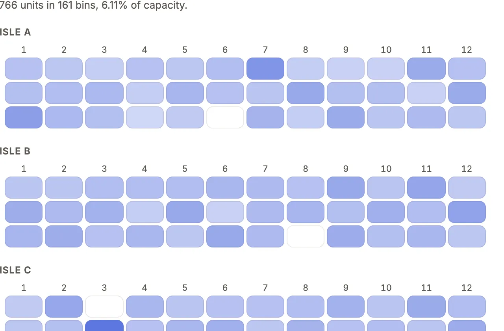

Draw what no built-in block draws with a React component of your own, fed by checked reads and changing data only through commands.

```sh
npm i -D rolldown @types/react
```

An App declares a component by an id and a module path inside its directory, and a section places it:

```ts
export const binMap = component('bin-map', { module: './widgets/BinMap.tsx' });

export const warehouseBins = custom('Floor', binMap, {
  rows: {
    bins: { from: 'bin', whose: 'warehouse_id', show: ['id', 'code', 'zone', 'capacity', 'units', 'active'], sort: 'code', limit: 500 },
  },
  figures: {
    bins: { from: 'bin', whose: 'warehouse_id', measure: 'count' },
    units: { from: 'bin', whose: 'warehouse_id', measure: 'sum units' },
  },
});
```

<!-- no sample: no sample App needs a component of its own; Ladle's free-form page is below. -->

The module, `widgets/BinMap.tsx`, draws with `@mistriwork/mistri/ui`.



## What you'll see

- The section stands among the page's built-in ones, with its title, in every look and in dark mode, because it draws with the looks' tokens.
- Its one read (`bins`) arrives as typed `rows`, and its two figures (`bins`, `units`) as exact `figures`, all compiled at load and run under the reader's grants, field projection and row policy; loading and errors are the platform's to draw.
- Edited from source, the module recompiles on save; `mistri build` bundles it, pinned to its version.

## When to use it, and when not

- Use a component only when no section, presentation, chart or display rule draws it, and the need is one App's: a bin map, a payroll timeline, a forum's post stream.
- Use [Choose a building block](/docs/choose/) first: a bug is fixed in the platform, and a need two Apps share is a platform gap to report, not a component.
- Use a [command](/docs/commands/) for anything the component changes: it never writes on its own.

## Options

| Kind | Declared | Placed | Props type |
| --- | --- | --- | --- |
| Section (default) | `component(id, { module, props })` | `custom(title, comp, { record, rows, props })` on a page or dashboard | `SectionProps` |
| Value | `kind: 'value'` | `resources.<r>.display.<column>` | `ValueProps` |
| Input | `kind: 'input'` | `resources.<r>.inputs`, an action's or a command form's `inputs` (`'trade.vin'` inside a group) | `InputProps` |
| List | `kind: 'list'` | `presentation: customList(comp, { show })` | `ListProps` |
| Page | `definePage({ path, label, reads, … })` in `pages/<path>.page.tsx` | Its own address and nav place; see [free-form pages](#free-form-pages) | `PageProps` |

`props` are JSON-safe: `prop.number({ default, min, max })`, `prop.text`, `prop.bool`, `prop.choice([...])`. `rows` holds up to eight named reads, `{ from, show, query?, sort?, limit? }`, tied to the record by `whose` on a page or to the window by `over` on a dashboard. Every key: [pages reference](/docs/dsl-pages/#pagessectionskindcustom).

## Write the module

```tsx
import { Empty, useFormat, useNavigate, type SectionProps } from '@mistriwork/mistri/ui';
import type { Rows } from '../mistri-schema.d.ts';
import type { warehouseBins } from '../pages/warehouse.ts';

export default function BinMap({ rows }: SectionProps<typeof warehouseBins, Rows, 'warehouse'>) {
  // rows.bins[0].code is a string, rows.bins[0].units a number
}
```

`@mistriwork/mistri/ui` is the only mistri module a component imports. It holds:

- **The kit**: `Card`, `Stack`, `Row`, `Heading`, `Button`, `Value`, `Tone`, `Meter`, `Stat`, `Columns`, `Table`, `Dropdown`, `Segmented`, `SplitListDetail`, `Empty`, `Icon`. `Table` draws each cell as a `Value`, dressed as the App dresses that column; sorting stays yours (`sort`, `onSort`), and `onRowClick` makes the first cell a link.
- **Reads**: `useRows`, `useRecord`, `useBreakdown`, `useFile`, all under the reader's grants, row policy and tenant.
- **Commands**: `useCommand(cmd)` with `available`, `reason`, `run` and `open`; an applied run resolves with the command's `output`.
- **The rest**: `useNavigate`, `useComposer` (fills the page's conversation box, never sends), `useViewer`, `useFormat`, `useMessage`, `useLook`, `useToken`, `useFlags`.

An id past 2^53 arrives as a string: draw it with `Value`, never through `Number()`.

### Figures

`figures` holds up to eight named aggregates: `{ from, measure, by?, whose?, query?, limit? }` on a page, `{ table, measure, by?, query?, over?, limit? }` on a dashboard. `measure` is `count`, or `sum`, `avg`, `min` or `max` over a column. They run on the server like a dashboard's metrics, under the reader's grants, with no SQL of the component's own. Counting `rows` instead counts at most the read's `limit`.

Without `by`, a figure is one value: a number, a string (a sum or id past 2^53) or `null` when no row matched. With `by` it is a list of `{ key, value, label? }`, biggest first, up to `limit` groups (100 by default, at most 500).

`useBreakdown(resource, { by, measure?, query?, limit? })` asks the same from the module, for a figure that follows a control. On a page it may ask only for the page's `reads`. Rows are keyed as the server names its columns (`sum(net)`), so prefer declared `figures` when the question is known; figures are checked at load, `useBreakdown` only when it runs.

### Types, values and styles

- `mistri check` writes `mistri-components.d.ts`: a props type per component, named from its id (`sales-summary` is `SalesSummaryProps`), from its declared props, reads, figures and record fields.
- A value component may export `label(value)`, the word each value of the column's vocabulary is said as, in breakdowns, legends, filter chips and the CSV export. It is synchronous and returns at most 80 characters; declared `values` win.
- Style with the tokens (`var(--surface)`, `var(--ink)`, `var(--accent)`, `var(--space-1)` to `var(--space-8)`, `var(--text-xs)` to `var(--text-xl)`…) and classes named `c-<component-id>-…`. `tokens` and the `Token` type list them all; `check` warns about a `var(--…)` that is none of them and names the nearest. An imported stylesheet is scoped to the component.
- `react`, `react-dom` and `@mistriwork/mistri/ui` are shared with the page, never bundled.
- Test with `@mistriwork/mistri/ui/testing` in Vitest: `renderSection(BinMap, warehouseBins, { data: fixtures<Rows>({ bin: [...] }) })` draws it over typed fixtures and records navigations and commands; `renderValue`, `renderList`, `renderPage` and `renderInput` draw the other kinds.

## Free-form pages

A page drawn whole by your code is one file, `pages/<path>.page.tsx`, from `@mistriwork/mistri/page`. Ladle's door list:

```tsx title="examples/apps/ladle/pages/check-in.page.tsx"
const page = definePage({
  label: 'Check-in',
  description: 'Tonight’s guests at the door: check each party in as it arrives.',
  icon: 'check-circle',
  nav: { position: 0 },
  reads: ['class_session', 'booking'],
  commands: ['checkIn'],
  params: ['class'],
  component: CheckIn,
});
```

See it in the sample (`examples/apps/ladle/pages/check-in.page.tsx:13`).

- The path is the file's name, and the address: `/check-in?class=2`. `home` may name a page by its path.
- `page.useRows`, `useRecord`, `useBreakdown` and `useFile` read only its `reads`; `page.useCommand` runs only its `commands`; `page.useParam('class')` keeps state in the address. Anything else is a type error, a `[page-undeclared]` problem in `check`, and refused by the server.
- A role is offered the page when it is granted every read (`roles` narrows it; `public: true` opens it within `auth.public`). `useCommand(…).granted` is false for a command the role lacks, so draw that button only where it is granted. A service role is offered a page only where the page names it.
- A `public: true` page may name `public: true` commands, and a signed-out visitor runs them through the page's own door. That door asks for the page's ticket, takes a request from the page's own origin only (never from a host that embeds it), and holds the run to the public form's rules. `run(record, input, { challenge })` passes a human check's token where `auth.challenge` names one. The answer is `{ reference, receipt }`, never the input.
- `authority.lock` records each page's reads, commands and loader. `<CommandForm command="…" />` is a command's own dialog behind a button.

A `loader` runs on the server for the reader and hands the component its `data`. It is exported from the commands module with `defineLoaders` and `defineLoader` (`@mistriwork/mistri/commands`); a page that names one it does not export, or one that reads past the page, fails `check` (`[page-loader]`):

```ts
export const loaders = defineLoaders({
  pickWalk: defineLoader({
    source,
    reads: ['pick_list', 'sales_order', 'warehouse'],
    async load({ db }) {
      const waiting = await db.pick_list.where({ status: 'to_pick' }).orderBy('released_at').limit(40);
// …
      return { lists: lists.sort((a, b) => (a.shipBy ?? '\uffff').localeCompare(b.shipBy ?? '\uffff')) };
```

Its `db` is read-only, holds only the tables it declares (each one the page reads too) and reads through the reader's grants, row policy and tenant. It has `params`, `viewer`, `now` and `signal`, ends after its `timeout` (`'5 seconds'` by default, at most ten) and returns at most 256 KiB of JSON. `mistri check` types `data` from what `load` returns. Give the component its own return type (`function PickWalk(): ReactNode`); without it TypeScript reports "'page' implicitly has type 'any'".

### Blocks

The platform's sections are components of `@mistriwork/mistri/page`, each taking its DSL helper's words as props and `from` for its table, one the page reads. Each loads when a page first draws it.

```tsx
<Grid>
  <Metric title="Open" from="ticket" query="status = open" width="third" />
  <Chart title="Opened" from="ticket" by="month opened_on" width="two-thirds" />
  <Panel title="This record" width="half"><RecordCard from="ticket" record={{ id: 7 }} /></Panel>
  <Tabs param="tab" tabs={[{ key: 'open', label: 'Open', content: <Rows title="Open" from="ticket" query="status = open" /> }]} />
</Grid>
```

- `<Rows title from query show sort limit />`: a dashboard's `rows()`.
- `<Metric title from query measure compare better format unit target />`: `metric()`.
- `<Chart title from by query measure shape format unit … />`: `chart()`.
- `<Breakdown title from by query measure limit format unit />`: `breakdown()`. `format="duration"` says a measure of seconds as "10h 2m", as on a dashboard.
- `<RecordCard from record show />`: the record as its page shows it, its name and verbs over its fields.
- `<Timeline from record />`: the record page's timeline.
- `<Tree from parent primary />` and `<Gantt from start end primary />`: a list's `tree()` and `gantt()`.
- `<Assistant />`: the App's assistant, where it declares one.
- `<Grid>`, `<Panel title width>` and `<Tabs tabs param>`: the layout, with `width` `full`, `half`, `third` or `two-thirds`.

A word a block does not take, or a resource the page does not read, stands as a problem note in the block's place.

## Security

A component is deployment code, trusted like `app.ts`, running in the reader's browser under the reader's session. The server stays the boundary: every read and command is authorized per request. The page's Content-Security-Policy allows only its own origin; `ui.csp.connect` and `ui.csp.images` open exactly the origins named, recorded in `authority.lock`. Importing `@mistriwork/mistri/commands`, server code, Node modules or files outside the App is refused at compile. Signed out, a component's reads are held to `auth.public`. The only commands it runs are the `public: true` commands of a public page. A page's loader cannot write, and is run only for a page the reader may open.

## Common mistakes

- "declares custom components, which are compiled with rolldown" at start → `npm i -D rolldown @types/react` in the App's project.
- `[component-markup]` or `[component-code-from-text]` fails `check` (exit 5) → draw React children; never `innerHTML`, `eval` or a string timer.
- `[component-color]`, `[component-radius]` or `[component-class]` warnings → use a token (`var(--accent)`, `var(--radius)`) and name classes `c-<id>-…`, so every look dresses it.
- A write from `fetch` is refused, or `useCommand` says a record's command is not granted though the role holds it → run the App's command with `useCommand`, which checks the grant, the record's revision and the command's `when`, and reach it through one of the resource's `actions`; one only the component runs takes `header: false`, which keeps it out of the record's bar, its More menu and every row menu.

## Related

- [Choose a building block](/docs/choose/): the built-ins to rule out first.
- [The general path](/docs/general-path/): Ladle's free-form page beside a host's own server and React app.
- [Component showcase](/components/): the kit and example components in every look.
- [Commands](/docs/commands/): what `useCommand` runs, and how it refuses.
- [Looks](/docs/looks/): the tokens a component draws with.
