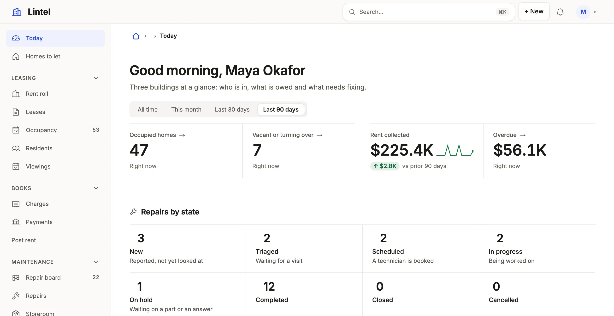

Put the figures that matter on one page, metrics, charts, breakdowns and waiting work, read over a window the reader picks.

```ts title="examples/apps/lintel/dashboards.ts"
export const today = dashboard(
  // …
  metric('Rent collected', 'charge', {
    // …
    over: 'due_on',
    // …
    better: 'up',
    // …
  }),
  // …
  {
    // …
    windows: ['this month', 'last 30 days', 'last 90 days'],
    window: 'last 90 days',
  },
);
```

See it in the sample (`examples/apps/lintel/dashboards.ts:8`) (abridged: the full dashboard adds occupancy, what is overdue, repairs by state, a chart of rent by month, a breakdown by building and two lists of work waiting).



## What you'll see

- A window button (This month, Last 30 days, Last 90 days) beside the filters; the pick is in the address (`?period=last-30-days`), and every section with `over` follows it.
- The dashboard opening on Last 90 days (`window`), and Rent collected over it, with its change against the 90 days before colored by `better: 'up'` and its trend under it. A metric with `over` shows both unasked; the trend is days over a month, weeks over a quarter, months over a year.
- Sections in rows by `width`, metrics in one strip; on a phone the metrics sit two to a row (an odd strip's first across the row), the other sections stack, and `aside` sections follow the main flow. With `areas` ([below](#place-sections-on-a-grid)) sections stand where you placed them.

## Place sections on a grid

Without `areas`, sections flow into rows by `width`. When one section has to stand beside a column of two others, name the areas of a grid and put each section in one:

```ts title="examples/apps/lintel/dashboards.ts"
export const today = dashboard(
  // …
  breakdown('Homes by building', 'unit', 'property_id', { to: 'units', area: 'building', icon: 'buildings' }),
  // …
  {
    // …
    areas: [
      'homes   homes   money    money',
      'repairs repairs repairs repairs',
      'trend   trend   trend    building',
      'leases  leases  viewings viewings',
    ],
  },
);
```

- One string per row, 1 to 8 rows. Each row has the same number of cells, 1 to 4, and the columns are equal, so `trend trend trend building` is three quarters and a quarter. A cell is an area's name (lowercase letters, digits and hyphens) or `.` for none.
- A section says its `area`. An area that covers two rows is that tall; several sections in one area stack, in the order you wrote them, and the last takes the height that is left. Metrics in one area are one strip.
- Every section names an area, except a `firstRun`, which leads the dashboard outside the grid. The area sets the width, so a section with an `area` takes no `width`, and `areas` is not written with an `aside`.
- `aside` is a column of context beside a dashboard that flows by `width`; a side area is part of one composed board whose rows line up. Say `aside` for context, `areas` when sections have to line up.
- A section left out by `empty: 'hide'` leaves its area when it was the area's only section: its cells go to the area on its left (the right one, for the first), and a row left empty is dropped.
- `mistri check` names a template that cannot be drawn in words (an area that is not a rectangle, one no section is in, a section in an area the template does not have). `mistri check --design` warns of `area-too-narrow`: a list or a matrix alone in a one-column area of a template three or four wide.
- With less than 13rem for each column (the dashboard's own width), the template becomes one column, the areas in the order they first appear, left to right, top to bottom.

## When to use it, and when not

- Use a dashboard for figures across many records: totals, trends, divisions, and short lists of what waits; it makes a good `home`.
- Use the same `metric`, `chart` and `breakdown` on a [record page](/docs/pages/) with `whose` for figures about one record.
- Use a [list](/docs/lists/) with `totals` instead when people need the rows behind a sum, and [behavior analytics](/docs/analytics/) for what people do in the App.

## Options

| Section | What it draws | Status |
| --- | --- | --- |
| `metric(title, table, opts)` | A figure; `compare`, `better`, `spark`, a `target` number or goal read from data; `to: 'tickets'` makes the card open that list on the rows it counted (the figure is its own `query` within the list's standing `query`, never a tab), `to: false` a card that opens nothing; `spark: false` draws no trend, windowed or not | Stable |
| `chart(title, table, by, opts)` | `shape`: `line`, `bar`, `donut` or `stacked`; by a column or `month close_date`; `curve: 'smooth'` on a line, `total: 'Leads'` in a donut's middle with each slice's share. `scatter` (with `x: 'count'` across and `measure` up), `heatmap` (by two keys, such as `'weekday moved_at, hour moved_at'`), `waterfall` and `treemap` | Stable |
| `funnel(title, table, stages, opts)` | Two to eight `stages` (`{ label, query?, optional? }`) a row passes in order, counted in one statement: each stage's rows, its share of the stage before it and the rows it lost; a stage opens the rows that reached it (`to`, as a chart's) | Stable |
| `breakdown`, `matrix` | Ranked bars by one key; counts or sums by two. `shape: 'steps'` draws a breakdown as a row of steps in the vocabulary's order, each with its count and a short `notes` line. `target: { from: 'quota', by: 'owner_id', measure: 'sum amount', over: 'period' }` reads each group's goal from another table and says each bar as a share of it | Stable |
| `rows`, `board`, `embed(view)` | Matching rows with a `limit` (and `empty`, what it says with none, as a list's), a board, one of the App's lists | Stable |
| `activity()`, `note()`, `firstRun()` | Recent changes, guidance, next steps while the tables are empty; `note(text, { variant: 'banner', title, eyebrow, action, image })` is a wide banner with one action | Stable |
| `custom(title, component, { rows, props, width })` | An [author's component](/docs/custom-components/), its `rows` narrowed by the window where they say `over`, handed the window as `period` and its `region`; as a record page places one | Stable |
| `find(title, resources, opts)` | One search box over several resources' records, the hits grouped by resource, each opening its record | Stable |
| `windows`, `window`, `over` | The picker's choices, in the query grammar (`this quarter`, `last 30 days`); the one the dashboard opens on (`window: 'last 30 days'`, else All time; `?period=` still wins); the date column a section follows, a computed date among them; `windowControl: 'button'` shows the picker as one date-range button instead of a segmented row | Stable |

Every section takes `query` (conditions, typed against its table), `measure` (`count`, `sum amount as won`, `avg`, `min`, `max`, `median`, or aggregates joined by `+ - * /`: `sum won / sum amount as rate`) and `width` (`third`, `half`, `two-thirds`). A metric with `over` compares with the period before the window unasked, as `compare: 'previous period'` says: a picked `last 30 days` against the 30 days before it (a calendar window, `this month`, shows no change). `compare: 'previous period'` without `over` shifts the query's one `last N days` phrase back; with neither, it is refused, since there is no date to window. A metric over a window also draws its trend across it; `spark: true` draws the last twelve months while no window stands. A chart groups by `day`, `week`, `month`, `quarter` or `year`, or lets the window choose: `chart('Signups', 'account', 'auto created_at', { over: 'created_at' })` is days over a month, weeks over a quarter, months over a year, and steps up again where the data is sparse; the chart says the unit it chose ("by week"), and a `median` follows the window alone. A week is said by its first day ("Oct 5"): Monday, or the first day of the App's `ui.locale` (Sunday in `en-US`). A dashboard follows changes as they happen ([live sync](/docs/live-sync/)), and re-reads what depends on the time each minute. Every key: [views reference](/docs/dsl-views/#viewskinddashboardsections).

A metric's data `target` that counts the same measure over the same table, with no condition the metric does not also hold, is the whole the figure is a share of: `metric('Approved', 'application', { query: 'status = approved', target: { measure: 'count' } })` says "118 of 159 (74%)" instead of "74% of 159 target", and the whole follows the metric's window and picks so both count one cohort. A target that cannot be shown to be a subset stays a goal.

A section with nothing to draw is left out with `empty: 'hide'` (any section but a metric); a `rows` section may instead say what it means with guidance. `empty: 'collapse'` is a record page's.

A group of a `breakdown`, `chart` or `matrix`, and a `funnel`'s stage, is a link to one of the App's lists, narrowed to the group: `to: 'tickets'` names it, `to: false` keeps the groups text, and without `to` it is the one list over the table that the reader is served. With none, or several, the groups are text (check says `drill-none` or `drill-ambiguous`): an App never opens the database browser from a dashboard. A bucketed `by` (`month close_date`) is never a doorway.

A heat map reads busy hours: `chart('Moves by weekday and hour', 'stock_movement', 'weekday moved_at, hour moved_at', { shape: 'heatmap' })`.

A portal's home finds anything the reader may read, from one box: `find('Find anything', ['article', 'catalog_item'], { placeholder: 'Search help and the catalog' })`. A resource is searched when the reader is served a list of it, by its records' names, through its search provider where it declares one.

## Common mistakes

- A warning that `better` has no `compare` → give the metric `over` (a date column), or drop `better`; there is no change for it to color.
- `[not-a-date]` on `over` → name a date or timestamp column; [dates and types](/docs/dates-and-types/) says which are.
- `median` refused on SQLite → it is PostgreSQL's (`percentile_cont`); use `avg`, or run on PostgreSQL.
- A section ignores the picker → give it `over: '<date column>'`; a section without one stays as its query says.

## Related

- [Blocks gallery](/docs/blocks/): every chart shape and block, pictured in Lumen.
- [Design a dashboard](/docs/compose-dashboard/): figures first, then how they move and divide, then what waits.
- [Query language](/docs/query/): the date phrases a window and a query can say.
- [Navigation and the shell](/docs/nav-and-shell/): making a dashboard the App's `home`.
- [Views reference](/docs/dsl-views/): every section key, generated from the schema.
