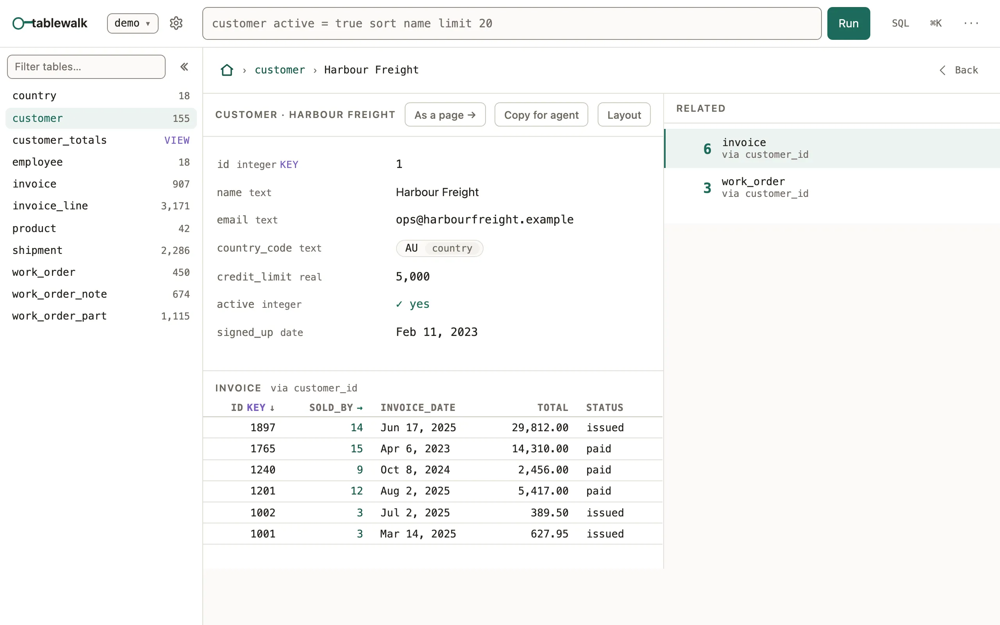

Open a PostgreSQL or SQLite database in the browser, follow its foreign keys both ways, and keep it read-only.

```sh
npx tablewalk postgres://reader@localhost/crm   # PostgreSQL
npx tablewalk ./crm.sqlite                      # a SQLite file
npx tablewalk --demo                            # no database yet: a throwaway sample
```



tablewalk is a product of its own, from the same repository as mistri: a
foreign key is a place you can go. It needs Node 24 or newer, no build step
and no config; `npx tablewalk --version` says which one you have. It serves no
App: `npx tablewalk --app …` is refused and names the `npx @mistriwork/mistri` command
that runs it, and mistri, in turn, serves no database browser. Apps run on
PostgreSQL and SQLite, like the browser; MySQL and MariaDB are not supported.

## What you'll see

- `Listening on http://localhost:4111`, then the database's tables. `--port`
  picks another port, `--open` opens the browser for you.
- A record shows its fields, then every table that points at it, each with a
  count. A reference such as an invoice's `customer_id` is a link to that
  customer; a table in the rail opens the rows that point here.
- The address changes at each step (`/crm/customer/~42`), so Back, a bookmark
  and a pasted link return to the same place.

## Ask, don't click

Type a question into the bar above a table, in the
[query language](/docs/query/) Apps use too:

```text
invoice total > 500 sort total desc
```

The condition is written into the address. Every one of these is a link you
can type, paste or send:

| Address | Opens |
| --- | --- |
| `/demo/customer` | A table. Any query works here, URL-encoded: `/demo/invoice%20total%20%3E%20500` |
| `/demo/customer/~42` | The customer whose key is 42 |
| `/demo/customer/~42/~invoice:9` | Invoice 9, reached from customer 42 |
| `/demo/customer!diagram` | A table's tab: `!rows`, `!ddl` or `!diagram` |
| `/demo/@customer~42` | A composed page, rooted at a record |

A `json` or `jsonb` column (SQLite `JSON` too) is laid out by its shape:
objects as fields, arrays of records as tables. Documents are read-only here.

## Read-only, and meant

Every read runs in a read-only transaction. Writing is an opt-in for each
connection (`"writable": true` in a config file), checked by the server in
every route and tool that writes, not by the UI. The database role is the
limit that always holds, so connect as one that can only read:

```sql
CREATE ROLE tablewalk_reader LOGIN PASSWORD '…';
GRANT USAGE ON SCHEMA public TO tablewalk_reader;
GRANT SELECT ON ALL TABLES IN SCHEMA public TO tablewalk_reader;
ALTER DEFAULT PRIVILEGES IN SCHEMA public GRANT SELECT ON TABLES TO tablewalk_reader;
```

tablewalk warns at startup when the role it connects as could do more than
read. To keep several databases, or a password out of your shell history,
name them in a config file:

```json title="tablewalk.json"
{
  "connections": [
    { "name": "crm", "url": "${DATABASE_URL}" },
    { "name": "local", "url": "sqlite:./crm.sqlite" }
  ]
}
```

```sh
DATABASE_URL=postgres://reader@localhost/crm npx tablewalk --config ./tablewalk.json
```

`${VAR}` reads the environment, and an unset variable is an error.

## For a coding agent

`npx tablewalk --mcp` gives an agent the same database as
up to twenty-three tools: seventeen that only read, and six writes listed only
for a writable connection. Every answer carries a link to the same rows in the browser.
[MCP for coding agents](/docs/mcp/)

## Common mistakes

- `Cannot find module 'pg'` → install the driver beside
  tablewalk: `npm install pg`.
- A reference shows as a plain value and leads nowhere → the database has no
  foreign key for it, and the walk follows only declared ones; add the
  constraint.
- The address answers nothing → another process holds port 4111; pass
  `--port 4112`.
- An old `#/…` link lands on the home page → the hash is not read; drop the
  `#` and the rest is the path.

## Related

- [Query language](/docs/query/): the bar's whole grammar, grouping and counting.
- [MCP for coding agents](/docs/mcp/): the tools, and how to wire them into an agent.
- [Keyboard](/docs/keyboard/): step through records with `j` and `k`.
- [Command line: database browser](/docs/cli-browser/): every flag.
- [an App from your database](/docs/quickstart-app/): turn the same database into a workspace for a team, with mistri.
