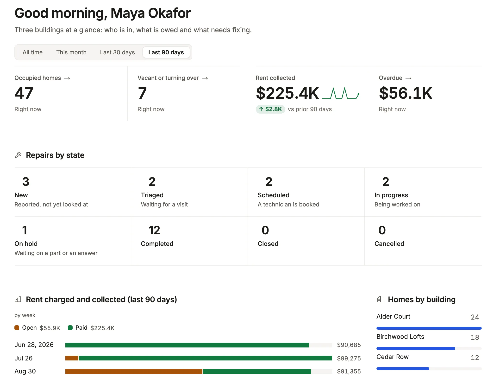

Know what a column's declared type lets it do (date windows, totals, yes or no) and declare SQLite text dates as dates.

```ts title="examples/apps/lintel/dashboards.ts"
    metric('Rent collected', 'charge', {
      query: 'kind = rent and status = paid',
      over: 'due_on',
      measure: 'sum amount as collected',
      better: 'up',
      // …
    }),
    // …
    chart('Rent charged and collected', 'charge', 'auto due_on, status', {
      query: 'kind = rent',
      over: 'due_on',
      measure: 'sum amount as rent',
      shape: 'stacked',
      // …
    }),
```

See it in the sample (`examples/apps/lintel/dashboards.ts:15`); [Sample Apps](/docs/examples/) says how to run Lintel. `due_on` is declared `DATE`, so it is a date.



## What you'll see

- A date column grouped by `day`, `week` or `month` (or `auto`, which picks the unit from the window), narrowed by a window (`over`), and offered date presets in filters (`last 7 days`, `next 90 days`).
- Numbers summed in totals and measures, and a yes/no column drawn as a check or a cross.
- Each column's kind in `mistri-schema.d.ts` under `Columns`, so query strings are typed as you write them: `'due_on = last 6 months'` passes, and a date phrase on a column that is not a date is an error at the string.

## When to use it, and when not

- Use the column's own type: declare `DATE`, `TIMESTAMP` or `timestamptz` for dates and `boolean` for flags. The kind comes from the declared type, never from the values stored.
- Use `types` on a resource only on SQLite, for a `TEXT` column of ISO dates you cannot rebuild the table to retype.
- Use a database view with a cast instead on PostgreSQL, which refuses `types` because the column's type already says it.

## Options

The declared type is matched as text, first rule first:

| Kind | The declared type contains | Examples |
| --- | --- | --- |
| boolean | `bool`, or an integer a `CHECK (flag IN (0, 1))` pins | `boolean`, `INTEGER CHECK (auto_renew IN (0, 1))` |
| number | `int`, `serial`, `numeric`, `decimal`, `real`, `double`, `float`, `money` | `bigint`, `numeric(12,2)`, `tinyint(1)` |
| date | `date` or `time` | `DATE`, `TIMESTAMP`, `timestamptz`, `DATETIME` |
| text | `char`, `text`, `uuid`, `json`, `enum`, `clob` | `varchar(80)`, `uuid`, `jsonb` |
| other | anything else, or nothing | `bytea`, `interval`, a PostgreSQL enum (its labels are a [vocabulary](/docs/vocabularies/)) |

On SQLite, `resources: { work_order: { types: { due_on: 'date', closed_at: 'datetime' } } }` makes the App read the column as a date. Its values must be ISO (`2026-09-24`, `2026-09-24 14:30:00`); anything else matches no window and groups as empty.

**Large numbers:** PostgreSQL `bigint`, `numeric` and `money`, and any integer past 2^53 arrive as strings, shown as written and never rounded. The generated `Rows` type says `string` (or `number | string`) for them, so a command handler converts on purpose. Every key: [resources reference](/docs/dsl-resources/).

**`now` and `today`, or `ctx.now()`:** in a declaration (an action's `set`, a field's or a machine's `default`, a New form's `auto`) write the words `now` and `today`. They are stamps, not values: the server works them out inside the write, in `ui.timezone`, so a request cannot choose them. In a command handler write `ctx.now()` and `ctx.today()` (`handle({ db, now, today })` takes them off the context): the same clock as a `Date` and a `YYYY-MM-DD` day, for code that computes with them, such as a due date `n` days on.

## Common mistakes

- `[not-a-date]`, or `"created_at" is TEXT, so the time window cannot narrow by it` → declare the column a date type, or on SQLite add `types: { created_at: 'date' }`.
- A SQLite `INTEGER` of epoch seconds treated as a number → store ISO text and declare it with `types`, or expose a view that converts it.
- An id shown as `9007199254740992` instead of its real value → it was run through `Number()` in your own code; keep it the string it arrives as.

## Related

- [Dashboards](/docs/dashboards/): windows, `over` and charts by day, week or month.
- [Query language](/docs/query/): the date phrases a query can say.
- [Lists](/docs/lists/): the calendar presentation, which needs a date column.
- [Display rules](/docs/vocabularies/): `format: 'relative'`, money and units.
