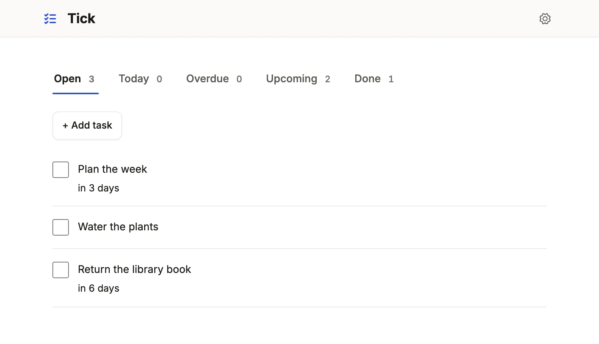

Three runnable sample Apps — Tick in one file, Lintel's property operations, Ladle's general path — what each shows, how to start it, where to look.

```sh
mkdir try && cd try && npm init -y && npm pkg set type=module
npm install @mistriwork/mistri typescript
cp -r node_modules/@mistriwork/mistri/examples/apps/tick ./tick
node node_modules/@mistriwork/mistri/examples/databases/tick/seed.mjs ./tick.db
npx @mistriwork/mistri --config ./tick.db.json --app tick
```

The samples ship in the npm package, seeds included; copy one out of
`node_modules` first, because Node does not run TypeScript from there. Tick is
a whole App in a single file. Lintel is the flagship, an App in modules with
its own test suite. Ladle is the general path: a host's own React site and
server with the App inside. All run on SQLite with synthetic data, Lintel on
PostgreSQL too, and each README holds the full recipe.

## Find a capability

| To see | Read |
| --- | --- |
| A whole App in one file, with inline types, quick add and autosave | [Tick](#tick) |
| Fixed actions that set a field | [Tick](#tick) |
| Roles that extend roles, field grants, and a resident who sees only their household under a row policy | [Lintel](#lintel): `app.ts`, `policy.ts` |
| State machines with groups, a timer on a date, stock a line consumes and a delivery restocks | [Lintel](#lintel): `resources.ts` |
| Commands that change several tables in one transaction, with refusals | [Lintel](#lintel): `commands/` |
| Boards, queues, a gantt, a calendar and cards refined from a rail | [Lintel](#lintel): `views.ts` |
| Dashboards with windows, comparisons, steps and charts | [Lintel](#lintel): `dashboards.ts` |
| Record pages: a conversation with a reply and note composer, a gallery, a price headline | [Lintel](#lintel): `pages/` |
| A landing page, a public listing and an anonymous form | [Lintel](#lintel): `landing.ts`, `views.ts`, `commands/viewing.ts` |
| A job, an event and the workflow it starts, and a signed callback | [Lintel](#lintel): `jobs.ts`, `late-fees.ts` |
| Email to a person with no account, only while they agreed | [Lintel](#lintel): `resources.ts` (`notify`) |
| An App's own tests in layers, with a clock and a browser | [Lintel](#lintel): `tests/` |
| PostgreSQL seeds | [Lintel](#lintel) |
| A free-form page beside declared lists, the handler in a server of your own, the App in a React app of your own | [Ladle](#ladle): `pages/`, `host/` |

The repository catalog (`examples/apps/README.md`)
names the file that shows each capability. What none of them shows (a CRM
pipeline, a theme of your own, tenancy, a forum, a warehouse) is a pattern in
the [agent skill's recipes](/docs/build-with-an-agent/) or the guides under
[Choose a building block](/docs/choose/), not a sample.

## Run a sample

Each seed takes a new database path, writes the database and a writable
connection file beside it (`<path>.json`), and refuses to overwrite either.
Lintel and Ladle sign people in, so they also need, once per shell:

```sh
export BETTER_AUTH_SECRET="$(node -e 'console.log(require("node:crypto").randomBytes(32).toString("hex"))')"
export MISTRI_AUTH_ADMIN_EMAIL=admin@example.test MISTRI_AUTH_ADMIN_PASSWORD=a-long-local-password
```

The first start creates that administrator; sign in with it. Each server
prints its address, `http://localhost:4111/` unless you pass `--port`.

## Tick



A to-do list in one `app.ts`: a checklist with quick add, a New form whose
date hides once a task is done, Complete and Reopen actions, a hand-kept
order and autosave. No menu, no sign-in.

```sh
cp -r node_modules/@mistriwork/mistri/examples/apps/tick ./tick
node node_modules/@mistriwork/mistri/examples/databases/tick/seed.mjs ./tick.db
npx @mistriwork/mistri --config ./tick.db.json --app tick
```

From a source checkout, the same files are under `examples/`:
`npm run start -- --config /tmp/tick.db.json --app examples/apps/tick`.

Open `/`, then the **Overdue** tab, then a task. Follow
[Tick in fifteen minutes](/docs/tick-tutorial/) to change it.
README (`examples/apps/tick/README.md`)

## Lintel

A property company's three Denver buildings, run from one App by two
audiences. The office works a staff desk: leasing, a manager, technicians
and an accountant, with a rent roll edited in place, an occupancy gantt, a
repair board and Today, a dashboard of the morning. Residents sign in to the
same App and see only their own household: their charges, their repairs and a
conversation with the office. Signed out, a visitor browses the homes to let
and asks for a viewing. Rent is posted by a job on the first of the month, a
late-fee workflow follows it, parts used on a repair come off the
storeroom's shelf, a finished repair emails the resident, and the payment
processor's signed callback settles a charge once. It wears Lumen.

```sh
export LINTEL_MAIL_SECRET=$(openssl rand -base64 24) PAYMENT_CALLBACK_SECRET=$(openssl rand -hex 16)
cp -r node_modules/@mistriwork/mistri/examples/apps/lintel ./lintel
LINTEL_APP=./lintel node node_modules/@mistriwork/mistri/examples/databases/lintel/seed.mjs ./lintel.db
npx @mistriwork/mistri --config ./lintel.db.json --app lintel \
  --jobs lintel/jobs.ts --policy lintel/policy.ts --port 4610
```

Keep the two secrets exported in the shell that starts the server. From a
source checkout, use `node --import tsx examples/databases/lintel/seed.mjs`
and `npx tsx packages/mistri/src/server/index.ts` with the `examples/apps/lintel` paths.

Open `/` signed out for the front page and `/listings`, then sign in as the
administrator for Today, `/leases` and `/repair-board`. On PostgreSQL,
`seed-postgres.mjs` takes an empty database. The
README (`examples/apps/lintel/README.md`)
says what each file teaches. Read the App piece by piece in
[the DSL in one App](/docs/dsl-tour/).

### Where to read in Lintel

- `app.ts`: the roles, home rules by role and the shell.
- `resources.ts`: what each table says once, including the machines.
- `commands/`: every business write, one module for each part of the business.
- `policy.ts`: the row policy, and the services the jobs run as.
- `jobs.ts`, `late-fees.ts`, `events.ts`: the monthly job, the workflow and the signed callback.
- `views.ts`, `dashboards.ts`, `navigation.ts`, `landing.ts`, `pages/`: the screens.

### Lintel's tests

`tests/` is the App's own suite, written on `@mistriwork/mistri/testing` and
Playwright alone, the way an App's repository would hold it, and the worked
reference for [testing an App in layers](/docs/testing-apps/). It starts the
App with its jobs and policy (`start.ts`), then checks every grant in
`authority.lock` as a matrix (`permissions.test.ts`), rent posted once and
the late-fee workflow on a test clock (`ledger.test.ts`), a repair's visit,
parts and consent-gated email (`maintenance.test.ts`), the signed payment
callback (`integrations.test.ts`), a resident's portal (`portal.test.ts`)
and the public, staff and phone journeys in a browser (`*.spec.ts`).

```sh
node scripts/test-node.mjs examples/apps/lintel/tests/*.test.ts
npx playwright test --config examples/apps/lintel/tests/playwright.config.ts
```

## Ladle

A cooking school: classes, bookings and a check-in page for the door, inside
the school's own React site. [The general path](/docs/general-path/) in one
project: the check-in page is drawn whole by the App's own code
(`pages/check-in.page.tsx`); the school's Node server mounts the App's handler
beside a JSON route of its own (`host/server.ts`, `host/schedule.ts`); and the
school's site, in its own design, embeds the staff App under its header with
`@mistriwork/mistri/react` (`host/main.tsx`).

```sh
cp -r node_modules/@mistriwork/mistri/examples/apps/ladle ./ladle
LADLE_APP=./ladle node node_modules/@mistriwork/mistri/examples/databases/ladle/seed.mjs ./ladle.db
npx @mistriwork/mistri --config ./ladle.db.json --app ladle
```

That serves the App on its own. For the school's site around it, install the
host's dependencies (`npm install vite @vitejs/plugin-react react react-dom tsx`)
and run `npx tsx ladle/host/server.ts ./ladle.db.json 4620`: `/` is the public
schedule, `/staff` the App. The README (`examples/apps/ladle/README.md`) has the
source-checkout recipe.

## Related

- [Tick in fifteen minutes](/docs/tick-tutorial/): four edits to the running Tick.
- [The DSL in one App](/docs/dsl-tour/): Lintel read from top to bottom.
- [The general path](/docs/general-path/): Ladle's three seams, explained.
- [An App from your database](/docs/quickstart-app/): the same shape over your own database.
- [Build with a coding agent](/docs/build-with-an-agent/): an agent reads these samples as its worked examples.
