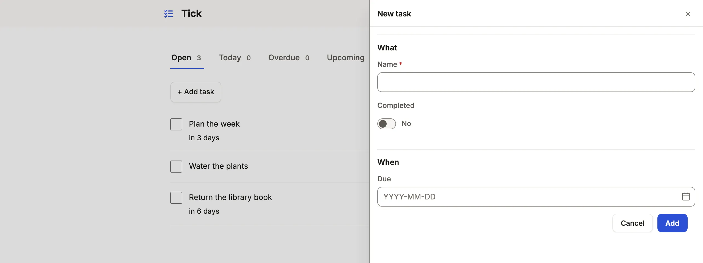

Curate the New form and record editing of a table, which fields in which groups, their defaults and help, and when Save happens.

```ts title="examples/apps/tick/app.ts"
      form: {
        defaults: { completed: false },
        groups: [
          { label: 'What', fields: ['name', 'completed'] },
          { label: 'When', fields: ['due_on'] },
        ],
        // …
        when: { due_on: 'completed = false' },
      },
```

See it in the sample (`examples/apps/tick/app.ts:36`). The resource says `access: 'write'`; a form without a `form` key is drawn from the schema all the same.



## What you'll see

- **New** opens the list's `open` surface (a modal in Tick; a drawer by default for eight fields or fewer, a page for more or for `steps`), the inputs in the groups' order, `completed` filled with its default.
- Each input drawn from its column: a vocabulary of four words or fewer as radios, a longer one as a listbox, a reference as a typeahead, a date as a picker, prose as several lines. An input that may be left empty says "(optional)" right after its label.
- An existing record edits with Save and Discard (Tick saves on blur instead, `editing: { save: 'blur' }`); a refusal marks the field it names, in the server's words.

## When to use it, and when not

- Use a resource `form` when people create or edit a record's own columns, and the server's checks are the table's columns and its `validation`.
- Use an [action](/docs/actions/) instead for a fixed change (Mark lost), and a [command](/docs/commands/) when the change is checked against stored state, who acts, or several tables in one transaction.
- Use a [command form](/docs/command-forms/) for a guided or public form (an application, a sign-up) that makes rows through a command.

## Options

| Key | What it does | Default | Status |
| --- | --- | --- | --- |
| `groups` | `{ label, description?, fields }`; the inputs are the groups' fields, in order, rows as in `show` | none | Stable |
| `show` | The inputs, in order, when there are no `groups` or `steps`; an inner list is a row, side by side: `[['email', 'phone'], 'company']` | every writable column | Stable |
| `defaults` | Values a new record starts with; `today`, `now` and `me` from `@mistriwork/mistri/app` | none | Stable |
| `fields` | Per input: `label`, `help`, `placeholder`, `multiline`, a reference's `where`, `as` (`'cards'`, `'buttons'`, `'radios'` or `'select'` for a vocabulary or a flag; `category: { as: 'cards' }`) | the column's | Stable |
| `when` | `{ salary: 'pay_type = salary' }`: an input shown only while the draft matches; a computed column is worked out from the draft | always | Stable |
| `steps` | `{ label, fields }` a step at a time, under a progress bar; `fields` takes rows as `show` does | none | Stable |
| `open`, `description` | `'drawer'` or `'page'`; one sentence under the heading | by size | Stable |
| `lines` | Child rows as a grid, inserted with the record in one transaction ([lines](/docs/order-lines/)) | none | Stable |
| `live` | Computed columns and rollups said as the form is filled in | none | Stable |

A row is up to three fields read together, drawn side by side at one height in the drawer and on the page, and as one column once the form is too narrow for them (a phone's drawer). A help line or an error stays under its own field. A field stands in one row; with `steps` and `groups` both written, a row stands inside one group.

`text` sits beside it too: `text: { email: { pattern: '[^@\\s]+@[^@\\s]+\\.[^@\\s]+', message: 'Enter an email address.' } }`, with `min`, `max` (characters) and `pattern` (the whole value), said under the field as it is typed and held on every write. On PostgreSQL a `varchar(80)`, a `CHECK (char_length(name) >= 2)` or a `CHECK (code ~ '^[A-Z]{3}$')` gives the same rule without it; what the App writes wins, key by key.

`validation` sits beside `form` on the resource and holds on every write: `{ must: 'close_date >= created_on', when?: 'stage = closed_won', message }`. A rule may read through one reference, so a line keeps a rule about its parent — `{ must: 'order_id.status = bench', message: 'Parts go on only while the order is on the bench.' }` — judged on the server against the order as the write sees it, and said at `order_id`. A rule may name a computed column, the record's own or the referenced record's (`{ must: 'total > 0', message: 'Charge something.' }`), and a default may come from one (`{ from: 'service_id.list' }`): it is worked out of the stored row, unless it reads a rollup, another record or `me`. `delete: true` offers Delete, and `ui.editing.save: 'blur'` saves a field when it loses focus. An App has no Undo: a Save carries the values it showed, so one over a record someone changed since is refused rather than written over theirs. Every key: [resources reference](/docs/dsl-resources/#resourcesform).

## Common mistakes

- `show` and `groups` both written is refused → write `groups` alone; `show` is read from them, as from `steps`.
- `[new-cannot-form]`: New is missing for a role → add the column a new row needs to the role's `fields.<table>.write`, or make the row with a command.
- `[command-and-edit]` on a table a command writes → narrow the role's `write` columns, or give the table a `machine`, so a Save cannot undo the command's work.
- A form `when` is mistaken for a permission → it only hides an input; the server accepts what the role may write. Narrow access in [roles](/docs/roles/).

## Related

- [Design a form](/docs/compose-form/): grouping, help text, and what a form leaves out.
- [Display rules](/docs/vocabularies/): the words, tones and formats inputs and values share.
- [Command forms](/docs/command-forms/): guided, public and saved-on-every-step forms.
- [Resources reference](/docs/dsl-resources/): every form key, generated from the schema.
