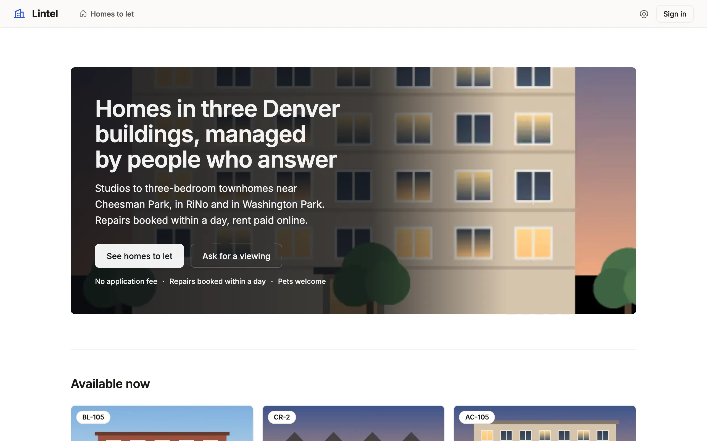

Greet signed-out visitors with a front page, and, where you allow it, let them read chosen records without an account.

```ts title="examples/apps/lintel/landing.ts"
export const lintelLanding = landing(
  hero(
    'Homes in three Denver buildings, managed by people who answer',
    // …
    [{ label: 'See homes to let', to: 'listings' }, applyTo('request-viewing', 'Ask for a viewing', 'secondary')],
    {
      // …
      highlights: ['No application fee', 'Repairs booked within a day', 'Pets welcome'],
    },
  ),
  [
    embed('listings', { title: 'Available now', limit: 6, sort: 'available_on' }),
    // …
  ],
  { label: 'Lintel: homes to let in Denver' },
```

See it in the sample (`examples/apps/lintel/landing.ts:6`) (abridged: the full page adds questions and a closing call to action). Lintel declares it as `welcome: lintelLanding` in `views`, and opens it for signed-out visitors with `home: [{ view: 'welcome', signedOut: true }, …]`.



## What you'll see

- At `/`, signed out, the landing in the App's own look under a top bar, the brand, the public entries and **Sign in**, in place of the staff sidebar; signed in, `/` is the App's home, and `/welcome` previews the landing.
- The hero's photo, a row of a public file resource, beside the words (`layout: 'split'`; Lintel's hero sets its words over the photo with `layout: 'overlay'`), and lists of public records as cards below it.
- Public pages arrive drawn, each with its title, a canonical link and a share card, and listed in `/sitemap.xml`.

## When to use it, and when not

- Use a landing when an App that signs people in has visitors who should learn what it is first; an App has at most one, and it needs `auth`.
- Use `auth.public` when visitors should read real records (a catalog, a forum); without it a landing reads no data at all, only what the App's definition says.
- Use a public [command form](/docs/command-forms/) instead when visitors only send something (an application, a report), and nothing is read back.

## Options

| Helper or key | What it does | Status |
| --- | --- | --- |
| `hero(heading, description?, actions, { image, layout, search, highlights })` | The one heading; one to three actions: `{ label, to }`, `signIn(label)`, `applyTo(form, label)` | Stable |
| `hero(…, { badge, tiles, points })` | `badge: { text, icon? }`, a short line above the heading (40 characters); `tiles`, two to four photos from a public file resource in a mosaic beside the words, in place of `image`; `points`, up to four `{ icon, text }` rows, in place of `highlights` | Stable |
| `features`, `steps`, `faq`, `text`, `contact` | Points, numbered steps, questions, prose, links; up to twelve sections in all | Stable |
| `callToAction(title, description?, actions)` | A closing prompt with one to three actions | Stable |
| `embed(view, { limit, sort })`, `search(view, filters)` | Records of a cards list; a search over a list's filters (both need `auth.public`); a filter the list `suggest`s suggests here too | Stable |
| `auth.public` | `{ read: [...], fields }`: resources a signed-out visitor reads, read-only | Stable |
| a resource's `slug: true` | A public record's address carries its name; any other spelling answers 301 | Stable |

Everything on a landing is plain text, never HTML or Markdown, with length limits checked at load; a link is `https://`, `mailto:` or `tel:`. The footer is the App's `ui.footer`. Every key: [views reference](/docs/dsl-views/#viewskindlandinghero), [auth reference](/docs/dsl-auth/#authpublic).

## Search engines and link previews

With `auth.public`, public pages are served ready to read; there is nothing to configure. What a visitor may read decides what each of these says: a row or field the public grant or row policy hides never appears in the HTML, the sitemap or a preview.

- **Pages arrive drawn.** A public list, a record, the landing and a public form come with their content in the HTML, so a crawler or a reader without scripts sees it. The App takes the page over when it starts, and nothing on screen moves. `MISTRI_SSR=0` turns this off; titles, canonical links, preview tags and the sitemap stay.
- **Every page names itself**: its `<title>`, a `<link rel="canonical">`, and Open Graph and Twitter tags. A record with `slug: true` carries its name in its address, and any other spelling answers 301.
- **`/sitemap.xml`** lists every public address, under the address `mistri check --routes` prints; past 10,000 it becomes an index. **`/robots.txt`** keeps crawlers out of the API and points to the sitemap.
- **Share cards.** A page without a photo previews with a 1200×630 card the server draws in the App's look (`GET /api/og?path=…`), when `satori` and `@resvg/resvg-js` are installed; a record with a photo previews with its photo.
- **Pictures at the size they are drawn.** Cards, galleries, record photos and a hero ask for a width (`srcset`; `w` is 160 to 1920), after the same read as the full file, and the page offers AVIF and WebP through `<picture>` with the format in the address (`&f=avif`), so a CDN keeps one copy of each. A bare `&w=` still answers by `Accept`. Resizing needs `sharp`; without it every width sends the original. Copies are kept on disk up to 256 MB, in a private temp folder unless `MISTRI_IMAGE_CACHE` names one, and in the file resource's bucket too when it has one, so instances share them.
- **Who may keep a picture.** A picture read by nobody in particular (an App with no sign-in, or a signed-out visitor to a resource under `auth.public`, without a row policy) is sent `public, max-age=86400, stale-while-revalidate=604800`, and `public, max-age=31536000, immutable` when its address names its bytes (`&h=`, which a public page writes where the file resource keeps a `thumbnail` and a `hash`). A picture read by a person, or under a row policy, is always `private, no-cache`.
- **No shift when it arrives.** A public picture is made at upload in AVIF and WebP at 320, 480, 640, 960 and 1280 pixels, with its average color and proportions kept; the server's drawing of a public page sets `width`, `height` and a background color from them, and `…&meta=1` returns them as JSON.

## Common mistakes

- "A landing view requires `auth`" → add `auth` with a provider; an App without sign-in has no signed-out visitor to greet.
- An `embed` or `search` refused without `auth.public` → name the list's tables in `auth.public.read`, within the roles' own read.
- `[authority-lock]` after adding `auth.public` → the grant is part of `authority.lock`; review it, then `mistri check --app . --write-authority` and commit the lock.
- A link to `http://` or `javascript:` refused → use `https://`, `mailto:` or `tel:`.

## Related

- [Sign-in](/docs/sign-in/): providers, sign-up and the sign-in screen the landing's action opens.
- [Command forms](/docs/command-forms/): the public form an `applyTo` action opens.
- [Navigation and the shell](/docs/nav-and-shell/): `home` rules and the footer.
- [Lintel](/docs/examples/): the property sample, signed out and signed in.
