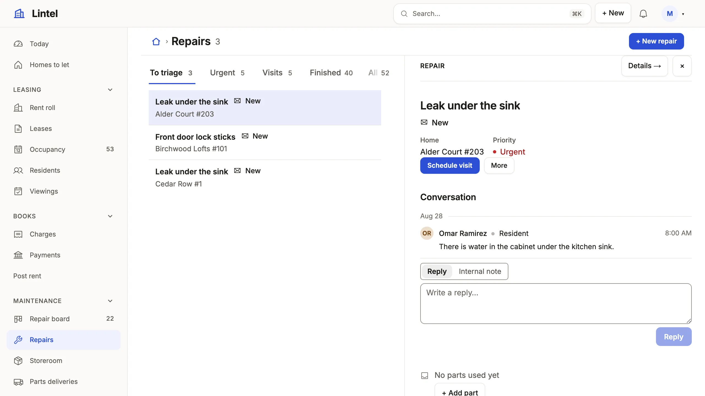

Show a table's rows the way the work divides, by tab, filter and sort, as a grid, cards, a board, a queue or a calendar.

```ts title="examples/apps/lintel/views.ts"
  repairs: listView('Repairs', 'maintenance_request', {
    icon: 'wrench',
    roles: [...OFFICE, 'technician'],
    show: ['title', 'unit_id', 'category', 'priority', 'status', 'assigned_to', 'reported_on', 'scheduled_on'],
    filters: ['status', 'category', 'priority', 'assigned_to', 'unit_id.property_id'],
    // …
    split: { row: { primary: 'title', lines: ['unit_id'], badge: 'status' } },
    tabs: [
      { segment: 'to_triage', sort: 'reported_on' },
      // …
      { label: 'All', sort: 'reported_on desc' },
    ],
  }),
```

See it in the sample (`examples/apps/lintel/views.ts:143`) (some tabs left out); each tab names a segment, a condition declared once on the repair resource in `resources.ts`. [Sample Apps](/docs/examples/) says how to run Lintel.



## What you'll see

- A tab per slice of the work, each counted; the open tab is in the address (`/repairs?tab=urgent`), and so is every filter and sort (`?priority=urgent&sort=-reported_on`).
- A bar of filters over the rows (`filterBar: 'rail'` turns it into a rail of counted facets, as the public listings do); `unit_id.property_id` filters by the building a repair's home is in.
- The repair picked opens beside the list (`split`), its conversation drawn whole with its verbs in its head; on the Ledger each row carries its own verbs in a ⋯ instead (`rowActions`). A column named in `editable`, as on the Rent roll, edits in place (Enter or F2).

## When to use it, and when not

- Use a list when people find, compare and work many records of one table; pick its `presentation` from [Choose a building block](/docs/choose/#show-rows): a grid to compare, `cards` to look at, `board` for stages, `queue` for an inbox, `split` to read one after another, `calendar` for dates.
- Use a [record page](/docs/pages/) instead for one record and everything around it, and a [dashboard](/docs/dashboards/) for figures across tables.
- Use a [command](/docs/commands/) with `targets: 'many'` instead of a bulk action when many records must change in one transaction.

## Options

| Key | What it does | Default | Status |
| --- | --- | --- | --- |
| `show` | Columns and label paths, 4–7, the name first | the table's columns | Stable |
| `tabs` | `'segment'`, `{ segment, sort? }` or `{ label: 'All', sort? }`, the first opens; the conditions are the resource's `segments` | none | Stable |
| `query` | Standing conditions every tab narrows further | none | Stable |
| `sort` | `'created_on desc'`, or named orders `[{ label, sort }]` as a Sort menu | the key | Stable |
| `filters`, `filterBar`, `suggest` | Filter boxes; `filterBar: 'rail'` draws counted facets; a path filters by a parent's column (`'account_id.industry_id'`), `{ has: 'opportunity', filter: 'stage' }` by the rows that point at the record, counted as records; `suggest: { title: ['make', 'model'] }` has a text filter offer up to eight values of those columns as the person types, read through their grants | none; a bar | Stable |
| `presentation` | `queue()`, `calendar()`, `cards()`, `checklist()`, `customList()`; `tree('parent_account_id', 'name')` folds records under their parent, `gantt('starts_on', 'ends_on', 'name', { by: 'kind' })` draws spans between two dates (**Preview**: `gantt` may change in any 1.x release); a card may reach one hop through a reference (`cards('vehicle_id.title', { image: { about: 'vehicle_id', from: 'vehicle_photo', whose: 'vehicle_id' } })`) | a grid | Stable, `gantt` Preview |
| `board` | `{ by, primary, … }`: lanes of cards by one column; `category` puts a colored tag on each card, `footer: [{ column: 'close_date', icon: 'calendar' }, 'team']` a row of up to four facts under it | no board | Stable |
| `split` | `{ detail, limit, row }`: the list beside the picked record; `row: { primary, lines, properties, badge, avatar }` says how a row reads, and the view's `shortcuts: { s: 'startWork' }` binds single keys to the picked record's actions (shown beside each verb, off while an input has focus) | no split | Stable |
| `editable`, `totals`, `rowActions` | Cells edited in place, sums over the whole tab, a row's own actions | off | Stable |
| `open`, `order`, `import` | `'drawer'` or `'modal'`; a column people drag rows by; Import from CSV | page; none; off | Stable |
| `opens` | a reference column: a row opens the record it names, so a list of `ticket_watcher` opens each ticket; a grid only | the row | Stable |

A tab's `query` is the [query language](/docs/query/) without the table name: `status = open and due_on < today`, `close_date = next 90 days`, `account_id.rating = hot`. With the generated `mistri-schema.d.ts` beside the App, every query string is typed: `` `amout` is not a column of opportunity `` is a type error at the string. That needs exactly one App's schema in the TypeScript project; with none or two, the types stand down and `check` judges the strings ([the limit](/docs/app-dsl/#typed-query-strings)). Every key: [views reference](/docs/dsl-views/#viewskindlisttabs). Each presentation is pictured in the [blocks gallery](/docs/blocks/).

## Common mistakes

- `[query-grammar]` on a tab that says `status = open sort due_on` → move the order to the tab's own `sort: 'due_on'`; `query` holds conditions.
- A column of keys (`owner_id` shows 7) → show the label path `owner_id.name`, or give the resource a `recordLabel`.
- `[unknown-column]` in `show` or `filters` → the catalog lists the table's columns; `mistri schema --brief` prints them one table to a line.

## Related

- [Design a list](/docs/compose-list/): which columns, how many tabs, where the filters go.
- [Query language](/docs/query/): every operator and date phrase a tab can say.
- [Display rules](/docs/vocabularies/): the tones, words, money and units every cell is drawn with.
- [Views reference](/docs/dsl-views/): every list key, generated from the schema.
- [Segments](/docs/segments/): name a query once and use it as a tab, a metric or a word.
