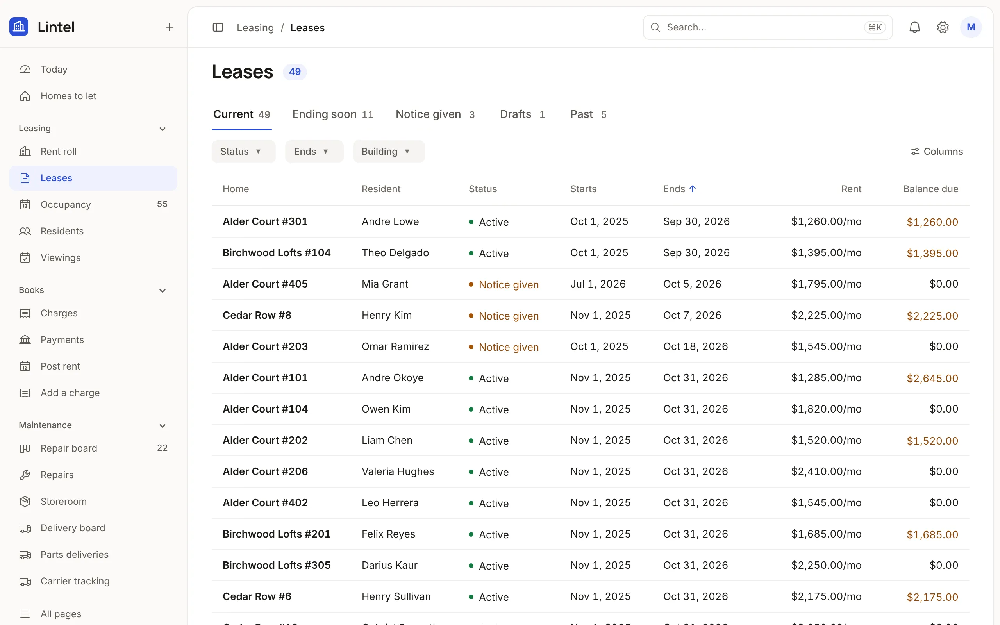
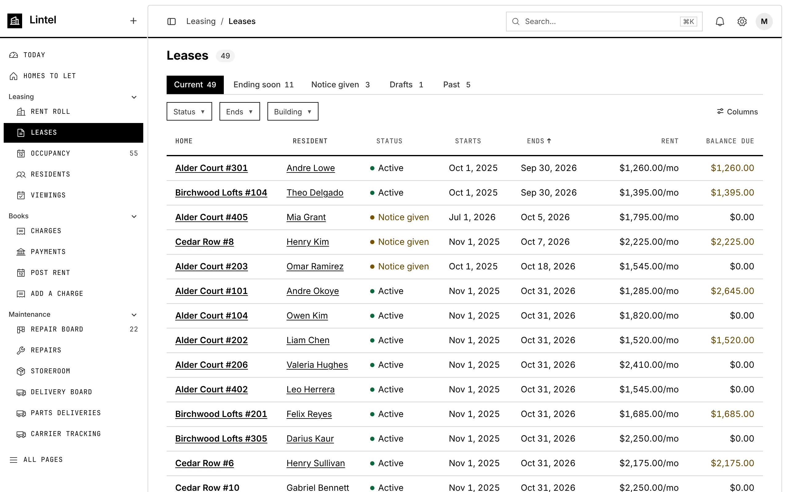
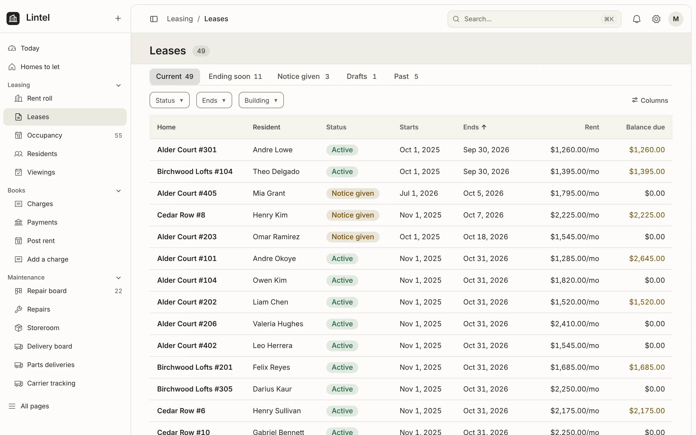
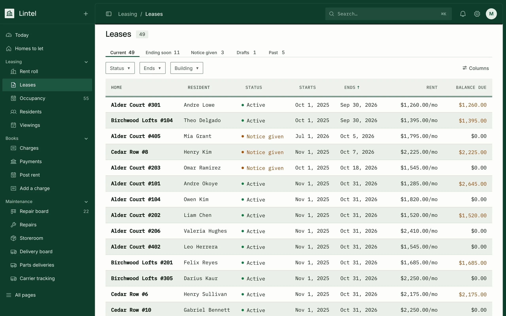
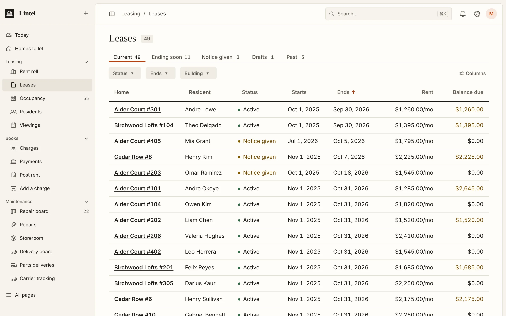
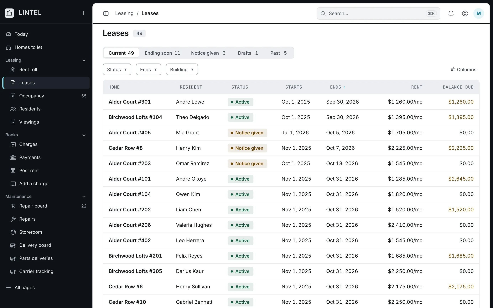
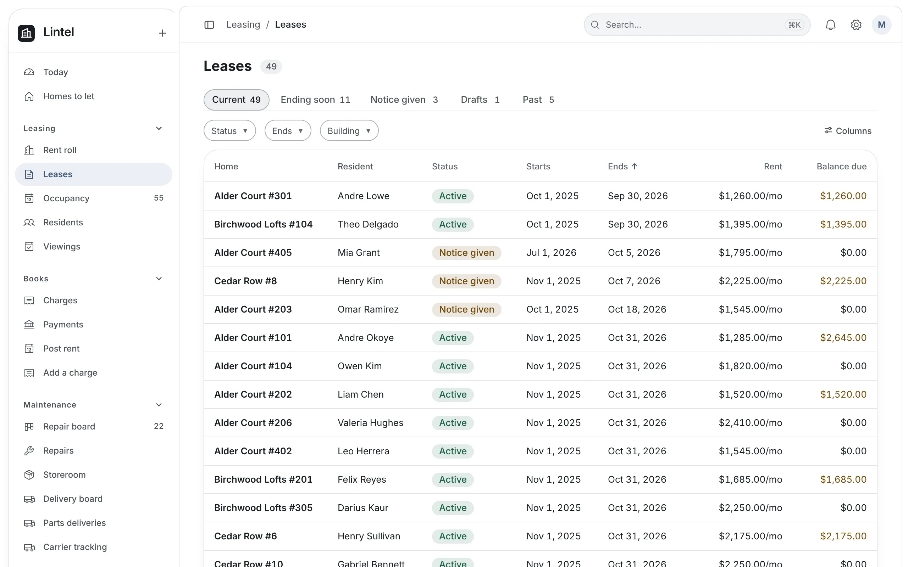

Dress an App in one of eight built-in looks, adjust its accent and corners, or register a look of your own.

```ts title="examples/apps/lintel/app.ts"
  ui: {
    logo: 'buildings',
    theme: { preset: 'lintel' },
    customThemes: [lintel, blueprint, hearth, tidelight],
    shell: {
      placement: 'side',
      rail: true,
```

See it in the sample (`examples/apps/lintel/app.ts:176`): Lintel names a look of its own (Lumen with one recipe changed, `theme.ts`), offers three more in the reader's picker ([Blueprint](/docs/themes/#a-look-of-your-own), Hearth, `hearth.ts`, and [Tidelight](/docs/themes/#a-brand-in-one-block)), and folds its side menu to a rail. `ui: { theme: { preset: 'sage' } }` picks another built-in look, `palette: 'cobalt'` one of the twelve palettes every look offers; `theme: { accent: '#2258cf', radius: '8px' }` adjusts the accent and corners of the one it names.



## What you'll see

- The same rooms, structure and type scale in every look, light and dark; a look changes color, face and corners, never what is shown or who may change it.
- Readers may pick another look, one of the twelve palettes, and System, Light or Dark under Preferences, kept in their browser; the App's choice is the default.
- The accent dresses the selected tab, links, the filled button and the first series of every chart; the database browser and the Workbench keep their own look.

## The eight, side by side

Lintel's leases in each look. Every component in every look is in the [component showcase](/components/).

<div class="tw-looks">
<figure>

<figcaption><strong>Workshop</strong> — the default. A shop floor's paper and ink, the paper on the frame: a grained paper bar and menu and a paper band behind each page's head, the work on white, Barlow with titles in its condensed bold in sentence case and the App's name in condensed capitals, square 2px corners, hairlines, and one restrained accent — the filled primary key, links, the current tab's rule, the menu's marker beside a soft tint, the focus ring and the first chart series; Safety orange unless a palette is named.</figcaption>
</figure>
<figure>


<figcaption><strong>Lumen</strong> — a precision workspace set in Inter with lining tabular figures: white surface cards lifted on a cool slate ground, a navy primary, statuses as dotted tinted pills, stat cards with tinted marks and sparklines, framed data tables, gradient charts and boards headed by strip lanes; Cobalt unless a palette is named. Opt in with <code>preset: 'lumen'</code>.</figcaption>
</figure>
<figure>



<figcaption><strong>Mono</strong> — black and white: square corners, monospace labels, the current tab inverted. Opt in with <code>preset: 'mono'</code>.</figcaption>
</figure>
<figure>



<figcaption><strong>Sage</strong> — a soft workspace: a dashboard's panels in white on cream, tables open on the ground, sage-green charts, statuses as tinted pills. Opt in with <code>preset: 'sage'</code>.</figcaption>
</figure>
<figure>



<figcaption><strong>Ledger</strong> — a bookkeeper's desk: green-tinted paper on faint graph paper, a dark green cover for the menu, figures, ids and labels in a monospace, field groups and sections as ruled boxes, a double rule under every table's column heads, and one deep ledger green. Opt in with <code>preset: 'ledger'</code>.</figcaption>
</figure>
<figure>



<figcaption><strong>Atelier</strong> — a printed page: warm paper, the machine's book serif for titles and large figures, sections named in small capitals, column heads in sentence case, a row opened by its underlined name, nothing boxed and nothing floating; the primary button in the ink and a rust second color unless a palette is named, on paper that stays warm under every one. For what is read more than it is worked. Opt in with <code>preset: 'atelier'</code>.</figcaption>
</figure>
<figure>



<figcaption><strong>Graphite</strong> — an instrument: cool grays under a white page, a near-black menu by day and by night, labels in tracked monospace capitals, tabs as keys in a sunken track, a list's heads on a band over rows that tint under the pointer, figures as the cells of one card and statuses as dotted pills; one primary, the ink, and one cyan signal unless a palette is named. Tight and compact, for people in it all day. Opt in with <code>preset: 'graphite'</code>.</figcaption>
</figure>
<figure>



<figcaption><strong>Bloom</strong> — soft and round: a ground in the palette's faintest tint (gray under Slate, its default) with everything on it a white tile, the menu a card standing off the window's edge, a dashboard's figures as wells in the tint, a record's states as one segmented bar, a list as one tile with its rows ruled apart, buttons and tabs as pills and the primary one in the hue itself. Opt in with <code>preset: 'bloom'</code>.</figcaption>
</figure>
</div>

## Recipes, look by look

Each part's treatment in each look, as `mistri theme show <look>` prints it. A theme that `extends` a look starts from its column; `mistri theme show . --diff lumen` says what yours changes.

| Part | Workshop | Lumen | Mono | Sage | Ledger | Atelier | Graphite | Bloom |
| --- | --- | --- | --- | --- | --- | --- | --- | --- |
| `nav` | `slot` | `pill` | `inverted` | `quiet` | `wash` | `quiet` | `slot` | `float` |
| `bar` | `ruled` | `airy` | `ruled` | `soft` | `dark` | `plain` | `dark` | `soft` |
| `tabs` | `rule` | `underline` | `inverted` | `tint` | `rule` | `rule` | `lifted` | `pill` |
| `windows` | `segmented` | `lifted` | `segmented` | `tint` | `segmented` | `tint` | `segmented` | `lifted` |
| `stat` | `divided` | `icon` | `framed` | `panel` | `divided` | `plain` | `panel` | `bento` |
| `section` | `open` | `card` | `open` | `panel` | `panel` | `open` | `card` | `panel` |
| `fields` | `open` | `card` | `open` | `panel` | `panel` | `rail` | `card` | `panel` |
| `table` | `open` | `card` | `open` | `hairline` | `banded` | `open` | `card` | `rows` |
| `status` | `dot` | `pill-dot` | `dot` | `pill` | `quiet` | `quiet` | `pill-dot` | `pill` |
| `board` | `ruled` | `strip` | `ruled` | `soft` | `ruled` | `ruled` | `strip` | `soft` |
| `chart` | `plain` | `gradient` | `plain` | `wash` | `plain` | `line` | `gradient` | `wash` |
| `buttons` | `keyed` | `raised` | `accent` | `accent` | `accent` | `accent` | `accent` | `accent` |
| `links` | `plain` | `plain` | `underline` | `plain` | `plain` | `name` | `plain` | `plain` |
| `rules` | `hairline` | `hairline` | `ink` | `hairline` | `double` | `ink` | `hairline` | `hairline` |
| `avatar` | `plain` | `round` | `plain` | `large` | `plain` | `plain` | `plain` | `round` |
| `workflow` | `markers` | `markers` | `markers` | `markers` | `markers` | `markers` | `pills` | `segments` |
| `banner` | `plain` | `plain` | `tint` | `tint` | `plain` | `plain` | `plain` | `gradient` |
| `steps` | `strip` | `strip` | `flat` | `flat` | `strip` | `strip` | `strip` | `tinted` |
| `lanes` | `tag` | `tint` | `tint` | `tint` | `plain` | `plain` | `tag` | `tint` |
| `header` | `band` | `plain` | `plain` | `band` | `plain` | `plain` | `plain` | `plain` |
| `pane` | `inset` | `inset` | `inset` | `inset` | `inset` | `inset` | `inset` | `inset` |
| `filters` | `solid` | `solid` | `solid` | `solid` | `solid` | `quiet` | `solid` | `solid` |
| `required` | `star` | `star` | `star` | `star` | `star` | `optional-word` | `star` | `star` |
| `formStep` | `plain` | `plain` | `plain` | `plain` | `plain` | `ruled` | `ruled` | `plain` |
| `actionBar` | `plain` | `plain` | `plain` | `plain` | `plain` | `plain` | `plain` | `raised` |

## Type, look by look

The type roles each look says (`type.roles`, [Theme recipes](/docs/theme-recipes/#type)); a role it leaves out is drawn as the platform draws it.

| Role | Workshop | Lumen | Mono | Sage | Ledger | Atelier | Graphite | Bloom |
| --- | --- | --- | --- | --- | --- | --- | --- | --- |
| `title` | condensed, 28px, 700 | 22px, 600, -0.022em | 30px, 700 | 600 | 26px, 600, -0.01em | serif, 30px, 400, -0.01em | 600, -0.015em | 30px, 700, -0.02em |
| `heading` | condensed, 23px, 700 | 19px, 600, -0.018em | | | 20px, 600, -0.018em | serif, 26px, 400, -0.01em | | |
| `section` | 15px, 600 | 14px, 600, -0.01em | | | `data`, 12px, 500, `upper` | 12px, 600, `upper`, 0.09em | `mono`, 12px, 600, `upper` | 16px, 600, -0.01em |
| `label` | 12px, 600 | | `mono`, `upper` | | `data`, 500, `upper` | `small-caps`, 0.05em | `mono`, 11px, 500, `upper` | |
| `figure` | condensed, 38px, 700, `tnum` | 24px, 600, -0.025em, `tnum` | `mono`, 700 | | `data`, 30px, 500, `tnum` | serif, 34px, 400, -0.01em, `lnum` | `mono`, 500, `tnum` | 32px, 700, -0.03em |
| `nav` | 500 | | `mono`, `upper` | | 400 | | | |

## When to use it, and when not

- Use a built-in look (`preset`) for almost every App: Workshop for operations and field work, Lumen for a polished workspace product, Mono for dense daily operations, Sage for a soft workspace, Ledger for books, figures and records kept in ruled columns, Atelier for what is read more than it is worked (a client's portal, a report), Graphite for a dense console people are in all day, Bloom for a friendly product people meet now and then.
- Use `accent`, `radius` and `font` to carry a brand's color into a built-in look without leaving it.
- Use [`defineTheme`](/docs/themes/) when a brand needs its own grounds and inks or another look's treatments; [Themes and branding](/docs/themes/#three-themes-to-start-from) has three to copy.

## Options

| Key | What it does | Default | Status |
| --- | --- | --- | --- | --- |
| `ui.theme.preset` | `workshop`, `lumen`, `mono`, `sage`, `ledger`, `atelier`, `graphite`, `bloom`, or a registered look's id | `workshop` | Stable |
| `ui.theme.palette` | One of twelve palettes every built-in look offers: `crimson`, `safety`, `amber`, `moss`, `emerald`, `teal`, `cobalt`, `violet`, `plum`, `rose`, `slate`, `ink` | Workshop and Atelier `safety`, Lumen `cobalt`, Ledger `emerald`, Graphite `teal`, Bloom `slate`, Mono and Sage `ink` | Stable |
| `ui.theme.accent` | One color, or `{ light, dark }`; one color is mixed toward white on dark | the look's | Stable |
| `ui.theme.radius`, `font` | Corners (Mono keeps its square ones) and the interface face | the look's | Stable |
| `ui.customThemes` | Up to 20 themes of the App's own from `defineTheme`, offered in the reader's picker; `ui.theme.preset` names one as the App's look | none | Stable |

`mistri check` refuses a color under 4.5:1 for text or 3:1 for a control, and chart series too close for color-blind readers. Every key: [ui reference](/docs/dsl-ui/#uitheme).

## Common mistakes

- A misspelled `preset` is a type error → use one of the five ids, or register a `defineTheme` result in `ui.customThemes` and name its id.
- A contrast failure in `mistri check` → change the color it names (`accent`, `lineControl`, `chart[2]`) until text reaches 4.5:1 and a control's edge 3:1.
- A font that never shows → `type.font` names installed faces only; mistri fetches none, so list a fallback stack.
- Grounds and inks set through `accent` → `accent` is one color; for grounds, register a look with `defineTheme`.

## Related

- [Navigation and the shell](/docs/nav-and-shell/): the menu and bar each look dresses.
- [Design checks](/docs/design-lint/): `mistri shot --theme all` and what the checks flag in each look.
- [Custom components](/docs/custom-components/): drawing with the looks' tokens, so every look dresses your component.
- [Component showcase](/components/): every block in every look, light and dark.
