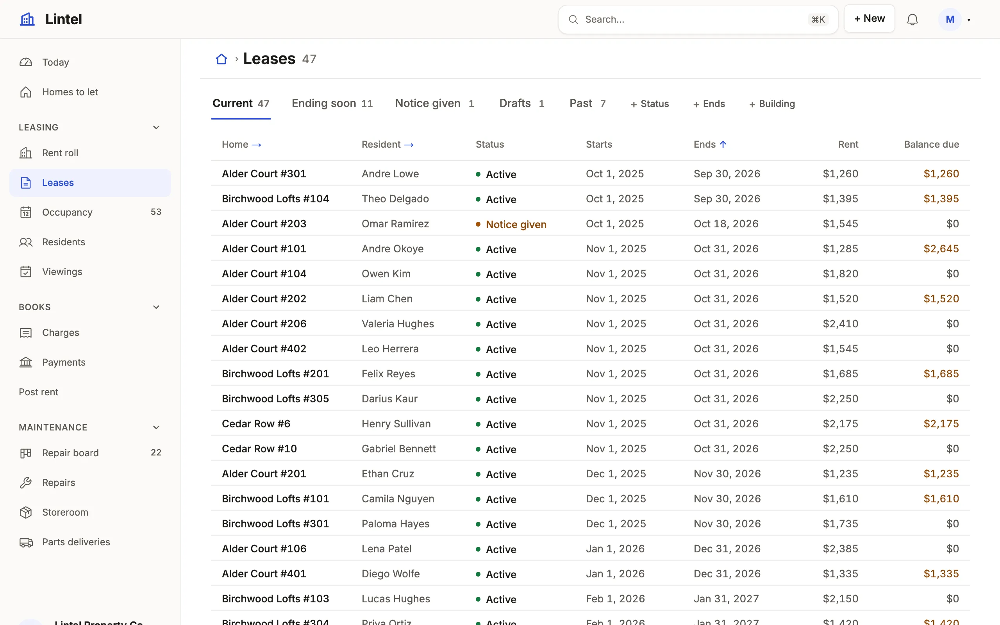
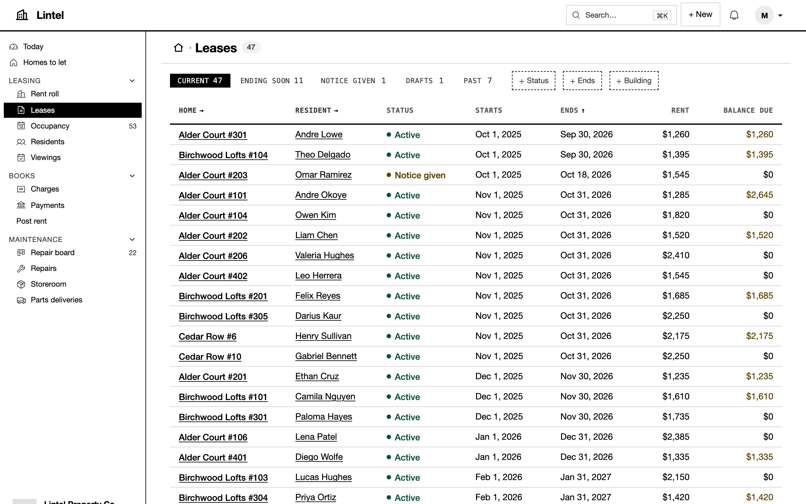
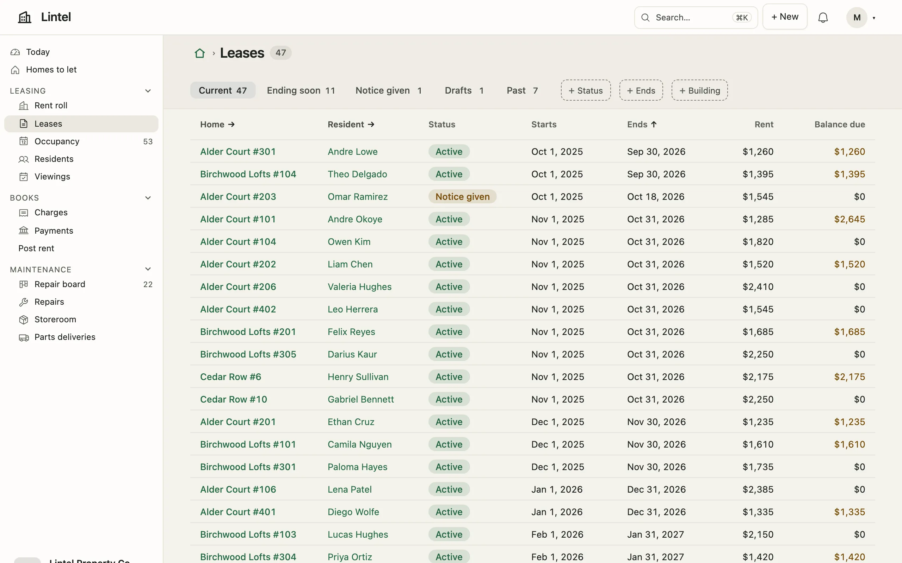
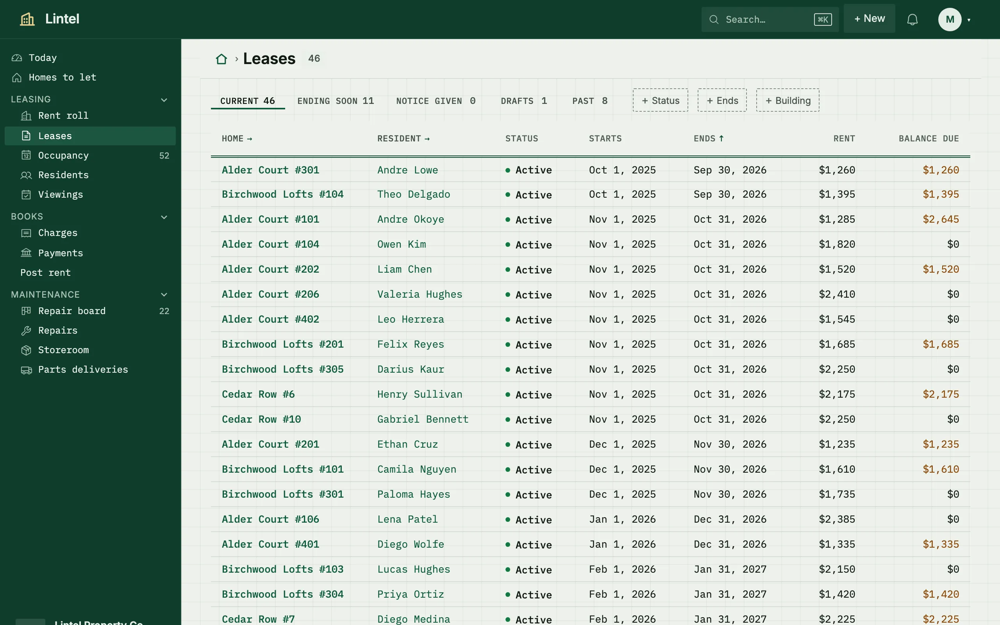

Dress an App in one of five built-in looks, adjust its accent and corners, or register a look of your own.

```ts title="examples/apps/lintel/app.ts"
  ui: {
    logo: 'buildings',
    theme: { preset: 'lintel' },
    customThemes: [lintel, blueprint, hearth, tidelight],
    shell: {
      placement: 'side',
      rail: true,
```

See it in the sample (`examples/apps/lintel/app.ts:169`): Lintel names a look of its own (Lumen with one recipe changed, `theme.ts`), offers three more in the reader's picker ([Blueprint](/docs/themes/#a-look-of-your-own), Hearth, `hearth.ts`, and [Tidelight](/docs/themes/#a-brand-in-one-block)), and folds its side menu to a rail. `ui: { theme: { preset: 'sage' } }` picks another built-in look, `palette: 'cobalt'` one of the twelve palettes every look offers; `theme: { accent: '#2258cf', radius: '8px' }` adjusts the accent and corners of the one it names.



## What you'll see

- The same rooms, structure and type scale in every look, light and dark; a look changes color, face and corners, never what is shown or who may change it.
- Readers may pick another look, one of the twelve palettes, and System, Light or Dark under Preferences, kept in their browser; the App's choice is the default.
- The accent dresses the selected tab, links, the filled button and the first series of every chart; the database browser and the Workbench keep their own look.

## The five, side by side

Lintel's leases in each look. Every component in every look is in the [component showcase](/components/).

<div class="tw-looks">
<figure>

<figcaption><strong>Workshop</strong> — the default. A shop floor's paper and ink: warm paper grounds, an ink menu with grain, Barlow with titles, section heads and labels in condensed capitals, square 2px corners, ink rules, and one restrained accent — the primary key, links, the current tab's rule, the menu's marker, the focus ring and the first chart series, never a tint; Safety orange unless a palette is named.</figcaption>
</figure>
<figure>


<figcaption><strong>Lumen</strong> — a refined workspace: white cards lifted on a warm stone ground, a navy primary, statuses as tinted pills, stat cards with tinted marks and boards headed by tinted lanes; Cobalt unless a palette is named. Opt in with <code>preset: 'lumen'</code>.</figcaption>
</figure>
<figure>



<figcaption><strong>Mono</strong> — black and white: square corners, monospace labels, the current tab inverted. Opt in with <code>preset: 'mono'</code>.</figcaption>
</figure>
<figure>



<figcaption><strong>Sage</strong> — a soft workspace: a dashboard's panels in white on cream, tables open on the ground, sage-green charts, statuses as tinted pills. Opt in with <code>preset: 'sage'</code>.</figcaption>
</figure>
<figure>



<figcaption><strong>Ledger</strong> — a bookkeeper's desk: green-tinted paper on faint graph paper, a dark green cover for the menu, figures, ids and labels in a monospace, field groups and sections as ruled boxes, a double rule under every table's column heads, and one deep ledger green. Opt in with <code>preset: 'ledger'</code>.</figcaption>
</figure>
</div>

## Recipes, look by look

Each part's treatment in each look, as `mistri theme show <look>` prints it. A theme that `extends` a look starts from its column; `mistri theme show . --diff lumen` says what yours changes.

| Part | Workshop | Lumen | Mono | Sage | Ledger |
| --- | --- | --- | --- | --- | --- |
| `nav` | `slot` | `pill` | `inverted` | `quiet` | `wash` |
| `bar` | `ruled` | `airy` | `ruled` | `soft` | `dark` |
| `tabs` | `rule` | `underline` | `inverted` | `chosen` | `rule` |
| `windows` | `segmented` | `lifted` | `segmented` | `chosen` | `segmented` |
| `stat` | `ruled` | `divided` | `framed` | `panel` | `divided` |
| `section` | `open` | `open` | `open` | `panel` | `panel` |
| `fields` | `open` | `rail` | `open` | `panel` | `panel` |
| `table` | `open` | `quiet` | `open` | `hairline` | `hairline` |
| `status` | `dot` | `quiet` | `dot` | `pill` | `quiet` |
| `board` | `ruled` | `strip` | `ruled` | `soft` | `ruled` |
| `chart` | `plain` | `line` | `plain` | `wash` | `plain` |
| `buttons` | `keyed` | `raised` | `accent` | `accent` | `accent` |
| `links` | `plain` | `plain` | `underline` | `plain` | `plain` |
| `rules` | `ink` | `hairline` | `ink` | `hairline` | `double` |
| `avatar` | `plain` | `round` | `plain` | `large` | `plain` |
| `workflow` | `markers` | `markers` | `markers` | `markers` | `markers` |
| `banner` | `plain` | `plain` | `tint` | `tint` | `plain` |
| `steps` | `strip` | `strip` | `flat` | `flat` | `strip` |
| `lanes` | `tag` | `tint` | `tint` | `tint` | `plain` |
| `header` | `plain` | `plain` | `plain` | `band` | `plain` |
| `required` | `star` | `star` | `star` | `star` | `star` |
| `checkbox` | `native` | `native` | `native` | `native` | `native` |
| `formStep` | `plain` | `plain` | `plain` | `plain` | `plain` |
| `actionBar` | `plain` | `plain` | `plain` | `plain` | `plain` |

## Type, look by look

The type roles each look says (`type.roles`, [Theme recipes](/docs/theme-recipes/#type)); a role it leaves out is drawn as the platform draws it.

| Role | Workshop | Lumen | Mono | Sage | Ledger |
| --- | --- | --- | --- | --- | --- |
| `title` | condensed, 30px, 700, `upper` | 28px, 600, -0.02em | 30px, 700 | 600 | 26px, 600, -0.01em |
| `heading` | condensed, 22px, 700, `upper` | 24px, -0.018em | | | 20px, 600, -0.018em |
| `section` | condensed, 15px, 700, `upper` | 16px, 600, -0.01em | | | `data`, 12px, 500, `upper` |
| `label` | condensed, 700, `upper` | | `mono`, `upper` | | `data`, 500, `upper` |
| `figure` | condensed, 38px, 700, `tnum` | | `mono`, 700 | | `data`, 30px, 500, `tnum` |
| `nav` | 500 | | `mono`, `upper` | | 400 |

## When to use it, and when not

- Use a built-in look (`preset`) for almost every App: Workshop for operations and field work, Lumen for a polished workspace product, Mono for dense daily operations, Sage for a soft workspace, Ledger for books, figures and records kept in ruled columns.
- Use `accent`, `radius` and `font` to carry a brand's color into a built-in look without leaving it.
- Use [`defineTheme`](/docs/themes/) when a brand needs its own grounds and inks or another look's treatments; [Themes and branding](/docs/themes/#three-themes-to-start-from) has three to copy.

## Options

| Key | What it does | Default | Status |
| --- | --- | --- | --- | --- |
| `ui.theme.preset` | `workshop`, `lumen`, `mono`, `sage`, `ledger`, or a registered look's id | `workshop` | Stable |
| `ui.theme.palette` | One of twelve palettes every built-in look offers: `crimson`, `safety`, `amber`, `moss`, `emerald`, `teal`, `cobalt`, `violet`, `plum`, `rose`, `slate`, `ink` | Workshop `safety`, Lumen `cobalt`, Ledger `emerald`, Mono and Sage `ink` | Stable |
| `ui.theme.accent` | One color, or `{ light, dark }`; one color is mixed toward white on dark | the look's | Stable |
| `ui.theme.radius`, `font` | Corners (Mono keeps its square ones) and the interface face | the look's | Stable |
| `ui.customThemes` | Up to 20 themes of the App's own from `defineTheme`, offered in the reader's picker; `ui.theme.preset` names one as the App's look | none | Stable |

`mistri check` refuses a color under 4.5:1 for text or 3:1 for a control, and chart series too close for color-blind readers. Every key: [ui reference](/docs/dsl-ui/#uitheme).

## Common mistakes

- A misspelled `preset` is a type error → use one of the five ids, or register a `defineTheme` result in `ui.customThemes` and name its id.
- A contrast failure in `mistri check` → change the color it names (`accent`, `lineControl`, `chart[2]`) until text reaches 4.5:1 and a control's edge 3:1.
- A font that never shows → `type.font` names installed faces only; mistri fetches none, so list a fallback stack.
- Grounds and inks set through `accent` → `accent` is one color; for grounds, register a look with `defineTheme`.

## Related

- [Navigation and the shell](/docs/nav-and-shell/): the menu and bar each look dresses.
- [Design checks](/docs/design-lint/): `mistri shot --theme all` and what the checks flag in each look.
- [Custom components](/docs/custom-components/): drawing with the looks' tokens, so every look dresses your component.
- [Component showcase](/components/): every block in every look, light and dark.
