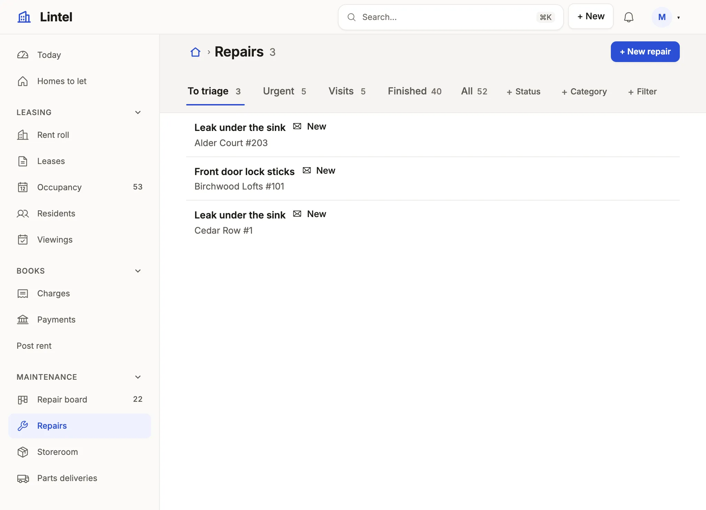

Say where each visitor starts, arrange the menu in groups with icons, and place the menu at the side or along the top.

```ts title="examples/apps/lintel/app.ts"
  home: [
    { view: 'welcome', signedOut: true },
    { view: 'portal', roles: ['resident'] },
    // …
    { view: 'today' },
  ],
  nav: navigation,
```

See it in the sample (`examples/apps/lintel/app.ts:161`). The menu itself is arrangement only:

```ts title="examples/apps/lintel/navigation.ts"
export const navigation = [
  // …
  navGroup('leasing', 'Leasing', ['units', 'leases', 'occupancy', 'residents', 'viewings'], { icon: 'key' }),
  // …
] satisfies Navigation;
```

See it in the sample (`examples/apps/lintel/navigation.ts:8`) (the other entries are single views and the Books and Maintenance groups).



## What you'll see

- The menu in the groups' order, each entry with its view's `icon`, the current one marked; a group's heading folds its section, remembered per person; ⌘B or « folds the menu to a rail of icons.
- A visitor lands on `home`; the breadcrumb's home and the logo lead back to it, and ⌘K finds any view, in the menu or not.
- On a phone the menu folds into the bar, and dialogs fill the screen.

## When to use it, and when not

- Use `navGroup` once the menu has more than about six entries, in the order the day runs, with `{ folded: true }` on a section used rarely; fewer, list the view ids.
- Use `home` as a list of rules when roles start in different places, as above.
- Use [access](/docs/access-model/) and [roles](/docs/roles/), never the menu, to decide what a reader may open: a view left out of `nav` is still served at its address.

## Options

| Key | What it does | Default | Status |
| --- | --- | --- | --- |
| `home` | A view id, or rules (`{ view, roles }`, `{ view, signedOut: true }`) ending in one with no condition | required | Stable |
| `nav` | View ids, `{ to, label }` for a menu-only word (`color: 1`–`8` puts a chart color's dot beside it), `navGroup(id, label, children, { icon, placement, inline, folded })` | no menu | Stable |
| a group's `inline: true` | A top-level group's items stand in the top bar as links, not behind a menu | a menu | Stable |
| `ui.logo`, a view's `icon` | One of the curated Phosphor names (`AppIcon` in `schema/app.d.ts`, all listed in [the icons](/docs/icons/)): `house`, `kanban`, `chart-line`, `package`…; `ui.logo` may instead be the App's own picture, `{ src, dark, mark }` ([themes](/docs/themes/#a-logo-of-your-own)) | none | Stable |
| `ui.shell.placement`, `rail` | `'side'` or `'top'`; a folded sidebar's rail of icons | `'side'`, a rail | Stable |
| `ui.shell.counts`, `menuSearch` | Live row counts beside lists; a filter box over the menu | off | Stable |
| `ui.shell.search`, `breadcrumbs`, `heading` | `false` leaves each out, for a focused App; an App with no `nav` has no menu | shown | Stable |
| `ui.shell.search: 'everyone'` | Offers the header's search to a signed-out visitor as well | members only | Stable |
| `ui.shell.width`, `gutter` | `'full'`, `'wide'` or `'narrow'`; the side gutter | `'full'` | Stable |
| `ui.footer` | One footer, drawn by every room and the landing | none | Stable |
| `ui.shell.new` | A "+ New" button beside the bell listing every way to make something: `{ view }` (a list's New form, or a signed-in form) or `{ command }` (the signed-in form that runs it), each with an optional `label` and `icon`. A reader sees only the lines they may use; none, no button. A long menu groups its lines under headings as a nav group does: `{ label: 'Service desk', children: [{ view: 'tickets' }] }` | no button | Stable |

With `notify` rules on a resource, a bell in the bar counts unread notices and `/notifications` lists them (in a tenant App, those of the customer the person is working in) ([resources reference](/docs/dsl-resources/#resourcesnotify)). The look is `ui.theme`: [Looks](/docs/looks/). Every key: [ui reference](/docs/dsl-ui/#uishell).

## Common mistakes

- `[unknown-view]` for a nav entry or a `home` rule, or a refused `ui.shell.new` line → use one of the view ids the message lists; a New line takes a list or a signed-in form, never a dashboard, and a `command` exactly one form runs (if two do, name that form by `{ view }`).
- A dashboard that `nav`, `home` and every embed leave out is refused → put it in the menu, or `embed` it where it is read.
- An icon name outside the list is a type error and a load error → pick one from `AppIcon`; the menu takes no image files.
- `home` rules with no final unconditional rule are refused → end with `{ view: '<id>' }` for everyone else.

## Related

- [Design the navigation and shell](/docs/compose-shell/): how many groups, which placement, and what to leave out.
- [Looks](/docs/looks/): the three built-in looks and your own.
- [Public pages](/docs/landing-pages/): the front door a signed-out visitor's `home` opens.
- [ui reference](/docs/dsl-ui/): every shell key, generated from the schema.
