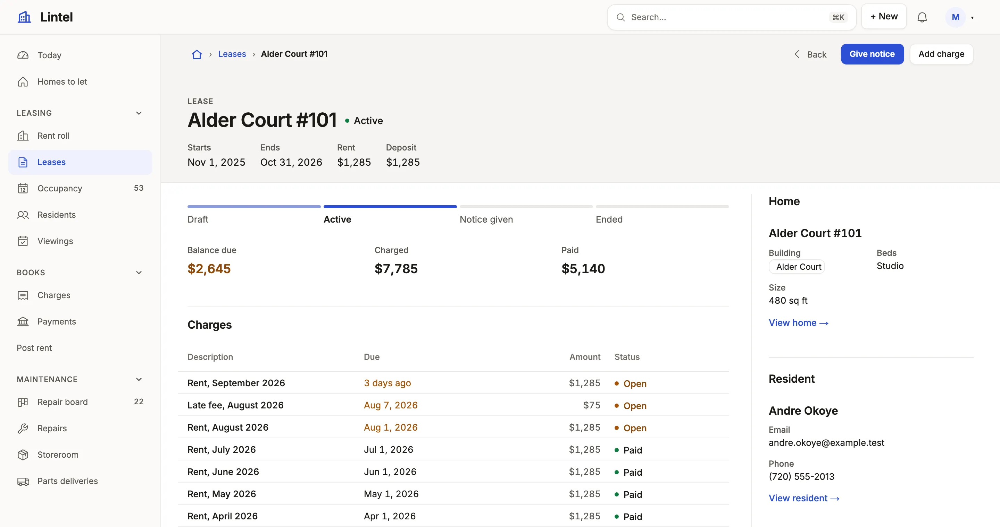

Show one record with everything around it, its head, figures, child lists as tabs and a side panel, on one page per table.

```ts title="examples/apps/lintel/pages/lease.ts"
export default page(
  'lease',
  [
    header({
      status: 'status',
      facts: ['start_on', 'end_on', 'rent', 'deposit'],
      // …
    }),
    // …
    card('Home', 'unit_id', ['property_id', 'bedrooms', 'sqft']),
    // …
    history(),
  ],
  { listTabs: false },
) satisfies Page;
```

See it in the sample (`examples/apps/lintel/pages/lease.ts:7`) (abridged: the full page adds the charges and payments as related lists and the resident's card). A file in `pages/` whose default export is a page is that page, keyed by its name (`pages/lease.ts` is `lease`), with no list in `app.ts`; `mistri check` lists each page it found by its file. A `pages/` module with no default export is one the pages import.



## What you'll see

- The head: the status as a toned chip beside the name, the start, end, rent and deposit under it, and the record's actions, the forward one filled and `destructive` ones apart; the lease's machine draws its stepper over the figures.
- Related lists below the figures: stacked, as this page asks with `listTabs: false`; left on, adjacent ones share one tab strip, the open tab in the address (`/leases/1/charges`), and a closed tab is never fetched.
- The aside: the parent as a card, `current()` for the one child that matters now, and a `properties` rail edited in place. On a phone the current row follows the summary, ahead of the related lists; the parent card, the rail and the history follow the main flow.

## When to use it, and when not

- Use a page for any table people open one row of; a table with no page opens on this same anatomy, drawn from the schema, and the scaffold writes one.
- Use an [overview page](/docs/compose-overview/) (`aside: false`, a summary of five, a chart) for a person or a company read as a profile.
- Use a [list](/docs/lists/) with `open: 'drawer'` instead when a glance is enough, and a [dashboard](/docs/dashboards/) for figures across many records.

## The aside and the layout

A page that declares no `region: 'aside'` section gets one: the record's remaining readable fields, those no section already shows, as a `properties` rail titled by the resource's `noun` ("Bike"). Nothing remaining draws none; `page('bike', [...], { aside: false })` leaves it out. Write your own aside to say it differently. A page whose record is a thread, a thing for sale or something read says so with `layout` in its options, or is given it from its sections when it names none ([design a record page](/docs/compose-record-page/) says how), and the regions move to suit it: `'conversation'` keeps one `timeline` last in the main column at a reading measure with the record and any related list beside it (Lintel's repairs, `examples/apps/lintel/pages/maintenance_request.ts:37`); `'showcase'` puts a `gallery` first with a panel of one to three aside sections (the price) beside it, so a phone reads the price after the photos (its homes and buildings); `'article'` is one column at `--page-measure` (70ch) with no aside (Tick's task). What a layout cannot place is refused with its fix ([`layout-conversation`](/docs/check-codes/#layout-conversation) and the rest); [design a record page](/docs/compose-record-page/) says which to pick.

## Options

| Section | What it draws | Status |
| --- | --- | --- |
| `header({ status, facts, primary, destructive, actions })` | The head: a status chip, up to six facts, the verbs in order; `actions: [...]` names the ones drawn and the rest wait in More | Stable |
| `fields(show, { presentation, editable })` | The record's own values: `summary` (the main column's default), `properties` (the aside's), `facts`, `table`; `editable: true` changes a property in place through the action that sets it | Stable |
| `card(title, reference, show)` | A box for the record a reference names, in the aside: `card('Sold by', 'dealer_id', ['rating', 'city'])` | Stable |
| `headline(show, { links, subfigure, was, note })` | A large figure with up to two buttons, in the aside: a price and "Ask about this car" | Stable |
| `related(title, from, whose \| { same, near }, opts)` | Rows that point at the record, or rows that share a key with it (`{ same: ['account_id'] }`, `near: { price: 0.25 }` within ±25%; over the page's own table the record itself is left out): `show` (4 columns), `query`, `sort`, `create`, `totals`, `empty`, `group` (a header over each record the rows share, a page of groups at a time), `rowActions` (each row's own verbs in a ⋯ at its end); `presentation: cards(…)` draws them as a list view's cards, every key the same | Stable |
| `current(title, from, whose, opts)` | The one related row `query` and `sort` pick, as a card | Stable |
| `metric`, `chart`, `breakdown` with `whose` | A dashboard's figures, about this record; a metric takes `format` (`'percent'` reads 0–100: 53.8 is "53.8%") and `unit` | Stable |
| `timeline`, `history()`, `embed`, `note`, `custom` | Several tables in date order, the record's changes, a list view, guidance, [your component](/docs/custom-components/) | Stable |

A `timeline` that is a conversation says `newest: 'last'` (oldest first, scrolled to the end), `composer: { reply: 'reply', note: 'addNote' }` (a pinned Reply / Internal note toggle running those commands on the record, for roles granted them), `tone: { kind: { internal: 'warn' } }` and `compact: { kind: ['system'] }`. `side: 'author_id = record.caller_id'` sets the rows that condition picks against the far edge, the caller's against the desk's, `record.` naming the page's record; it applies to each stream that has its columns, and a stream without them is never on the far side. A stream may say its own `side`, `tone` and `compact` instead (`stream({ ..., side: 'author_id = record.caller_id', tone: 'info', compact: true })`). The composer's `templates: { from, labelColumn, text, query: 'active = true' }` offers saved replies, only the rows the `query` names. A `note` is `variant: 'quiet'` or `'callout'`.

`card()`, `current()` and `history()` stand in the aside (`history()` shows eight changes, titled in the reader's language); `region: 'main'` puts one under the record. Every section takes `region`, `width`, `tab` (sections sharing one share a panel) and `when: 'status = converted'`, a condition that reads a reference path or a computed column as a list's filter does (`when: 'company_id.major_incident_open = true'`). A related list's `create` opens the child's New form with the parent key filled, `defaults` and `prefill: { account_id: 'account_id' }` from the record. `history()` needs the record history store, provisioned once with `mistri migrate stores up --app <dir>`, or `provisionStores(<the database>, { only: ['record-history'] })` from `@mistriwork/mistri/maintenance`. Every key: [pages reference](/docs/dsl-pages/).

## Common mistakes

- `[unknown-action]` for `header({ primary: 'renew' })` → name an action the resource keys (`actions: { renew: action(…) }`); a `string` variable does not compile, write the id.
- `[not-a-reference]` on `related(…, 'task', 'owner_id')` → `whose` is the child's foreign key to this table; [relationships](/docs/relationships/) lists them.
- `aside-summary` or `aside-columns` from `mistri shot` → four figures and four short columns fit beside an aside; show fewer, or `shell: { placement: 'top' }`.
- `excludeSelf` is refused → siblings are `related(title, table, { same: [column] })`.

## Related

- [Design a record page](/docs/compose-record-page/): the one skeleton, and why each part sits where it does.
- [Actions](/docs/actions/): the verbs the head draws, and the machine behind the stepper.
- [Relationships](/docs/relationships/): what `whose` and `about` follow.
- [Pages reference](/docs/dsl-pages/): every section key, generated from the schema.
