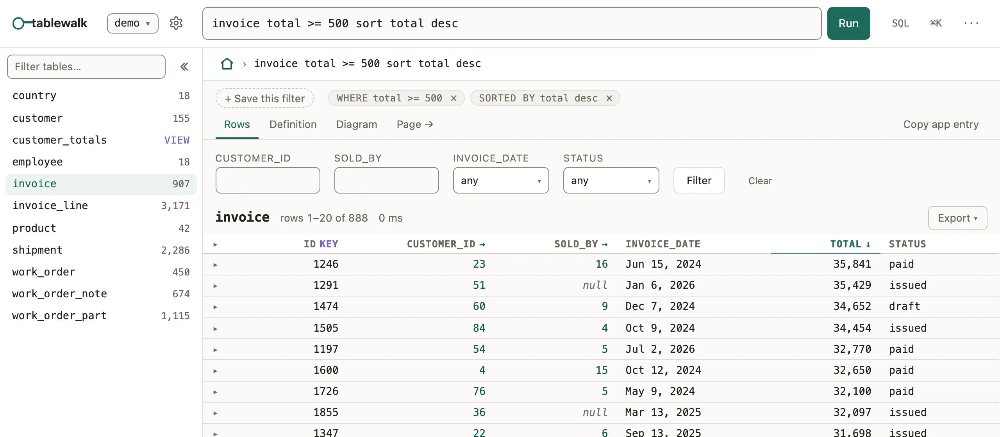

Ask a table for rows by condition, follow references in a path, and group and
count, in one line the address keeps.

```text
invoice total >= 500 sort total desc
```

Type it into the bar above any table. Every example on this page runs against
`npx tablewalk --demo`.



## What you'll see

- Only the matching rows, with a count that stops at 10,000 and says so.
- The line written into the address (`/demo/invoice%20total%20%3E%3D%20500…`),
  so a copied link reruns it.
- **SQL** beside the result shows the statement it compiled to, with every
  value bound as a parameter.

## When to use it

- Use the query bar when you know the condition, not the record: overdue,
  over a limit, missing an email.
- Use the [walk](/docs/database-browser/) instead when you start from one record and want
  what is around it.
- Use raw **SQL** only for what the language cannot say (window functions,
  unions); it shows the same result grid but checks nothing for you.

## Conditions

The table comes first; conditions, columns, sort and limit follow.

```text
customer active = true sort credit_limit desc
customer country_code in (AU, NZ) and email is not empty
employee title contains manager show first_name, last_name
invoice total between 100 and 1000 and status = issued
invoice invoice_date = last 30 days
```

| Intent | Spelling |
| --- | --- |
| Compare | `=`, `!=`, `<`, `<=`, `>`, `>=`, `between a and b` |
| Compare two values | `qty < reorder_at`, `paid < owed` (a rollup): beside a number, a date or a flag, a bare word naming a column, rollup or computed column is its value; beside text it stays a word |
| Match text | `contains`, `startswith`, `endswith` (case-insensitive where the database allows) |
| Match a set | `in (AU, NZ)`, `not in (AU, NZ)` |
| Check null | `is empty`, `is not empty` |
| A machine's states | `status is open` (not final), `status is onBench` (a group it names), `is not` for the rest |
| Combine | `and`, `or`, parentheses |
| Choose columns | `show` (or `select`), with `as` to rename |
| Order and cut | `sort column desc` (or `order by`), `limit 20` |

Dates are phrases: `today`, `yesterday`, `this week`, `last month`,
`this quarter`, `last 30 days`, `next 7 days`; `previous 30 days` is the window
just before `last 30 days`. Hours and minutes count from the instant:
`due_at = next 2 hours` is due within two hours. `now` is the instant itself:
`resolution_due_at < now` is past due. Quarters are calendar quarters (January,
April, July, October); there is no fiscal year. A value with a space is quoted:
`name = "Kereru Coffee"`.

## Follow a reference in a query

A dotted path walks a foreign key, as many steps as the schema has:

```text
invoice show id, total, customer_id.name as customer where total >= 500
invoice customer_id.name startswith K
```

## Ask about the rows that point here

`any` asks whether a record has a row of another table pointing at it, and
`where` what that row must hold; `no` asks for none:

```text
customer any invoice where status = void
customer no invoice
product any invoice_line where invoice_id.status = paid
employee no employee via manager_id
```

When the other table points here through two references, `via` names the one
meant. Two `any` conditions may each be held by a different row; for one row
holding both, put both inside one: `any invoice where (status = paid and total > 500)`.

## Group and measure

Measures come before `by`, then up to three grouping keys:

```text
invoice count by status
invoice count, sum total as billed by month invoice_date sort billed desc limit 12
invoice where total > 100 count by customer_id.country_code.name as country
customer count distinct country_code as countries by active
```

Measures: `count`, `count column`, `count distinct column`, `sum`, `avg`,
`min`, `max`. Date buckets: `day`, `month`, `quarter`, `year`. Here `sort`
names a column of the answer (`billed`), not a path.

## Common mistakes

- `"totl" is not a column on invoice. Did you mean "total"?` → a typo is an
  error, never an empty result; take the suggestion.
- `customer_id.name = Kereru Coffee` is refused → quote a value with a space:
  `= "Kereru Coffee"`.
- `Nothing called "total" is in this breakdown` → after `by`, `sort` names a
  column of the answer: `sort billed desc`.
- An App's tab or `when` will not parse → it is this same language; the
  `query-grammar` [check code](/docs/check-codes/#query-grammar) says at which
  character. In an App the strings are typed too, where the TypeScript project
  registers exactly one App's schema ([the limit](/docs/app-dsl/#typed-query-strings)).

## Related

- [tablewalk, the database browser](/docs/database-browser/): follow one record's references by clicking.
- [MCP for coding agents](/docs/mcp/): `query` and `breakdown` take these lines verbatim.
- [Keyboard](/docs/keyboard/): `/` focuses the bar; `⌘/` opens it as a panel.
- [Lists](/docs/lists/): an App's tabs and filters are written in this language.
