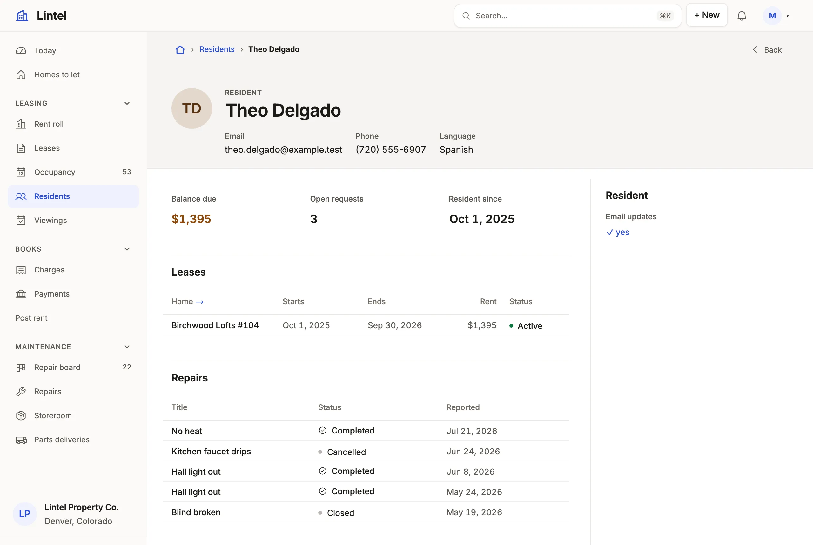

Follow foreign keys from a record to what it points at and what points at it, and declare the keys a database leaves out.

```ts title="examples/apps/lintel/pages/resident.ts"
    header({ facts: ['email', 'phone', 'language'] }),
    fields(['balance', 'open_requests', 'since']),
    related('Leases', 'lease', 'resident_id', { show: ['unit_id', 'start_on', 'end_on', 'rent', 'status'], sort: 'start_on desc' }),
    related('Repairs', 'maintenance_request', 'resident_id', {
      show: ['title', 'status', 'reported_on'],
      sort: 'reported_on desc',
      limit: 8,
    }),
```

See it in the sample (`examples/apps/lintel/pages/resident.ts:8`); [Sample Apps](/docs/examples/) says how to run Lintel.



## What you'll see

- A foreign key column (`unit_id`, `resident_id`) drawn as its record's name, linked to that record, never as a number.
- A related list per table that points back (`resident_id` on `lease` and on `maintenance_request`), and a self-reference (a `parent_account_id`) as its own list of children.
- Label paths such as `owner_id.name` in a list's `show`, a card or a `recordLabel`, read in the same statement.

## When to use it, and when not

- Use a hop (the foreign key, written as its column) wherever one table reaches another: `related`, `whose` on a metric, chart or rollup, `about` on a section about another record, `stream(from, whose, at, show)` on a timeline. `mistri-schema.d.ts` lists every table's hops under `References`.
- Use `references` on the resource when the database holds the link as plain text (`site_code` naming `site.code`); declare a real foreign key instead when you own the schema.
- Use `related(title, from, { same: [column] })` instead to list rows that share a value with the record (the same category) rather than point at it; it needs no key.

## Options

| Where | Written | Example |
| --- | --- | --- |
| Related list | `related(title, table, hop, { show, query, sort, create })` | `related('Contacts', 'contact', 'account_id', …)` |
| Label path | `hop.column`, as deep as the keys go | `opportunity_id.account_id.city` |
| Figures about the record | `whose: hop` on `metric`, `chart`, `breakdown` | `{ whose: 'account_id' }` |
| Rollup | `count`, `sum`, `min`, `max` over the rows that point here | `count('task', { query: 'status = open' })` |
| Declared key | `references: { col: { to, column? } }` on the resource | `{ site_code: { to: 'site', column: 'code' } }` |

A composite key is `a+b`, and the constraint's name where two keys share columns. Where its other columns are NOT NULL and its target column is unique alone, as in a tenant's `(tenant_id, incident_id) REFERENCES incident (tenant_id, id)`, its remaining column is a reference too: `incident_id.number` is a path, and `incident_id` draws the ticket. A declared reference's target must be unique (its primary key, the default, or a unique constraint on that column alone) and of the same kind; it is followed like a key, but is never authority for a write and adds no delete impact. Every key: [resources reference](/docs/dsl-resources/).

**Across [sources](/docs/sources/):** two sources on one connection are one database, so a key between them joins. A reference into a source on another connection is read in two steps (the rows, then one read of the targets through that source's grants): it labels, links and gives the target a related list, while a filter, sort, grouping, rollup, `tags` or `notify` path through it is refused. A tenant App's references stay within its one source.

## Common mistakes

- `has no reference called "site_code"` or `[not-a-reference]` → the column is not a foreign key; add one (`ALTER TABLE work_order ADD FOREIGN KEY (site_code) REFERENCES site (code)`) or a `references` entry, then run `mistri check`.
- `[unknown-column]` on a label path (`owner_id.nmae`) → each step is checked against the table it lands on; the message names the nearest column there.
- A filter or sort through a reference to another connection is refused → move both tables to one connection, or filter on the near side.

## Related

- [Record pages](/docs/pages/): where related lists, metrics and timelines sit.
- [Resources and fields](/docs/access-model/): `recordLabel`, which names the record a key points at.
- [Query language](/docs/query/): label paths in a tab's query (`account_id.rating = hot`).
- [Design a record page](/docs/compose-record-page/): which related lists earn a tab.
- [Stock that can't be oversold](/docs/stock/): a line that takes from the record it points at.
