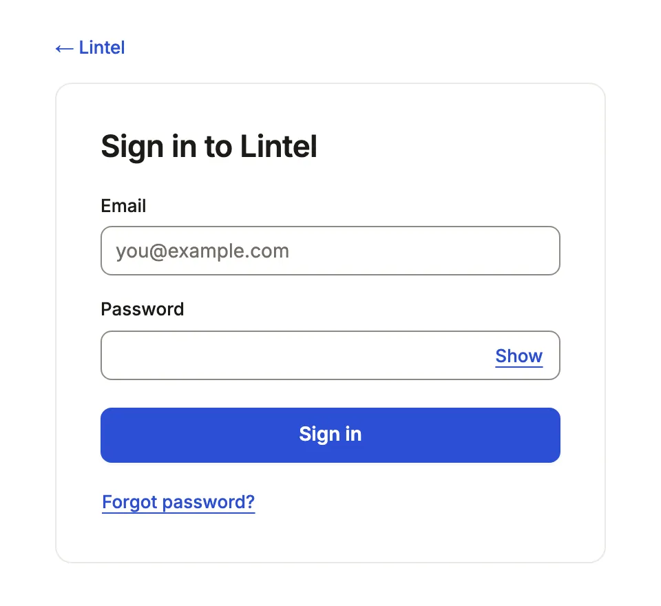

Make people sign in before they reach an App, with passwords, GitHub, Google
or your identity provider, and manage their accounts in the App.

```ts title="examples/apps/lintel/app.ts"
auth: {
  // …
  providers: ['email'],
  // …
  roles: {
    leasing,
    manager,
    // …
    admin: { label: 'Admin', extends: 'manager', operations: ['workflows'] },
```

See it in the sample (`examples/apps/lintel/app.ts:56`): the `admin` role is the account a first start bootstraps (`MISTRI_AUTH_ADMIN_EMAIL`).



## What you'll see

- A sign-in card at every address of the App until a session exists; the server reads a signed-out visitor nothing but what `auth.public` names.
- An account menu in the bar: who is signed in, **Your profile** (name, password and, when the App sends [email](/docs/email/), address: a link goes to the new address and a notice to the old one), preferences, dark mode and **Sign out**, which locks and clears the App at once.
- For an account holding `admin`, **Manage accounts** in that menu.

## When to use it, and when not

- Use `auth` whenever the App is reached beyond your own machine: without it, every column of every declared resource goes to anyone who reaches the port.
- Use [roles](/docs/roles/) beside it when people differ in what they read and write; `auth` without `roles` signs people in and gives them all the same access.
- Use an [identity provider](/docs/identity-providers/) instead of passwords when your organization already signs people in.

## Options

| Key | What it does | Default | Status |
| --- | --- | --- | --- |
| `providers` | `'email'` (password), `'github'`, `'google'`, `oidc('<name>')`, `saml('<name>')` | `['email']` | Stable |
| `signUp` | `'invite'` (an administrator adds accounts), `'open'`, or `{ providers, domains }` | `'invite'` | Stable |
| `defaultRole` | The role a new account gets | `'user'` | Stable |
| `roles` | What each role reads, writes and runs ([roles](/docs/roles/)) | none: all alike | Stable |
| `public` | What a signed-out visitor reads ([roles](/docs/roles/#signed-out-visitors)) | nothing | Stable |
| `me` | The table and email column that are the signed-in person (`{ from: 'member', column: 'email' }`); in a [tenant App](/docs/tenant-apps/#who-me-is) the column holds the account's id, and `me` is the row in the tenant the person is working in | none | Stable |
| `me.create` | `{ name: 'full_name' }`: the server makes a new account's row on its first signed-in request (sign-up, invitation, first single sign-on), once; the email column must be unique | none | Stable |
| `store` | Where accounts and sessions live: a SQLite file or a `postgres://` URL, apart from the business data | `auth/<id>.db` in the config directory | Stable |

All keys: [the generated reference](/docs/dsl-auth/). Changing `auth` needs a restart.

### What the server needs

- `BETTER_AUTH_SECRET` in its environment, at least 32 characters; without it the App does not start.
- The address people reach it at, when that is not loopback: `--allowed-host` ([build and deploy](/docs/build-and-deploy/)).
- A first account: `MISTRI_AUTH_ADMIN_EMAIL` and `MISTRI_AUTH_ADMIN_PASSWORD` make it, with `admin`, at the first start; or `signUp: 'open'`. Each example's README shows its seed step.
- With a `postgres://` store, sessions are read once every few seconds rather than on every request ([the sign-in store](/docs/performance/#the-sign-in-store)): a sign-out elsewhere, such as on another instance, is honored here for up to `MISTRI_AUTH_SESSION_CACHE` seconds (default 5; `0` reads the store on every check). One made through this server takes effect at once.
- For password resets and verified addresses, an [email service](/docs/email/). Without one, `MISTRI_AUTH_RESET=log` writes each reset link to the log under `mistri dev` only; a served App logs one line, with no link, saying a reset was requested and nothing was sent, and warns at startup.
- With `signUp: 'open'`, an [email service](/docs/email/) too. A self-made account is matched to `me` (and to the rows a row policy finds by its email) and given notifications only once its address is verified; until then it is signed in as nobody in particular. An account an administrator makes is verified when made. `mistri check` fails on open sign-up with no email service ([`open-sign-up-unproven`](/docs/check-codes/#open-sign-up-unproven)).

### Managing accounts

An account holding `admin` adds accounts (name, email, roles and, with
passwords, a first password), sets roles, deactivates and reactivates them,
and sets a new password. Deactivating or a new password ends the account's
other sessions and revokes its API tokens and OAuth grants, as a reset by
link does; a reactivation brings none of them back. An administrator cannot remove their own `admin` or deactivate
themself. What `admin` reads and writes in the App comes from its entry in
`roles`, as for any role.

Every change is recorded in the sign-in store in the same transaction (who,
when, the account, the fields before and after, never a password or a token);
a change that cannot be recorded is not made. **History** on the accounts
screen reads it. A tenant App manages members through its own
[administration](/docs/tenant-apps/).

### Settings records

A one-row resource such as a company profile opens from **Settings** in the
account menu, on its own page and under its own grants:
`company: { access: 'write', settings: 'Company profile' }`.

### What a session protects

- The shell sends a Content-Security-Policy: scripts from the server only, `connect-src 'self'`, no framing by other sites.
- A signed-in reader's pictures are `private, no-cache` with `Vary: Cookie`, so a withdrawn grant or a sign-out takes effect at once.
- History, the activity feed and notices name people, never their email.
- What a browser already fetched is not erased from it; there is no policy polling.
- A session check that gets no answer (a timeout, a dropped connection, a gateway's 502, 503 or 504) is asked once more after a short pause before the App says the session is unavailable. A session that has ended (401) or now belongs to another person locks the App at once.

## Common mistakes

- `"auth" needs BETTER_AUTH_SECRET in the environment` → set a random value of 32 characters or more, kept like a password.
- Nobody can sign in to a new App → set `MISTRI_AUTH_ADMIN_EMAIL` and `MISTRI_AUTH_ADMIN_PASSWORD` for the first start, or open sign-up.
- A new account sees an empty App → `defaultRole` names a role `roles` does not declare (the default is `user`); declare it or name one that is. `[role-label]` → give each role a `label`, the name people read on the accounts screen.
- "Sign-in failed (500)" and nothing else → the server's stderr has one line for it, `mistri: auth POST /api/auth/sign-in/email answered 500 for App "<id>": <error>`, never the email, password, token or cookie. A wrong password is a 401 and is not logged.

## Related

- [Roles and field access](/docs/roles/): what each signed-in person reads, writes and runs.
- [Sign in with your identity provider](/docs/identity-providers/): OpenID Connect or SAML, roles from claims.
- [Email](/docs/email/): resets and verified addresses.
- [Tenant Apps](/docs/tenant-apps/): one App, several organizations, members per tenant.
