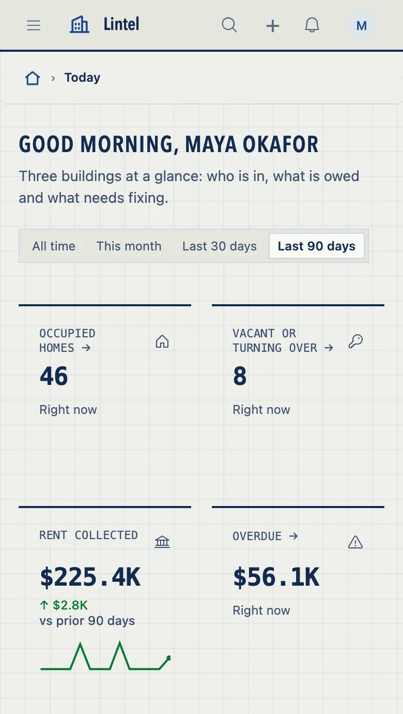
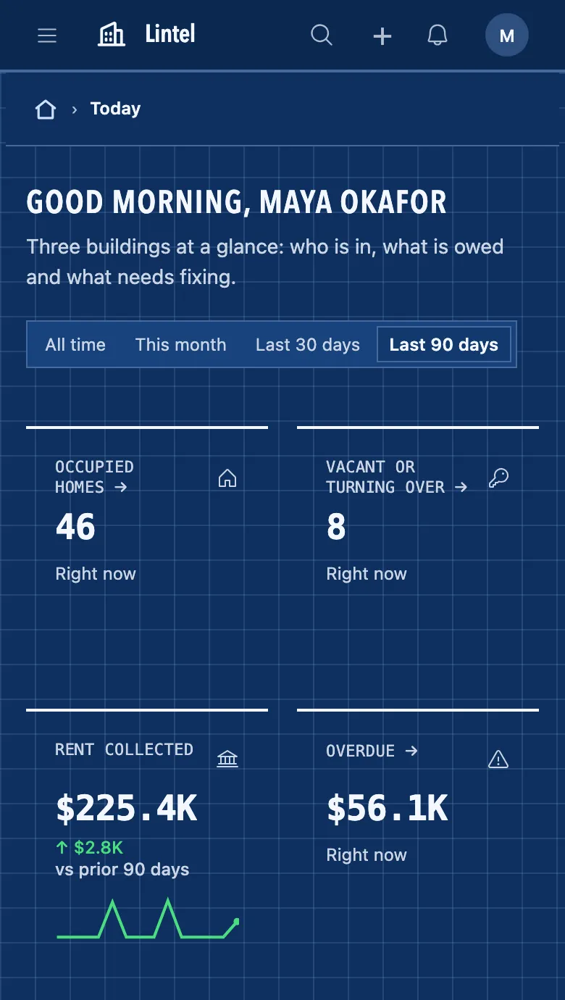

Write an App's own theme by purpose with defineTheme, and let each tenant put its logo, name and accent on it.

```ts title="examples/apps/lintel/theme.ts"
export const lintel = defineTheme({
  id: 'lintel',
  label: 'Lintel',
  extends: 'lumen',
  recipes: { header: 'hero' },
});
```

See it in the sample (`examples/apps/lintel/theme.ts:7`). That is the smallest theme: Lumen with one recipe changed. `defineTheme` checks every color and shape.

<!-- no picture: a theme is every page of the App; the looks page shows them -->

## What you'll see

- Every page in the theme's colors, corners and faces, light and dark, with the treatments its recipes pick.
- In a tenant App with `branding`, each tenant's logo, name and accent in the bar, the tab, its sign-in page, its public forms and its mail.

## When to use it

- Use a built-in look ([Looks](/docs/looks/)) unless the brand needs its own grounds and inks.
- Use `extends` to start from a built-in and say only what differs; leave it out to start from the plain structure and name the four colors the rest derive from.
- Use `branding` when one deployment serves several organizations that each want their own logo and accent.
- Use `type.faces` to ship the brand's own font: WOFF2 files in the App's directory, cut to Latin as served, at most 150 KB together, the heading's face preloaded ([fonts](#fonts)).

## Options

| Key | What it does | Default | Status |
| --- | --- | --- | --- |
| `extends` | The built-in look to start from, `lumen`, `mono` or `sage`, or a theme that extends one ([publish a look](#publish-a-look)) | none: the plain structure, and `ground`, `surface`, `ink` and `accent` named | Stable |
| `colors.light`, `.dark` | Colors by purpose: `ground`, `surface`, `ink`, `accent` (a fill; `onAccent` is the words on it and `accentInk` the accent as text, each derived to read when omitted), `primary` (the fill of a form's primary action, Continue, Submit or Add; `onPrimary` is the words on it, derived to read when omitted; Lumen's is its ink, Mono's and Sage's their accent; name your accent here to have forms press in your brand), `field` (a field's fill; where it is omitted a form's field is an outline and no fill, its edge `lineControl` lightened to the faintest that reads at 3:1), `line`, `status`, `nav`, `chart`, `rules`, `shadow`; `nav` dresses the menu under every `bar` recipe, `shadow` is the ink every lift is mixed from; a theme that names an `accent` and no `chart` draws its first chart series and its metric sparklines in that accent | the base's | Stable |
| `shape.elevation` | A preset (`flat`, `hairline`, `soft`, `raised`), or `{ card, float }`, each `none`, `hairline`, `low`, `mid` or `high`, over the base's drawing | the base's | Stable |
| `scheme` | `dark`: worn dark until the reader picks a mode, still with a light mode. `dark-only`: no light colors, `colors` names `dark` alone, and a reader cannot turn it light | follows the reader and their machine | Stable |
| `palettes` | Named variations a reader may pick | none | Stable |
| `shape`, `type`, `density` | Corners (`radius: { control, field, pill, panel }`: a control `0px`–`16px` or `'round'`, a field and a pill `0px`–`12px`, a pill round when omitted, a panel `0px`–`20px`), widths (`border: { rule, control, panel, focus }`), font stacks, spacing | the base's | Stable |
| `motion` | The pace things enter at: `house`, `brisk` (a quarter quicker) or `still` (nothing enters, as reduced motion draws it); reduced motion is `still` under every pace | `house` | Stable |
| `rhythm` | How far apart things stand: `house`, `tight` (the layout steps, `--space-5` to `--space-8`, and `--section-seam` a quarter closer) or `airy` (a quarter wider); a control's own padding never moves | `house` | Stable |
| `type.base` | The size an App's text is drawn at, `13px` to `16px`; every size grows with it | `13px` | Stable |
| `type.roles` | How each kind of text is drawn: `display`, `title`, `heading`, `section`, `body`, `label`, `data`, `figure`, `nav`, each a `face`, `size`, `leading`, `tracking`, `weight`, `case` and `features` where it takes one ([Type](/docs/theme-recipes/#type)) | the base's | Stable |
| `type.faces` | Font files the theme ships from the App's directory ([fonts](#fonts)) | none | Stable |
| `colors.*.band`, `recipes.table: 'banded'` | Every other row of a table on the band color, each ink checked on it; lists and grids only, not the calendar. A `status` or `tag` with an opaque `parts` ground keeps it on the band and `check` warns ([theme-band](/docs/check-codes/#theme-band)) | `raised` | Stable |
| `surface` | A pattern behind the page (`ground`) and the menu (`nav`): `paper`, `grain`, `grid`, `dots`, `lines` or `scanlines`, `strength` 1 to 3, in the theme's line color | none | Stable |
| `parts` | A published part's own `ground`, `ink`, `edge` (color roles by path, never hex), `radius`, `lift`, `face`, `weight` and `case`; never its size or visibility | none | Stable |
| `type.icons` | The icons' weight: `regular`, `light`, `bold` or `fill` | `regular` | Stable |
| `stylesheet` | A `.css` file beside the theme, at most 8 KB, that dresses published parts only: `[data-part="stat"]` rules, role colors, pictures beside it, edges, corners, lifts and faces, never a size or a place; refused by line otherwise. No glow: a shadow is one of the look's lifts in the theme's `shadow`, which C2 refuses lighter than the ground, and `text-shadow` and `filter` are refused | none | Stable |
| `contract`, `from` | A published look says the contract it was written to (`1`) and `from: import.meta.url`, so its faces and stylesheet are read from its package | none | Stable |
| `recipes` | Each part's treatment from a closed menu: `nav`, `bar`, `tabs`, `stat`, `table`, `buttons` and more, each value pictured in [Theme recipes](/docs/theme-recipes/) | the base's | Stable |
| `shell.placement` | Where the menu goes, `'side'` or `'top'`, when this is the App's theme; `ui.shell.placement` wins | the App's | Stable |
| `ui.theme.for` | A theme per audience: `public` for every page a signed-out visitor sees, worn whatever a reader picked, and `roles: { rider: 'cadence' }`, the first entry the account holds, over a tenant's saved theme; a reader's own pick still wins in the shell | none | Stable |
| `branding.allow` | What a tenant may change: `logo`, `name`, `accent`, `palette`, `radius`, `density`, `theme` | required | Stable |
| `branding.editors` | The tenant roles whose members may save it | required | Stable |
| `branding.themes` | One to six themes a tenant picks from (`theme` needs two) | the App's own look | Stable |
| `brandingForm()` | A dashboard section: the form beside a live preview | none | Stable |

```ts
branding: { allow: ['logo', 'name', 'accent'], editors: ['admin'] },
views: { settings: { kind: 'dashboard', sections: [brandingForm('Branding')] } },
```

A tenant App with `branding` needs its store, once: `provisionStores(<the database>, { app: { definition } })` from `@mistriwork/mistri/maintenance`, which makes every store the App declares (`only: ['branding']` names it alone, and is refused for an App without `branding`). An App's own message may say `{brand.name}`, `{brand.logo}` and `{brand.accent}`; each is filled for the tenant it is sent in.

A tenant that may change `logo` may also add a second picture for a dark bar and for dark mode; the bar draws it there as it does an App's own `dark`, and the first logo stands where there is none. It is never a key of its own in `allow`.

## A brand in one block


Tidelight (`examples/apps/lintel/tidelight.ts`) is a brand over Mono: one teal for the action, warm neutrals, softer corners. Mono's type and spacing stay. Trimmed:

```ts title="examples/apps/lintel/tidelight.ts"
export const tidelight = defineTheme({
  id: 'tidelight',
  label: 'Tidelight',
  extends: 'mono',
  colors: {
    light: {
      ground: '#fbfaf6', surface: '#ffffff', raised: '#f2efe6',
      ink: '#10211f', inkMuted: '#3f4f4c', line: '#e3dfd3', lineControl: '#5a6966',
      accent: '#0f5e5a', link: '#0f5e5a',
      primary: '#0f5e5a', onPrimary: '#ffffff', // 7.6:1
    },
    dark: { … },
  },
  shape: { radius: { control: '8px', field: '8px', panel: '12px' } },
});
```

`primary` fills each form's one action; `onPrimary` is its words, and `mistri check` fails the theme below 4.5:1 between them. Every role it does not name is derived from the ones it does and checked like them: the field's edge, the soft accent tint, the focus ring and the first chart series. The file also writes the side menu's colors and orders the chart's grays as `mistri check` proposed, so the teal series stays apart from its neighbors.

## A look of your own


Blueprint is Lintel's second theme (`examples/apps/lintel/blueprint.ts`, 61 lines): blue ink on gridded vellum by day, a blueprint by night. The App, its data and its addresses do not change. The file, in order, trimmed:

**Colors, light then dark.** Name the grounds, the ink and the accent; every color left out is derived. Dark is written on its own, not inverted.

```ts
colors: {
  light: {
    ground: '#eff0ea', surface: '#fafaf6', raised: '#e5e7df', ink: '#132a4f',
    line: '#ced7e4', lineControl: '#66789a', accent: '#1d4a91', link: '#1d4a91',
    status: { good: '#0b7736', critical: '#b3261e' },
    // … nav, chart
  },
  dark: {
    ground: '#0e2f5e', surface: '#12386d', raised: '#18427c', ink: '#f3f7ff',
    line: '#46699d', lineControl: '#93add6', accent: '#f3f7ff', link: '#cfe0ff',
    // … status, nav, chart
  },
},
```

`mistri check --app` measures every pair in both modes and, for a failing one, names the nearest color that passes.

**Pattern, shape and spacing.** A grid behind the page, square corners, hairlines instead of shadows, wide margins between sections.

```ts
surface: { ground: { kind: 'grid' } },
shape: { radius: { control: '0px', field: '0px', panel: '0px', pill: '0px' }, elevation: 'hairline' },
density: 'compact',
rhythm: 'airy',
```

**Type roles.** System fonts: names in condensed capitals, labels and figures in a monospace.

```ts
type: {
  font: { heading: '"Avenir Next Condensed", "Arial Narrow", …, sans-serif', code: 'ui-monospace, …, monospace' },
  roles: {
    title: { face: 'heading', size: '28px', case: 'upper', tracking: '0.04em', weight: 600 },
    label: { face: 'code', case: 'upper', tracking: '0.02em' },
    figure: { face: 'code', weight: 600 },
    // … heading, section
  },
},
```

**Recipes and a part.** Each part's treatment from the menu, and one part dressed past it: a status in capitals.

```ts
recipes: { nav: 'inverted', bar: 'ruled', tabs: 'rule', stat: 'ruled', table: 'open', status: 'dot', header: 'hero' },
parts: { status: { case: 'upper' } },
```

<div class="tw-looks">
<figure>



<figcaption>Light: ink on vellum.</figcaption>
</figure>
<figure>



<figcaption>Dark: the blueprint.</figcaption>
</figure>
</div>

Lintel lists it in `ui.customThemes: [lintel, blueprint, hearth, tidelight]` and still wears its own. Each reader finds Blueprint under Preferences, Visual theme, beside the built-in looks; the theme `ui.theme` names is marked "This App's theme", and Reset puts a reader back on it. Name `ui.theme: { preset: 'blueprint' }` and Blueprint is the one marked.

`mistri grade examples/apps/lintel --theme blueprint` measures the rendered pages (Lintel's 26 at 1280, 390 and 320 wide, and at 390 in dark).

## Three themes to start from

Each extends no built-in look: it names its grounds, ink and accent, and the rest is derived; `mistri check` passes all three. Copy one into the App's `theme.ts` and change what is yours.

A neutral kit: grays, near-black ink, blue links, pill tabs with counts, a status as a dot and its word.

```ts
export const canvas = defineTheme({
  id: 'canvas',
  label: 'Canvas',
  colors: {
    light: { ground: '#ffffff', surface: '#ffffff', ink: '#0a0a0a', accent: '#171717', link: '#1d4ed8', line: '#d9d9d9', lineControl: '#8e8e8e' },
    dark: { ground: '#0a0a0a', surface: '#0a0a0a', ink: '#fafafa', accent: '#fafafa', link: '#93c5fd', line: '#303030', lineControl: '#666666' },
  },
  shape: { radius: { control: '4px', field: '4px' } },
});
```

A printed page: warm paper, a book face over the titles and figures, small capitals over the columns, one red for what is current.

```ts
export const ink = defineTheme({
  id: 'ink',
  label: 'Ink',
  colors: {
    light: {
      ground: '#f6f3ec', surface: '#fbf9f4', raised: '#efebe1', ink: '#1c1a17', line: '#ddd6c7', lineControl: '#7a7263',
      accent: '#1c1a17', link: '#9b2a1d', nav: { ground: '#f6f3ec', line: '#1c1a17', accent: '#9b2a1d' },
    },
    dark: {
      ground: '#14120f', surface: '#1b1915', raised: '#23201b', ink: '#f1ece1', line: '#38342c', lineControl: '#8b8475',
      accent: '#f1ece1', link: '#e8826d', nav: { ground: '#14120f', line: '#f1ece1', accent: '#e8826d' },
    },
  },
  shape: { radius: { control: '2px', field: '2px' } },
  type: {
    font: { heading: '"Iowan Old Style", "Palatino Linotype", Palatino, Georgia, serif' },
    roles: {
      title: { size: '30px' },
      label: { case: 'small-caps' },
      figure: { face: 'heading', weight: 600, features: ['lnum'] },
    },
  },
  recipes: { nav: 'underline', bar: 'ruled', tabs: 'rule', stat: 'ruled' },
});
```

A colored bar: one clear violet under a deep indigo bar, stat cards ruled in the first series, rows tinted on hover.

```ts
export const iris = defineTheme({
  id: 'iris',
  label: 'Iris',
  colors: {
    light: {
      ground: '#ffffff', surface: '#ffffff', ink: '#15132b', accent: '#5b3fd6', link: '#4f35c9',
      nav: { ground: '#1b1638', ink: '#f3f1ff', muted: '#bdb6e8', line: '#2f2858', accent: '#b9a8ff' },
    },
    dark: {
      ground: '#0e0e12', surface: '#16161c', ink: '#f3f1ff', accent: '#b9a8ff', link: '#c4b6ff',
      nav: { ground: '#1b1638', ink: '#f3f1ff', muted: '#bdb6e8', line: '#2f2858', accent: '#b9a8ff' },
    },
  },
  recipes: { nav: 'wash', bar: 'dark', stat: 'topline', table: 'tinted' },
});
```

## Chart colors and palettes

A chart with one series draws it in `chart[0]`. Several series take `chart[0]`, `chart[1]` and on, largest first, or in the order the column declares its values; a sparkline draws in `chart[0]`, and under `stat: 'icon'` a metric's icon and sparkline take `chart[0]` to `chart[3]` by the card's place in its row. Two kinds of series skip the order: a scale (Low to Urgent) draws in steps of one hue, and values that each have their own status (Paid good, Open warning) wear the `status` colors. `mistri check` holds each pair of neighbors apart, color-blind readers included, and suggests an order that keeps the brand's colors first.

`palettes` are named variations of one theme, `[{ id, label, light, dark }]`, each naming only the colors that differ; a reader picks one in Preferences, `defaultPalette` says which is worn first, and each is checked like the theme's own colors. `mistri shot --palette <id>` shoots a page in one, and `mistri grade --palette all` grades them all.

## Fonts

A theme may ship its own faces. Each is a `.woff2` (or `.woff`) file in the App's directory, served from the App's own address, never fetched from anywhere else; the heading's face is preloaded with the page.

```ts
type: {
  font: { heading: 'Workshop Sans, sans-serif' },
  faces: [{ family: 'Workshop Sans', src: './fonts/workshop-sans.woff2', weight: '100 900' }],
},
```

Each file is cut to Latin as the App loads — the letters, digits, accents and punctuation of English and the Western European languages — so a foundry's whole file can be dropped in as it comes; a face for an App written in another script says `subset: false` and ships whole. `mistri check` refuses a file that is missing, outside the App or not WOFF2, fails faces past 150 KB together as served, warns on one face past 80 KB and on a stack with no generic family to fall back to, and says what it serves: `2 faces, 61 KB, heading preloaded`. `mistri build` ships the files as served.

## A logo of your own

`ui.logo` is an App icon's name, or the App's own picture: a PNG, JPEG, WebP, GIF or SVG file in its directory, served from the App's own address and never fetched from anywhere else.

```ts
ui: { logo: { src: './brand/acme.svg', dark: './brand/acme-night.svg', mark: './brand/acme-mark.png' } },
```

The bar draws `src` in a 96 by 24 box, so a wide wordmark and a square mark take the same room; `dark` is drawn in dark mode, and `mark`, a square picture, is the browser tab's icon. An SVG is written again from an allowlist of shapes, a raster stays under 256 KB, and the name stays the bar's label for a screen reader. A tenant's logo, and one read from a record, are drawn over it. `mistri check` refuses a URL or a file it cannot read (`app-logo`) and warns on a picture with no `dark` (`theme-dark`); `mistri build` ships the files as served.

## Publish a look

A look is a package: one `defineTheme` that says the contract it was written to and where its files are, so the App that installs it reads them from the package.

```ts
export default defineTheme({
  id: 'ledger', label: 'Ledger', extends: 'lumen',
  contract: 1, from: import.meta.url,
  type: { faces: [{ family: 'Ledger Sans', src: './fonts/ledger.woff2' }] },
  stylesheet: './ledger.css',
});
```

An App wears it as its own, `customThemes: [ledger]`, or starts from it: `defineTheme({ id: 'ledger-blue', extends: ledger, ... })`, one level deep. Ship a `.d.ts` beside it and `mistri` as a peer dependency. `mistri check` refuses another contract, a file outside the package and a `from` with no `contract` (`theme-contract`); `mistri build` copies the files in.

## Seeing and fixing a theme

- `mistri theme show <id> --app .` prints every color, recipe, type and shape after `extends`, each inherited value marked; `--diff lumen` only what yours changes.
- `mistri check` names each failing color on its own line in the theme, with the nearest color of its hue that passes; `mistri check --fix` writes it.
- `mistri shot --theme <id> --compare lumen` puts a page in your theme beside the look it starts from; `--palette <id>` shoots a palette.
- `mistri shot --recipes <part> [page]` shoots the page once in each of that part's values, as one contact sheet.
- `mistri grade --theme all --palette all` grades every look the App can wear as one table, each finding with the promise of [the theme contract](/docs/theme-contract/) it breaks.
- `mistri dev` serves a theme bench at `/_mistri/theme/` (`/_theme` leads there): your App's pages light and dark side by side, a control for each recipe, the base size and each type role's menu, every contrast check read as you edit, and the `defineTheme` line to paste back.

## Common mistakes

- `mistri check` refuses a color → write the color or chart order it suggests, or run `mistri check --fix`.
- A tenant's accent refused on save → it is too light or too dark for the theme's grounds; the sentence says which.
- `branding.allow` with `ink` or a recipe → grounds, ink and recipes stay the App's; a tenant changes only the listed keys.

## Related

- [Theme recipes](/docs/theme-recipes/): every treatment a theme may pick, pictured.
- [The theme contract](/docs/theme-contract/): the promises a look must keep.
- [Looks](/docs/looks/): the built-in looks to start from.
- [ui reference](/docs/dsl-ui/): every `ui` and `branding` key.
