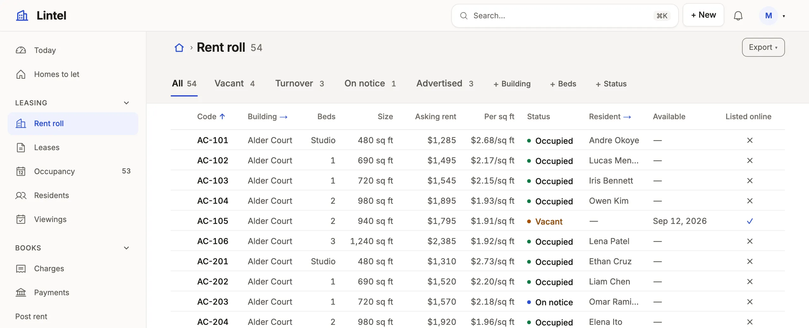

Say a column's stored values in words, colors, icons, money and units everywhere they appear, without changing what is stored.

```ts title="examples/apps/lintel/resources.ts"
    display: {
      market_rent: dollars,
      // …
      status: {
        // A vacant home is income to chase, not an alarm: warning, with the notice and turnover ahead of it in info.
        tone: { occupied: 'good', notice: 'info', vacant: 'warn', turnover: 'info' },
        values: { notice: 'On notice' },
      },
    },
```

See it in the sample (`examples/apps/lintel/resources.ts:56`) (on `unit`); `dollars` is `{ format: 'money', minor: true }`, whole cents said as dollars. [Sample Apps](/docs/examples/) says how to run Lintel.



## What you'll see

- `notice` said "On notice" and `turnover` said "Turnover", in a tone, in grid cells, record fields, cards, group headings, board lanes, a machine's stepper and the filter's choices.
- `market_rent` as `$1,825.00` because its rule says money in whole cents (a number named like money is money without one), and a figure with a `unit` beside it, as `rent_per_sqft` says `/sq ft`.
- Filters, sorts, exports and writes still use the stored value (`status = notice`), and `tone` and `icons` stay keyed by it.

## When to use it, and when not

- Use a display rule for how a value reads, once per column on the resource; every view, page and form follows it.
- Use `labels` on the resource instead to rename a column's caption, and `recordLabel` to say what names a record ([resources and fields](/docs/access-model/)).
- Use `hidden` instead of `masked` to keep a value from reaching the browser at all ([secrets](/docs/secrets/)); `masked` only draws `••••••`.

## Options

| Key | What it does | Default | Status |
| --- | --- | --- | --- |
| `tone` | Value → `good`, `warn`, `bad`, `info`, `neutral`; numbers take thresholds (`'>= 3'`); `'*'` for the rest; a yes/no column is keyed `true` and `false` | unnamed values are `neutral` | Stable |
| `values` | Value → its word (≤80 characters); unnamed values are still said as words | `in_review` reads "In review" where the column is a vocabulary | Stable |
| `icons` | Value → an App icon before the word; not on a figure | none | Stable |
| `format`, `unit`, `currency` | `money`, `percent`, `number`, `relative`, `duration`, `email`, `phone`, `url`; `unit: 'min'`, said in the singular for one (`unit: 'bikes'` reads "1 bike"); money always in the currency's decimals | as stored | Stable |
| `minor`, `currency: { column }` | Money kept in cents, said in the currency's decimals; each row's own currency ([money](/docs/order-lines/)) | major units; the App's currency | Stable |
| `bar`, `avatar`, `subtitle` | A bar beside a number, an initials disc, a second line from another column | off | Stable |
| `colors`, `icon`, `format: 'avatars'` | Value → one of the eight chart colors (a category's pill, a board card's tag); a lead mark in a small square toned by another column (`{ mark: 'lightning', tone: 'status' }`); a comma-separated list of names as overlapping initials | off | Stable |
| `format: 'rating'`, `outOf` | Stars, said as "4 of 5 stars", 3 to 10 of them; a `tone` colors the filled ones; edited as stars | 5 stars | Stable |
| `format: 'color'`, `'time'`, `'month'`, `'year'` | A swatch beside a hex code; a clock time (`14:30` reads "2:30 PM"); a month (`2027-03` reads "Mar 2027"); a year without a thousands separator. Each is edited in the browser's own picker | as stored | Stable |
| `format: 'json'`, `'qr'` | A JSON document as a tree on its record, an excerpt in a list, edited in a monospaced box that says where it stops being JSON (the server refuses one that is not); a value as a QR code to scan, its text under it (near-black on white in every look, so it scans) | as stored | Stable |
| `scan`, `signature` | `upc: { scan: true }` adds a Scan button that reads a barcode or QR code from the camera where the browser can; `signature_id: { signature: true }` on a reference to a [file resource](/docs/dsl-resources/#resourcesfile) is a pad to draw or type a signature, kept as a PNG there and drawn as the picture | off | Stable |
| `ring`, `slider` | `ring: true` on a percent draws a small progress circle; `slider: { min, max, step }` edits a number along its range | off | Stable |
| `masked` | `true` draws `••••••`; `{ prefix: 'ENC:' }` only for values with that prefix | off | Stable |
| `format: 'richText'` | Formatted text: whole on its record, an excerpt in a list, edited with a toolbar and Markdown shortcuts; `images: 'attachment'` keeps a pasted picture as an attachment of the record, `mentions: { from: 'member', by: 'id', labelColumn: 'name' }` offers people after an @, and `groups: { from: 'team', by: 'id', labelColumn: 'name', through: 'team_member' }` teams too; a `notify` rule's `mentions: { in: '<column>' }` tells them, a team as its members | off | Stable |

**Where a column's vocabulary comes from:** the database's own list (a PostgreSQL enum or `CHECK (status IN (…))`, a SQLite `CHECK … IN (…)`, a MySQL `enum(…)`). It feeds filter choices, board lanes and form pickers, sorts in the declared order (`new`, `qualified`, `won`), and appears in `mistri-schema.d.ts` under `Columns`, so a typed query string such as `'stage = won'` fails as you write it when `won` is not one of them. An `UPPER_SNAKE` code without `values` or a tone stays as stored. Every key: [resources reference](/docs/dsl-resources/#resourcesdisplay).

**Rich text is stored as HTML the server cleans.** Every write to a `richText` column, through a form, the API, MCP or a command, keeps only paragraphs, emphasis, headings, lists and checklists, links (`http`, `https`, `mailto`), quotes, code, tables and the App's own attachment pictures; scripts, styles and handlers never reach the database. The API and agents may send Markdown (`**done**`, `- [ ] call back`) or `{ format: 'markdown' | 'html', text }`; Markdown is read up to 20,000 characters (longer text is sent as HTML), and a value with more than 256 runs of `*`, `_` or `~` keeps them as written. A column of plain text drawn as rich text reads as its words.

## Common mistakes

- `[restated]` on `format: 'number'` beside a `unit`, or a `currency` that is the App's own → delete it; the platform says it already.
- A query that filters by the word (`stage = Won`) matches nothing, or fails as you type → filter by the stored value, `stage = closed_won`.
- `masked` used to protect a secret → the value still reaches the browser; use `hidden`.

## Related

- [Lists](/docs/lists/): where most rules are seen, and the board lanes they name.
- [Dates and types](/docs/dates-and-types/): which columns are numbers or dates to format.
- [Looks](/docs/looks/): the colors each tone wears.
- [Custom components](/docs/custom-components/): a value renderer when a rule is not enough.
