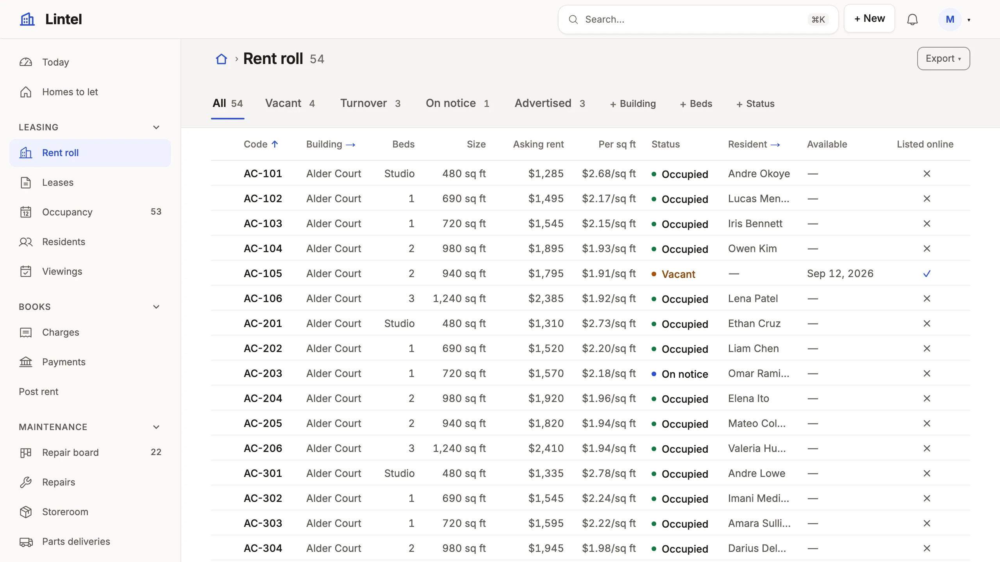

Show a table's rows the way the work divides, by tab, filter and sort.

```ts title="examples/apps/compass/views.ts"
tasks: listView('Tasks', 'task', { show: ['subject', 'status'], tabs: [{ label: 'All' }] }),
```

[See it in the sample](https://github.com/rbaljinder/mistri/blob/main/examples/apps/compass/views.ts#L70).



## What you'll see

- A tab per slice, counted.
- The address becomes `?tab=working`.

## When to use it, and when not

- Use a list when rows are compared; use a board instead when stages matter.
- Use cards instead when the things are looked at.

## Options

| Key | Does | Default | Status |
| --- | --- | --- | --- |
| `show` | Columns | the resource's | Stable |

## Common mistakes

- A raw `owner_id` column → show `owner_id.name`.
- A tab that needs its own order → give the tab its own `sort: 'due_on'`.

## Related

- [Design a list](/docs/compose-list/): the rules.
- [Vocabularies](/docs/vocabularies/): display rules.
- [Dashboards](/docs/dashboards/): figures.
